# 知序 · 知识平台完整操作手册

适用版本：2026-10-22 生产检索与统一知识写入版。阅读对象：资料维护人员、领域建模人员、知识审核人员、问答使用者与系统管理员。

这本手册按“选择任务 → 资料与候选 → 结构治理 → 正式知识 → 检索问答 → 维护与复核”的顺序编写。每章给出为什么要做、逐步操作、成功判定、失败恢复与下一步。网页阅读版为 [知识平台完整操作手册.html](知识平台完整操作手册.html)，可离线搜索、按章阅读和打印。

首次使用从 [工作区地图](#chapter-01) 和 [第一次完整路线](#chapter-04) 开始。已有正式结构补知识走 [路径 A](#chapter-05)；从资料发现结构走 [路径 B](#chapter-06)；直接手动维护结构走 [路径 C](#chapter-07)。只想阅读和检索文件时选择“仅文档处理”，不要求先建立图谱。

**核心约定：** 处理批次管理资料、抽取与事实结果；工作草案管理一轮结构变更，以及明确加入的候选依赖。查看或预演不会自动创建草案。事实写入、本体发布与索引同步分别核对，不以页面提示替代实际回执。

**存储边界：** PostgreSQL 保存权威记录、版本与审计。嵌入模型生成 embedding；当前关键词、语义、混合检索都使用项目显式构建的 Milvus 索引。失败时明确失败，不自动切换模式，也不使用本地向量回退。系统历史时点仅支持 PostgreSQL 历史关键词查询；历史语义/混合明确拒绝。

示例项目名、记录 ID、发布 ID 和题目只说明填写方式，实际操作使用自己的真实身份。截图来自运行应用，图注解释看哪里与怎样判断变化；交互稿不作为生产截图。步骤给出成功判定标准，功能与容量实测以验收记录为准；[本版交付复核](#chapter-29) 列出三条路径需要保留的运行证据。

2026-10-21 的统一写入截图使用经实际 API 建立的合成验收资料，演示来源选择、结构修改和关联事实处理；不用于评价抽取模型质量，也不代表 15 万实体容量验收通过。截图中的草案修订、建议数和回执数只属于该次示例，自己的项目以实际返回为准。

<a id="chapter-01"></a>
## 01｜先认清工作区与知识状态

### 场景

第一次进入平台，需要知道一份资料如何变成可以引用的知识，也要知道去哪修改。

### 为什么与何时

资料解析成功只说明原文可以处理。候选事实、候选术语、本体草案和正式知识有不同的治理状态；跳过这些区别，容易把“抽取到了”误认为“已经审核生效”。

### 前置身份与条件

使用有效账号登录并选择项目。viewer 使用知识问答和检索；admin、superadmin 按系统权限维护项目内容。人员管理控制全局系统角色，当前没有项目成员 ACL。

### 操作步骤

1. 在左上“当前知识项目”选择项目。之后每次写入前再次核对项目名。
2. 用“使用知识”下的“知识问答”“检索与图谱”查资料和知识。
3. 用“管理资料”下的“资料库”“知识台账”“本体建模层”分别管理来源、具体事实与结构定义。
4. 用“运行与质量”下的“构建与任务”“质量评测”查看处理进度、备份和评测。
5. 用固定“管理”分组进入“项目管理”“人员管理”。这两页的管理范围不会被内容 Metadata 筛选缩小。

| 对象 | 含义 | 确认位置 |
| --- | --- | --- |
| 原文与切片 | 文件解析后的内容与片段 | 资料库、原文阅读器 |
| 候选事实 / 断言 | 某份原文提出的实体、关系或属性陈述 | 提取知识、知识审核 |
| 候选术语 | 从候选事实归纳出的类、关系或属性名称 | 本体建模层的项目候选 |
| 本体草案 | 相对某次发布的一组待审变更 | 本体建模层、草案列表 |
| 正式术语 | 审核发布后的定义，拥有稳定 IRI | 本体目录、版本管理 |
| 正式事实 | 通过写入与治理规则的具体记录 | 知识台账、图谱、问答依据 |

### 正确结果

能够说清当前查看的是“草案未发布”“历史只读”还是“正式知识”。切换展示方式不会新增事实，也不会发布本体。

### 失败与恢复

若入口缺失，先核对角色，再刷新页面并确认服务与静态资源为同一版本。列表为空时先查看项目与已应用筛选，不要立即重复上传。

### 下一步

新账号先看 [账号与口令](#chapter-02)，新项目沿 [第一份资料完整路线](#chapter-04) 操作。

<a id="chapter-02"></a>
## 02｜登录、人员管理与自己的口令

### 场景

管理员为同事创建登录账号，调整角色或启用状态；使用者修改自己的口令。

### 为什么与何时

账号决定系统级读写权限。停用保留账号，删除会移除账号并释放登录名，两者后果不同。自己的口令应从个人账号入口修改。

### 前置身份与条件

人员管理需要 admin 或 superadmin。admin 可管理普通 admin/viewer，不能授予 superadmin，也不能修改受保护超管。已有 superadmin 不能被降级、停用或删除；当前登录者不能降级、停用或删除自己。普通管理员可能看见受保护行，不表示有修改权限。

### 操作步骤

1. 登录后进入“人员管理”，用账号/展示名与启用状态查找人员，并在系统角色列核对权限。
2. 点击“添加人员”，填写登录账号、展示名、系统角色与初始口令后提交。口令长度遵从表单与服务校验。
3. 点击目标行“编辑”，修改展示名或允许的角色。登录账号不在此改名。
4. 如需停用、重新启用、重置口令或删除，使用编辑面板对应操作并阅读影响确认。重置口令两次输入须一致。
5. 修改自己的口令时打开左下当前账号菜单的“改口令”，填写当前口令与新口令，按要求确认后提交；不要通过重置他人口令的流程绕过自身保护。
6. 用目标账号重新登录验证角色和启用状态，不在聊天或文档中记录明文口令。

### 当前界面

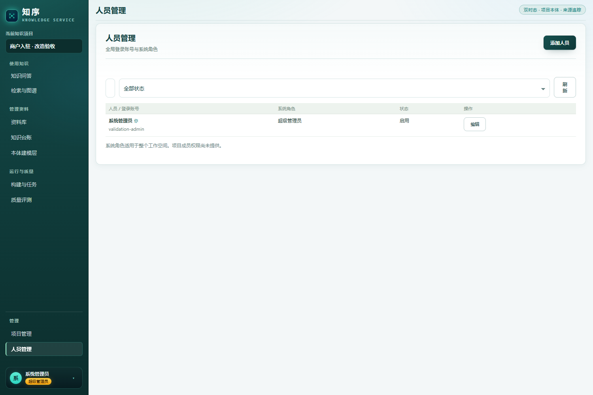

读图时先核对项目与当前对象，再看本章所述操作入口；操作后以服务回执和对应列表/详情变化判断结果。截图取自真实应用的隔离验收项目，示例数据用于说明布局。

### 正确结果

回执指出更改的对象和字段。viewer 不显示写入操作；直接调用写接口仍受服务端权限检查。人员列表是工作空间全局账号列表。

### 失败与恢复

409 用户名冲突时更换账号后重试；403 表示角色无权执行；保护性 409 应使用其他有权限账号或保留受保护状态。账号不存在则刷新清单。登录失败先核对账号启用状态与口令，不重复创建同名人员。

### 下一步

进入 [项目管理](#chapter-03)。如果业务要求“甲只能看 A 项目”，请查 [尚未支持的阶段](#chapter-27)，当前系统角色不能替代项目成员授权。

<a id="chapter-03"></a>
## 03｜创建、切换、设置与删除项目

### 场景

为不同知识空间建立独立项目，修改项目名称，或删除测试项目。

### 为什么与何时

项目是数据空间。新建项目默认从空本体开始，抽取方式留到每次上传时选择；不要求先接受一套通用本体。

### 前置身份与条件

创建、改名和删除需要管理员权限。删除前确认当前项目是否仍被其他操作使用，并保存需要的知识备份或导出文件。

### 操作步骤

1. 进入“项目管理”，点击“创建项目”，填写名称后提交。
2. 创建后进入该项目资料库空态，点击“添加文件”开始首批资料处理。
3. 已有项目用“进入项目”或左上项目切换器切换。提交任务前确认切换已经完成。
4. 在项目行点击“设置”修改名称；保存只改变名称。可从设置进入“项目概览”与“知识备份”。
5. 删除时点击“删除项目…”，核对影响并按界面要求输入项目名称，再确认。
6. 删除当前项目后选择剩余项目；删除最后一个项目后从空态重新创建项目。

### 当前界面

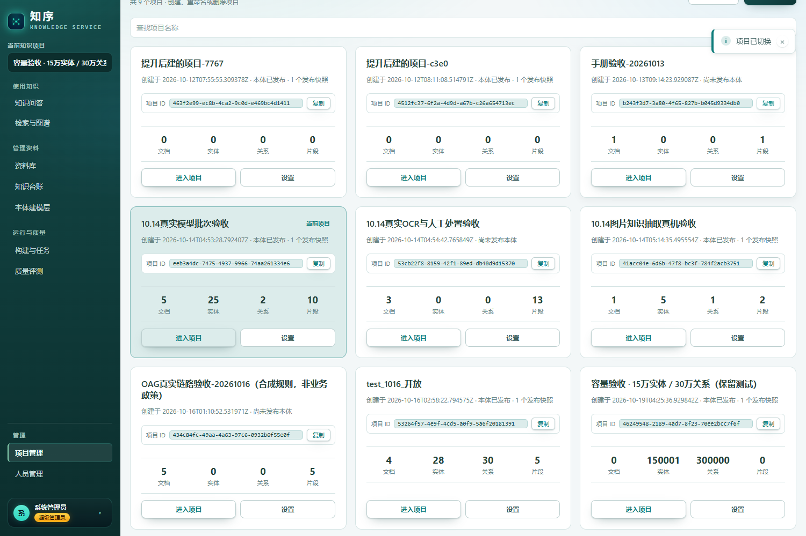

读图时先核对项目与当前对象，再看本章所述操作入口；操作后以服务回执和对应列表/详情变化判断结果。截图取自真实应用的隔离验收项目，示例数据用于说明布局。

### 正确结果

创建请求采用 `ontology_mode: "discovery"` 和 `use_default_ontology: false`。改名后名称同步。删除成功后不再保留被删除项目的活动上下文；外部投影清理状态与 PostgreSQL 删除回执分别呈现。

### 失败与恢复

删除回执中 `deleted` 成功但 `cleaned` 异常表示外部派生投影仍待清理，不代表项目业务记录恢复了。记录失败对象与任务 ID，交管理员处理。切换项目后看到旧请求结果时刷新当前页，勿继续使用旧项目 ID。

### 下一步

首次使用按 [完整路线](#chapter-04)；已有资料按 [上传模式](#chapter-04) 或 [持续建模](#chapter-11) 继续。

<a id="chapter-04"></a>
## 04｜第一次使用：先选任务，再走完整路线

### 场景

第一次把一份短资料放进项目，或者面对“添加文件”“待完善结构”“新增定义”时，不知道先点哪个。

### 为什么与何时

先判断“我要补充具体知识，还是修改描述知识的结构”。张三是一名客户、订单金额为 100 元是具体事实；客户类、订单类、金额字段和约束是结构。批次负责资料与抽取；草案负责一轮结构修改及明确关联的候选依赖。上传成功、抽取完成、加入草案、发布和索引完成分别有自己的结果。

### 前置身份与条件

选定正确项目；管理员执行写入。首次演练用内容短、来源明确的资料。新项目从空本体开始，可以先手动建模，也可以开放抽取；只想保留可检索原文时不需要先发布本体。

### 操作步骤

1. 核对左上项目和当前账号。第一次使用先按 [项目管理](#chapter-03) 创建项目，再进入资料库。
2. 用下表选处理路线。三种资料处理模式每批独立选择，不会因为上次选过某模式而永久改变项目。
3. 点击“添加文件”，依次选文件、选择资料与处理方式、填写 Metadata 与业务有效期，最后确认本批的文件、模式和本体依据。
4. 可先“预览首份切片”；预览不调用抽取模型，不写知识。确认后提交，记下处理批次，等待逐文件结果。
5. 先核对原文是否可读，再看候选/正式事实/失败的实际数量。按本体路线去 [路径 A](#chapter-05)，开放路线去 [路径 B](#chapter-06)，直接改结构去 [路径 C](#chapter-07)。
6. 在知识台账核对正式记录与来源断言，在构建与任务核对索引；随后先用关键词检查内容，再按需使用语义/混合检索和知识问答，打开引用核对固定原文。

| 这次要做的事 | 资料处理模式 / 入口 | 成功后先去哪里 | 是否需要结构草案 |
| --- | --- | --- | --- |
| 只保存、阅读和检索资料 | 仅文档处理 `documents` | 资料详情与原文；需要语义检索时核对索引 | 不需要；没有实体和关系是正常结果 |
| 为已有正式类型补充具体知识 | 按已有本体抽取 `ontology`，显式选已发布身份 | 批次结果、提取知识、知识审核、知识台账 | 不因上传创建；无法映射时另行申请补充结构 |
| 从资料中探索结构 | 开放抽取 `discovery` | 先核对候选；复用正式术语或完善结构 | 只有明确加入结构修改时才沿用或建立 |
| 已知道需要什么类、关系或字段 | 本体建模 → 新增定义 | 本轮修改、审核与发布 | 首项实际结构保存时准备目标草案 |

### 当前界面

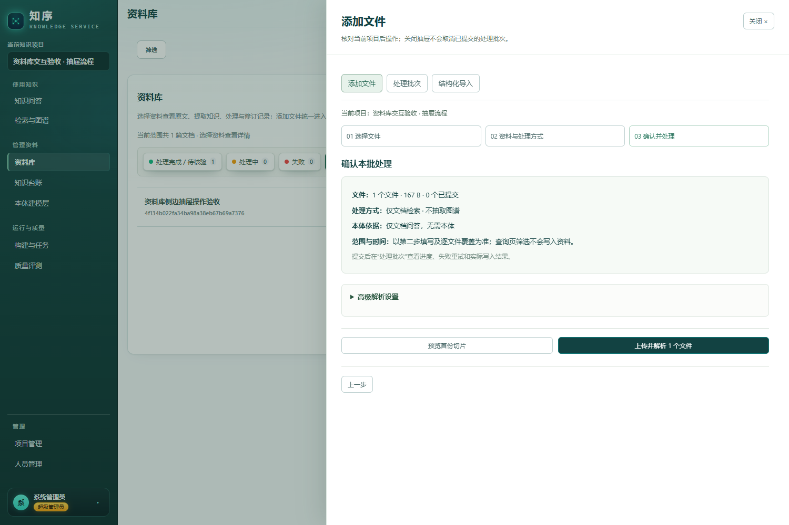

读图顺序：先看右侧当前步骤，再看本批处理方式与提交动作；背景资料列表用于确认仍处于同一项目。提交后观察批次回执，不能把抽屉关闭当成处理完成。

### 正确结果

可以分别回答“原文在哪”“本批用了哪个正式本体”“哪些是候选”“哪些已经正式写入”“是否真的修改结构”。仅文档路线不产生图谱；本体发布也不自动迁移历史事实。

### 失败与恢复

按原文解析 → 抽取 → 候选治理 → 正式写入 → 索引 → 问答逐段排查。已有原文但图谱为空时，先核对模式和待审核/待完善结构状态，不要默认重传。提交结果未知先查批次，避免重复上传。

### 下一步

按任务直接进入 [路径 A](#chapter-05)、[路径 B](#chapter-06) 或 [路径 C](#chapter-07)；批量与失败恢复见 [批次处理](#chapter-08)。

<a id="chapter-05"></a>
## 05｜路径 A：按已有本体补充知识

### 场景

正式本体已经有“客户”类和“客户编号”字段，现在上传资料补充“张三是客户、客户编号为 C001”等具体事实。

### 为什么与何时

正式术语是已有的填写框架。本次工作是核对来源与事实，不必为每份文件发布一版本体。抽取无法映射的内容需要诊断或结构申请；显示名称接近不能证明两个术语身份相同。

### 前置身份与条件

管理员、可解析文件、可用抽取模型，以及已发布且适用的正式本体。草案中启用的术语仍未发布，不能作为普通受控抽取依据。确认资料真实业务有效期与 Metadata。

### 操作步骤

1. 在资料库点击“添加文件”，选文件后选择“按已有本体抽取”。
2. 明确选择本批所用的正式发布，核对发布 ID 与显示版本。不能只凭“最新”二字判断是否适合这批历史资料。
3. 核对切片、有效期和高级选项，再提交处理；批次中保留所用发布，后续新发布不会默默替换本批依据。
4. 打开结果，分别查看新增、复用、待确认、未通过与失败项。进入资料详情的“提取知识”查看具体陈述及来源证据。
5. 对待确认事实核对实体身份、正式类型/关系/属性、值与时间；填写审核理由后执行页面允许的确认或排除。
6. 无法映射时保留诊断，使用“申请补充结构”或“完善本体结构”进入 [路径 B 的结构处理](#chapter-06)。不要通过修改显示名绕过映射，也不要把草案术语冒充正式术语。
7. 在知识台账按来源或真实 ID 核对正式结果；记录事实新增/复用数与索引同步状态。本体发布身份和草案数量不应因普通上传增加。

| 结果分支 | 意义 | 下一步 |
| --- | --- | --- |
| 新增 / 复用 | 具体事实通过当前规则，或命中已有规范记录 | 台账核对记录与新来源断言 |
| 待确认 | 映射、身份或事实范围仍需判断 | 打开知识审核，核对来源并说明理由 |
| 未通过 / 结构待定 | 现有定义不能表达，或约束/来源不符合 | 看诊断；确需改结构时明确加入草案 |
| 索引待同步 / 失败 | 正式知识与向量投影处于不同进度 | 查任务；不重复写同一事实 |

关系约束的 advisory/review/strict/off 与开放/按本体的词汇策略是两种设置。前者决定约束异常怎么处置，后者决定抽取是否限定已有词汇，不能相互替代。

### 正确结果

新增或修订的具体知识可追踪至资料、批次和正式发布。单纯复用既有结构不会生成空草案或新本体版本；正式事实与待确认候选的数量分别显示。

### 失败与恢复

发布不存在或不适用时重新选择真实已发布身份，再建立明确的新处理意图；不要改写旧批次回执。候选审核失败先看类型、约束、时间和来源诊断。索引失败到 [任务与索引](#chapter-24) 恢复，不以重传代替重试投影。

### 下一步

具体事实审核看 [知识审核](#chapter-10)，结构申请看 [路径 B](#chapter-06)，台账维护看 [事实 CRUD](#chapter-15)。

<a id="chapter-06"></a>
## 06｜路径 B：开放发现、确认复用与加入结构修改

### 场景

资料既提到了正式本体已有的“客户”，又提出“企业客户”和“统一社会信用代码”。需要把能复用的事实和确需补充的结构分开处理。

### 为什么与何时

开放抽取首先保留候选。草案不是所有资料和事实的容器；只有需要新增或修改定义的选中内容才加入一轮结构修改。预演帮助看清会改变什么，最终确认必须锁定目标、来源、事实范围和修订。

### 前置身份与条件

管理员；已完成开放抽取且来源仍可核对。复用已有结构时需要有效正式发布；加入结构时需要明确可编辑草案或明确“另建草案”意图。关系与属性依赖的实体事实也必须在确认范围内，不能只选一条关系而漏掉必需端点。

### 操作步骤

1. 资料库“添加文件”选择“开放抽取”，处理后打开批次结果或资料详情“提取知识”。本批结果先作为候选，不直接等同正式知识。
2. 对候选查看原文、证据和建议术语，区分可复用正式结构与需要补充结构；按真实正式 IRI/发布与事实范围确认，不仅按名称相似度判断。
3. 全部可复用时选择“仅复用正式术语，确认写入知识”，逐候选明确选择已发布 IRI；系统建议不会自动确认映射。关系和属性所需的实体依赖也要明确选择并确认映射。预览事实范围，确认无结构变更后执行“确认写入所选知识”。回执说明实际新增、复用和跳过，且不创建空草案或发布。
4. 需补结构时点击“完善本体结构”，在右侧“待完善结构”的“01 选择候选”核对来源文档名称、文档 ID、修订、来源证据、关联草案与依赖事实。先看抽屉顶部是否限定了当前文档或处理批次，再逐条勾选本轮要处理的候选；可用“返回来源文档”重新读证据。需要更多候选时继续读取后续页，不把当前一页当成整批范围。
5. 选择目标：沿用当前明确选中的可编辑草案，或者基于当前正式版本另建。存在多份草案而尚未选择时必须明确选择；打开清单或预演不会自动创建草案。
6. 在“02 明确处理目标”核对目标，点击预览按钮“预览选中内容（只读）”。进入“03 核对预览并确认”后，先比对目标草案 ID、修订和正式基线，再读结构建议、新增/复用/冲突、缺失依赖和警告。展开“逐条关联知识预期结果”，核对每条事实的候选 ID、内容、来源、预计结果及原因。预计新增、预计复用、预计跳过、等待结构获批、暂不能处理是不同分支；不是所有已选项都会新增记录。发现漏选依赖、错误映射或逐条结果不完整时返回调整选择，再重新预演。
7. 确认“加入本轮修改”。真正保存后先看“处理回执”，再回到目标草案核对增加后的修订、结构新增/复用数及事实选中/待发布数；待发布不等于正式入库，此时索引尚未请求是正常结果。仅看过预演的候选仍是“未加入本轮修改”。同一草案可先后接收多批候选，再继续手动编辑；第二次加入后检查第一次的手工操作和来源运行仍在。
8. 回到画布补充或修正定义，到“本轮修改”核对来自各批次的变更与关联知识。审核和发布分别检查结构变更及同时处理的关联事实。
9. 发布后分别核对本体发布身份、按来源列出的事实新增/复用/跳过与索引同步状态。未选候选、被拒绝/撤销/停用定义依赖的事实不能因本次发布自动生效。

| 操作阶段 | 数据是否保存 | 用户应核对的身份 |
| --- | --- | --- |
| 打开清单、选择、只读预演 | 不创建草案、操作或事实 | 项目、来源、候选集合、正式发布、目标意图 |
| 加入本轮修改 | 保存结构操作及明确候选绑定 | 草案 ID、修订、基线、实际加入项 |
| 校验、审核 | 形成当前内容的校验与逐项决定 | 操作指纹、警告、批准/拒绝范围 |
| 发布 | 处理获批结构及符合依赖/来源规则的关联事实 | 发布 ID、逐批事实回执、持久索引状态 |

读数量时分清单位：“结构建议”是定义层面的建议项，“关联知识”是明确选择的事实范围，“新增结构操作”是实际保存的草案操作，“知识新增 / 复用 / 跳过”是事实写入结果。多条事实可能复用同一个定义；不要拿结构项数与事实条数相减来推算漏写。

### 当前界面

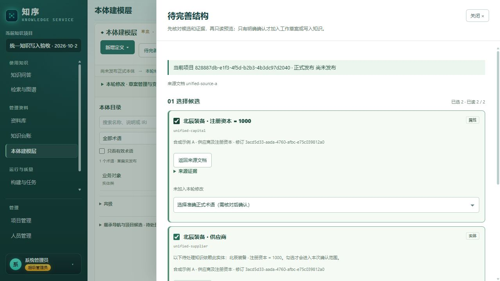

先看顶部当前项目与来源文档 `unified-source-a`，再看“已选 2 · 已读 2 / 2”。本图只处理来源 A 的两条合成候选：“北辰装备 · 注册资本 = 1000”及它依赖的“北辰装备 · 供应商”；属性卡片旁的“属性”和实体卡片旁的“实体”帮助辨别种类。展开“来源证据”或返回来源文档核对后再选择。勾选只是准备处理范围，卡片仍标“未加入本轮修改”，尚未保存草案或事实。

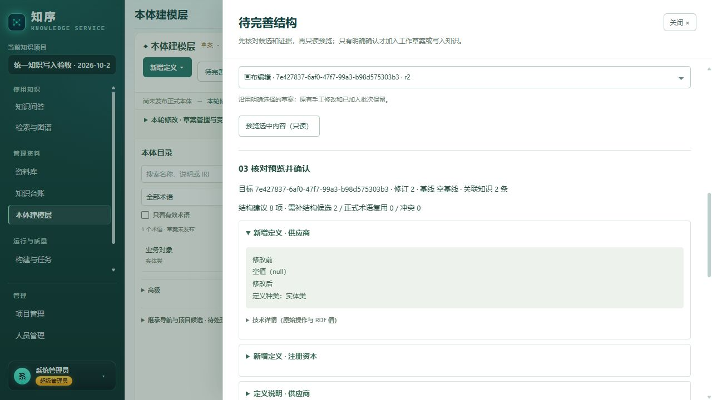

先核对上方选中的原手工草案，再比对预览中的同一目标 ID、修订 2、空基线与关联知识 2 条。本图共有 8 项结构建议；展开“新增定义 · 供应商”后，可以读到修改前为空、修改后为实体类。8 项建议与 2 条事实是不同单位。此时仍是只读预演，目标草案不会因为看过前后差异就变成新修订；确认前应继续读下面的逐条事实结果。

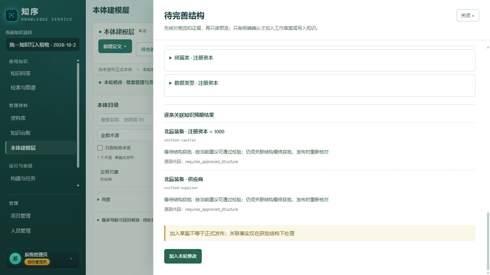

向下看“逐条关联知识预期结果”，分别核对注册资本事实和供应商实体。本图两条都标“等待结构获批”，并给出需要最终获批结构的原因；这不是已经新增 2 条正式知识。底部警告再次提示加入草案与正式发布的区别。核对每条内容、预期和原因后，才点击绿色“加入本轮修改”；若出现暂不能处理或范围不完整，先处理诊断并重新预演。

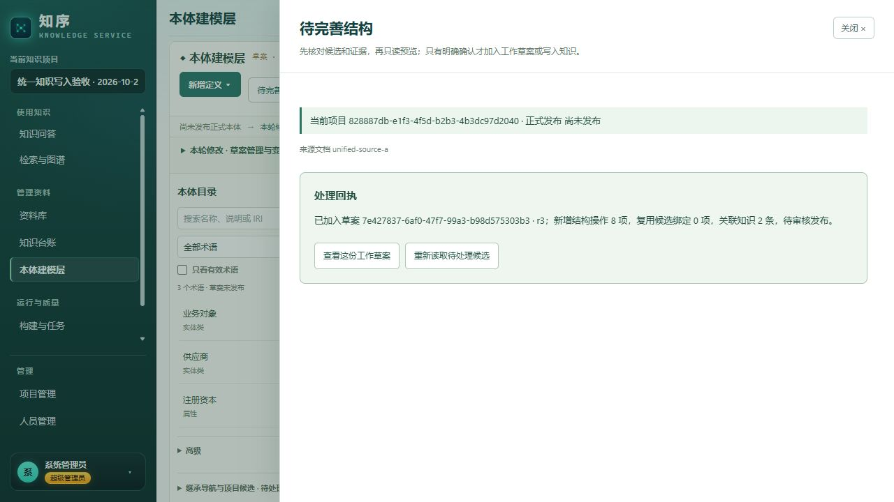

操作后先看“处理回执”：同一草案已到 r3，新增结构操作 8 项、复用候选绑定 0 项、关联知识 2 条，状态仍为待审核发布。背景目录读回“供应商”和“注册资本”，说明可以继续在这份草案完善定义；正式发布处仍显示“尚未发布”。用“查看这份工作草案”核对实际差异，用“重新读取待处理候选”查看关联状态；此时不要把 2 条待发布事实记作正式新增数。回执记录本次动作发生时的修订；之后若加入其他批次，最新修订应以重新读取同一目标草案为准。

**只复用正式术语的分支：** 本体已发布后，可把另一份资料中的新事实直接映射到正式定义。它与上面的结构加入是不同确认动作。

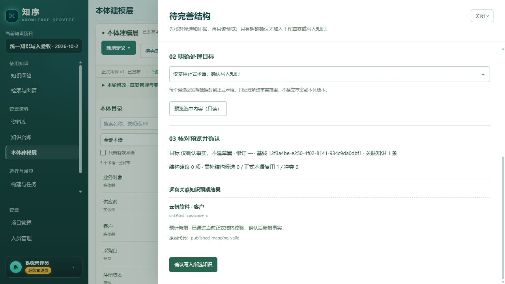

先在上方候选卡为“云帆软件 · 客户”明确选择正式客户 IRI，再核对本图中的“仅复用正式术语，确认写入知识”。预览目标为“仅确认事实，不建草案”，基线是正式发布 `12f3a4be…dbf1`，关联知识 1 条、结构建议 0 项、正式术语复用 1、冲突 0。逐条结果是“预计新增”，说明复用客户定义并不要求项目里已经存在云帆软件这条实体事实。核对后点击“确认写入所选知识”；本图展示预演下部，映射选择器位于上方候选卡。

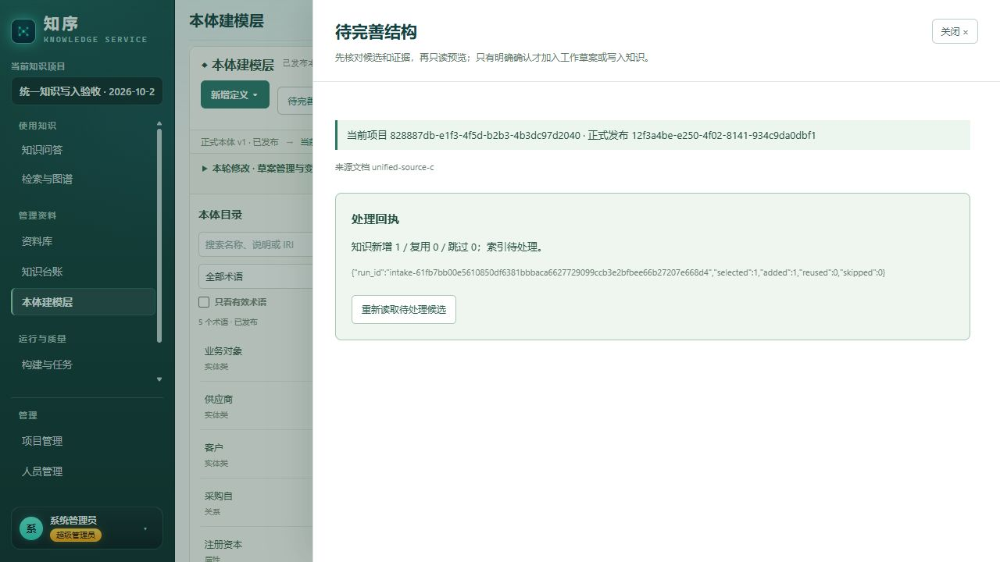

操作后核对当前正式发布身份与来源文档 `unified-source-c`。本例实际回执为知识新增 1 / 复用 0 / 跳过 0，索引当时待处理；实际确认前后的草案、正式版本对象保持一致，没有新建空草案或新发布。“正式术语复用 1”统计定义映射，事实“复用 0”统计是否命中已有规范事实，两者可以同时成立。后续索引任务完成后再核对 [语义检索](#chapter-18)，不因索引尚在处理重复确认事实。

### 正确结果

手动结构和多个来源的修改汇入明确的同一工作草案，先前操作与审核审计保留。仅复用时只处理选中事实；需要结构时只有符合最终获批结构和来源校验的关联事实被处理。不能把“已选”或“预演成功”显示为“已保存”。

### 失败与恢复

409 或预演失效时刷新草案修订、正式基线和来源，再核对选择并重新预演；不能把旧预演直接重发到新目标。来源撤回、关系缺端点、映射冲突或依赖操作被拒绝时按逐项诊断处理。保存响应未知先查草案与回执，使用“重试原请求并核对回执”沿用同一请求身份，避免重复加入。内容、目标或来源已经改变时则重新预演并建立新请求身份。关闭草案保留审计和候选；再次处理前重新核对来源及绑定。

### 下一步

手工补定义看 [路径 C](#chapter-07)，校验审核看 [草案治理](#chapter-13)，核对最终记录看 [知识台账](#chapter-15)。

<a id="chapter-07"></a>
## 07｜路径 C：直接手动维护本体结构

### 场景

已经确定要新增“企业客户”类型、某个业务关系或统一社会信用代码字段，不需要先上传文件来制造候选。

### 为什么与何时

结构决定以后怎样描述和校验具体知识。手动建模与从资料加入结构共用工作草案，但手动发布不会自动确认历史积压候选。保存定义、审核发布、写入事实是三个不同动作。

### 前置身份与条件

管理员并已选择项目。正式本体和历史发布只读；当前草案必须可编辑。空项目允许以空基线准备首版草案。有多份可编辑草案且尚未选定时，第一次保存前选择目标。

### 操作步骤

1. 进入本体建模，先看顶部正式发布，以及“本轮修改”的草案 ID、修订、基线和未发布状态。无草案时阅读“保存第一项结构调整时自动建立”的提示。
2. 使用顶部唯一通用入口“新增定义 ▾”，选择“实体类型 / 关系类型 / 属性字段”。不要为寻找另一套新建流程在目录与画布间来回切换。
3. 填写定义：实体类型可选父类；关系选择主体类 domain 与客体类 range；属性选择所属类、数据类型与限制。中文显示名称和稳定 IRI 各有用途，改名称不要另造身份。
4. 保存前核对目标草案。已有明确选择则沿用；没有草案时在实际保存首项时自动创建；多份未选则先选或明确另建。只打开页面、源码、表单或切布局不会创建草案。
5. 保存后等待“已保存到草案”及画布更新，再继续下一项。审核条件独立读取，保存不必等待完整发布校验；保存成功也不表示已经可发布。
6. 对选中类可用“新增子类 / 为此类新增属性 / 新增关联关系”；这些是同一流程的上下文快捷入口，核对预填对象和目标草案。画布“编辑继承 / 连接已有类型”先读确认框，明确本次新增或修改哪个定义。
7. 打开“本轮修改”，比较新增、修改、停用、恢复的前后值，查看影响和关联知识。纯手动修改应明确显示“关联知识 0 条”。
8. 按 [校验、逐项审核与发布](#chapter-13) 完成治理。发布后该草案成为只读历史；下一轮实际保存基于新正式发布建立或明确选择草案。
9. 若希望让旧候选使用新结构，从资料结果明确发起“用新版本核对候选”，再走复用确认或结构处理；新上传批次也要明确选新发布。历史事实仍按 [受控迁移](#chapter-14) 处理。

| 操作前看哪里 | 操作后应看到什么 |
| --- | --- |
| 正式发布身份、当前草案 ID / 修订 / 基线 | 原正式发布保持到审核发布；保存落在明确草案的新修订 |
| “新增定义”表单的种类、IRI 和预填父类/端点 | 本轮差异中出现本次新增或修改；检查器能读回定义 |
| “同时处理的关联知识”是否已有来源绑定 | 纯手工保存不增加候选事实；纯手工发布应为关联知识 0 条 |
| 是否正在历史预览 | 只读状态显示历史身份；回到最新后再开展下一轮实际保存 |

### 当前界面

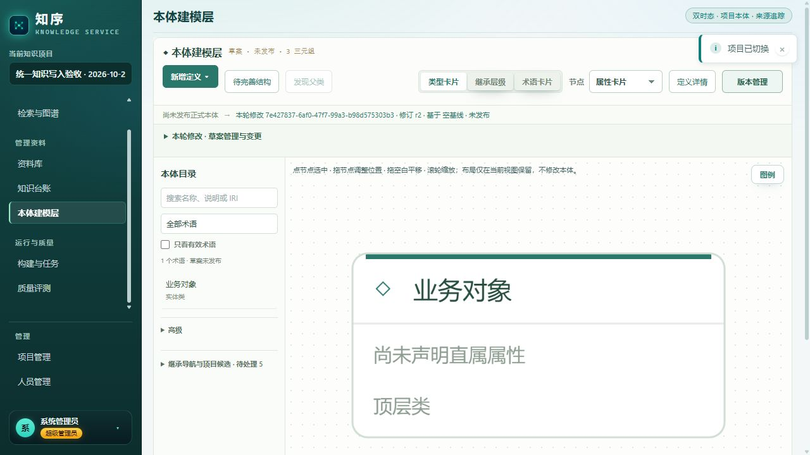

先看顶部“草案 · 未发布”，再看“本轮修改”的草案身份、修订 r2 和空基线；中部“业务对象”类型卡片与左侧目录表示定义已经读回草案。本例是合成验收数据。顶部“3 三元组”统计本体表达，不能读成已经写入 3 条业务事实；关联事实需展开“本轮修改”另行核对。下一次新增或修改后应看到同一目标草案的新修订与定义变化，正式发布身份要等审核发布后再确认。

### 正确结果

新增结构只出现在正确的草案及其修订中，草案术语显示“草案中启用 / 未发布”。正式发布后才成为可选抽取依据。手工发布不会顺带确认未绑定的候选，也不会自动改写历史事实。

### 失败与恢复

历史只读时先退出预览，原工作草案选择应保留。重复 IRI、自引用、继承环和基线变化按服务诊断处理。提示保存成功但刷新失败时重读该草案，不重复新建。重新编辑会使旧校验及相关审核决定失效，须重新校验审核；不以重新开一份草案躲开冲突。

### 下一步

定义细节和父类发现看 [本体目录与画布](#chapter-11)，复杂约束看 [源码与 SHACL](#chapter-12)，完成治理看 [本轮修改](#chapter-13)。

<a id="chapter-08"></a>
## 08｜多文件、ZIP、高级参数与断点恢复

### 场景

一次导入多个文档或 ZIP，其中部分文件解析失败，或模型限流导致处理暂停。

### 为什么与何时

上传、解析、切片、抽取、消歧、校验和向量化是不同阶段。保留批次与逐文件状态，才能选择合适的恢复粒度，减少重复处理。

### 前置身份与条件

管理员权限；服务已返回上传能力。ZIP 是否支持、成员格式、单文件/批次限额和 OCR 条件均以当前能力回执和错误信息为准。不能只按文件扩展名假定任意文件可处理。

### 操作步骤

1. 多选文件或加入支持的 ZIP，逐项核对文件清单、格式和标题。多文件以各文件名为标题；范围、时间与 Metadata 为本批共用，当前表单不提供逐文件覆盖。
2. 在第二步填写平台、业务、适用对象、发布时间、生效/失效时间。“更多资料字段（Metadata）”默认折叠；填写时必须是 JSON 对象，系统哈希、格式、解析器等来源字段覆盖同名用户输入。
3. 在“高级解析设置”选择并发及切片策略：固定长度加重叠、段落/句子边界、标题/中文条款。调节最大字符数与重叠后预览首份切片。
4. 按需开启实体属性抽取；选择关系约束模式：仅提示 `advisory` 时冲突关系可带警告入库；转审核 `review` 时冲突关系进入候选；严格拦截 `strict` 时该文档派生知识不提交；不检查 `off` 跳过端点类型组合检查，但端点与关系术语仍必须有效。这些参数与词汇是否开放独立，也不关闭显式 SHACL 约束。
5. 核对同名/别名消歧、语义相似自动合并及阈值。自动合并阈值不是正确性证明，高风险资料宜逐项复核。
6. 提交后在抽屉“处理批次”分别看申请并发与实际并发：申请 8、实际 4 表示服务本次只允许 4，不表示丢了 4 个文件。也可从资料库“处理批次”或“构建与任务”重新打开。用状态筛选与下一页逐文件核对完成、排队、需要处理和错误，按需下载失败明细。关闭抽屉不会取消服务端任务。
7. 临时停下用“暂停”，恢复用“继续”；取消只影响仍允许取消的工作。按界面状态使用“重试全部失败”。
8. 逐文件恢复选择“从断点继续”“只重试失败切片”或“整份重新处理”，先读错误与已提交结果再选择。

| 恢复方式 | 保留与重做的范围 | 使用前要判断 |
| --- | --- | --- |
| 从断点继续 | 复用配置兼容的成功切片，继续失败和未完成切片 | 原文件、本体、模型、提示词与关键设置仍兼容 |
| 只重试失败切片 | 仅重新执行明确失败的切片，未开始项保持待处理 | 目的是修复已失败项，而非恢复整个文件 |
| 整份重新处理 | 创建新尝试，重新解析与抽取 | 文件、模型、本体或关键设置已经改变，不能复用旧检查点 |

Markdown + 相对附件 ZIP 可同时携带多份正文与共享图片，附件路径应在包内，缺失附件需修正知识包。网络图片只登记为外部图片，不自动下载固化。本地图片先经 OCR 文字识别与质量门，再进入抽取或文档索引；OCR 不证明流程线、图标和空间关系的语义。

认证错误、文档损坏、缺失附件和 OCR 低置信度通常需要人工处理；临时超时、限流或服务不可用按实际重试状态等待。同批大量相同模型错误导致暂停时，先修模型再继续。无知识文字的图片可在来源解析视图执行“该图片无知识文字，忽略并继续”并填写原因，保留操作者审计，然后回批次从断点继续；不能用忽略绕过真正的业务文字。

### 正确结果

成功文件保留，失败文件有阶段、错误码、失败切片序号或重试时间。上传重试复用会话与幂等身份；不能把进度百分比当成正式知识数量。

### 失败与恢复

未取得服务能力时刷新能力，不盲目提交。格式/限额错误先修文件；模型限流等待或降低并发；解析已成功但抽取失败优先从断点或失败切片恢复。取消在检查点生效，已经提交的知识仍保留。整份重做前先查看原有记录与候选。

### 下一步

原文和 OCR 见 [资料详情](#chapter-09)；处理最终结果转到 [审核](#chapter-10) 或 [任务与索引](#chapter-24)。

<a id="chapter-09"></a>
## 09｜资料库、固定版本原文、OCR 与来源断言

### 场景

核对某份文件解析成什么、抽出了哪些知识，或者追查回答中的某句话来自哪页。

### 为什么与何时

一条正式事实可能由多份资料共同支持。来源在断言与证据血缘中，不能因记录顶层没有 `source_id` 就认定来源丢失，也不能凭记录 ID 前缀猜来源。

### 前置身份与条件

资料库维护入口需要管理员。原文阅读器需要资料保存了 `source_document_version_id` 及相应资源；旧资料可能只有规范文本或切片。当前项目与权限须允许访问该来源。

### 操作步骤

1. 进入“资料库”，首屏集中展示列表，不自动展开第一份文档。使用当前页筛选或“全部 / 处理完成与待核验 / 处理中 / 失败”状态按钮定位资料。
2. 点击资料行，在右侧详情抽屉查看“原文”“提取知识”“处理记录”“修订记录”。点击关闭或按 Escape 返回原列表与焦点；手机使用全屏抽屉。
3. 在“提取知识”核对断言种类、状态、内容与原文引句。存在规范记录时点击“查看正式知识”。待确认断言显示的是提议值，不等于正式记录当前值。
4. 点击“在原文中打开”，或从批次的“查看原文与 OCR”进入固定版本阅读器。“阅读视图”读标题、正文、表格与固化图片；“解析视图”检查块、源行号、OCR 文字、置信度和图片区域框；“原始视图”只读查看或下载固定版本原文件。
5. 检查图片/页面 OCR 的文字与定位框。仅在真实可用操作出现时重试 OCR 或忽略对应 OCR 资源；随后重新核对证据定位。
6. 来源追查优先从知识详情的断言证据，或问答中的冻结引用进入，核对文档版本、原文片段、字符/块位置与哈希。
7. 从“完善本体结构”打开待完善结构抽屉，核对当前资料/批次候选范围、来源与目标草案，再按 [路径 B](#chapter-06) 预演和确认加入。来源指纹用于阻止陈旧确认，不等于可任意选择历史文档 rN 重新发现的完整 revision manifest 协议。

### 当前界面

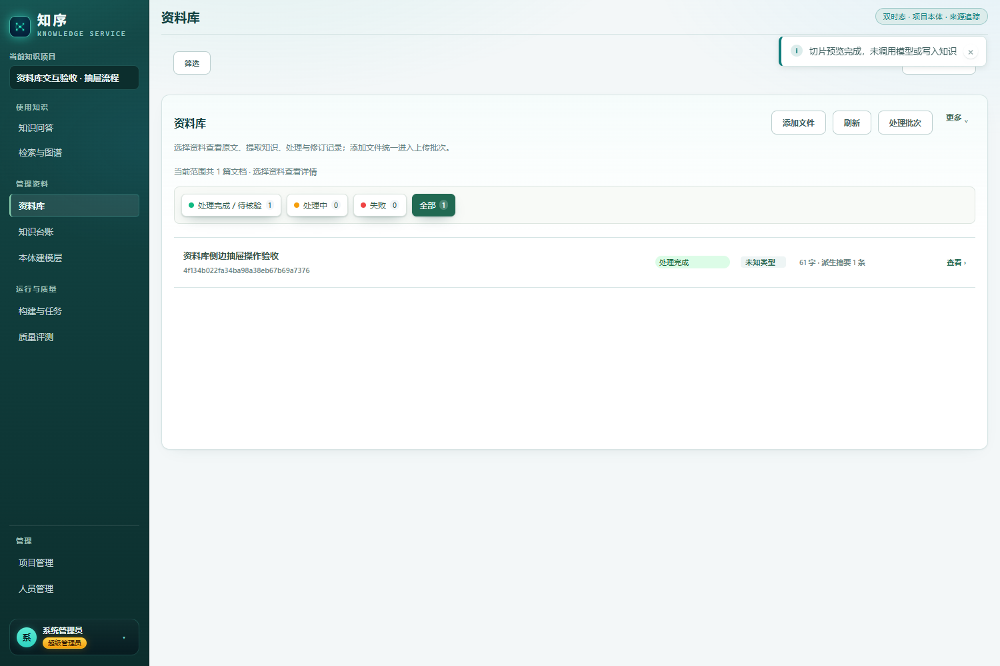

读图时先核对项目与当前对象，再看本章所述操作入口；操作后以服务回执和对应列表/详情变化判断结果。截图取自真实应用的隔离验收项目，示例数据用于说明布局。

### 正确结果

能从资料看到它的断言，并从事实看到相关来源。固定版本引用打开当次版本；来源无法解析时明确说明原因，不拿当前文档补成历史证据。

### 失败与恢复

来源原文资源缺失时显示来源无法核实；重建向量索引不能恢复原文。OCR 错误优先核对文件清晰度与 OCR 状态；重试不代表抽取已经重新执行。原文已经变化的候选需要按服务要求重新提取，不能直接批准旧片段。

### 下一步

按 [知识审核](#chapter-10) 确认事实；问答引用资格见 [引用与 OAG](#chapter-19)。

<a id="chapter-10"></a>
## 10｜候选事实、知识审核与约束异常

### 场景

抽取结果有待确认实体、关系、属性，或与正式本体、单值属性约束不一致。

### 为什么与何时

审核具体事实与审核本体结构是两条流程。前者决定某条知识是否写入，后者决定允许怎样表达；创建本体术语本身不会证明候选事实真实。

### 前置身份与条件

管理员；项目有对应候选。正式事实映射需要已发布本体。先处理依赖实体，再处理引用它们的关系和属性。

### 操作步骤

1. 从抽取结果进入审核，或在“知识台账”上方直接点击“知识审核”，再点击“刷新审核”。这个入口打开实际事实审核清单，区别于本体草案的结构审核。
2. 选择“待审核事实”，按实体映射、关系事实或属性事实筛选，展开原文证据。
3. 核对提议类型、抽取所用本体、端点与有效期。明确选择当前正式本体术语，填写审核理由后“批准并写入”或“拒绝”。
4. 若现有本体无法表达，使用“申请本体变更”，填写新建/调整定义、所属类或端点及理由；结构变更获批后回到事实映射审核。
5. 单值属性冲突时查看当前值，明确选“保留旧值/拒绝候选”或“接受新值”，不要假定普通批准会覆盖旧值。
6. 在“约束异常”逐项查看限制、实际值、期望值和级别，填写理由后“确认例外”或“标记需整改”。
7. 在“已处理”复核审核结论，再去台账确认实际写入记录及其修订。

### 正确结果

批准后的具体事实能查到正式记录，拒绝保留原文与审核痕迹。确认约束例外留下治理决定，不代表本体规则被删除，也不代表已自动整改数据。

### 失败与恢复

候选被阻塞时先审核缺失端点；拒绝实体不会自动拒绝所有依赖候选，应继续清理队列。来源变化时重新提取。无已发布本体时先完成建模发布；结构待定解除后仍核对知识本体归属，必要时执行受控迁移。

### 下一步

需扩展结构进入 [本体建模](#chapter-11)；需改已经入库的事实进入 [知识台账](#chapter-15)。

<a id="chapter-11"></a>
## 11｜本体目录、类型卡片、图与手工建模

### 场景

定义“商户”这种实体类型、商户间的业务关系，以及金额、日期、状态等数据属性。

### 为什么与何时

本体类描述一组实例；对象关系连接两个实体；数据属性连接实体和标量值。把金额做成实体或把继承当成业务关系，会影响抽取和验证。

### 前置身份与条件

管理员，选定项目。正式发布与历史快照只读，修改进入草案；历史预览先“回到最新”或从历史创建新草案。

### 操作步骤

1. 进入“本体建模层”，在“本体目录”按名称与种类查找类、关系、属性，按需要查看停用术语。
2. 默认“类型卡片”是在画布上有连线的白色类型节点，列出属性、数据类型、约束和继承摘要；选中后在检查器查看完整定义与稳定 IRI。“术语卡片”保留类、关系、属性的完整列表，也包含未设置端点的术语。
3. 可独立切换卡片与紧凑节点显示，再选择关系布局或“继承层级”排列。左侧层级树可以展开折叠，多父类显示交叉引用；继承箭头与业务关系箭头有独立图例。布局、折叠不会修改语义。
4. 从顶部“新增定义”菜单打开通用表单；选中类的“新增子类 / 为此类新增属性 / 新增关联关系”使用同一写入流程，填写中文名与可选英文标识。
5. 新类可不选父类；为选中类新建子类时核对预填父类。已有类在父类编辑区保留需要的多父类，只移除明确要撤下的父类。
6. 业务关系填写主体类 domain 和客体类 range；可选端点、多 domain/range 按服务支持的定义保留。未指定端点的关系仍在目录中，不因画布无边就消失。
7. 数据属性填写所属类、数据类型及适用约束。改显示名称或说明时保留原有 IRI 身份。
8. 画布改父类/连关系使用两步选择与确认；确认源和目标后提交到草案。插入一个中间父类时，分别新建类、增补新父边、明确移除旧边，再整体检查继承，不假定存在自动重接的一键操作。
9. 新建术语时，先等待“已保存到草案”及画布更新。底部审核条件独立读取，不阻塞继续建模，也不会清空正在输入的下一条术语。普通编辑读取轻量状态；审核、发布仍须执行完整校验，保存成功不等于已通过发布校验。

### 发现父类与持续完善

已有至少两个有效类且模型可用时，点击“发现父类”，核对新增父边、重复项与潜在循环，保留原本正确的多父类。先前来自资料的候选使用 [待完善结构](#chapter-06) 明确选目标和事实范围，不再以独立发现草案替代当前手动草案。模型建议只是一组待审核修改，不因模型返回成功直接发布。

继续完善同一轮时，先手动保存已有定义，再从来源 A 加入候选，随后从来源 B 加入候选。每次加入前核对同一目标草案 ID 和最新修订；加入后展开“同时处理的关联知识 · 按来源运行核对”，确认两个来源运行、各自候选范围和先前手工差异都保留。然后可继续从“新增定义”补类、关系、属性，或编辑已有草案定义。来源运行数、定义操作数和关联事实数分别计算，不把两次加入理解为覆盖前一次。

本轮合成示例的实际加入回执如下。三行沿用同一草案 `7e427837…`；修订只是本次示例的状态，不是每个项目固定要到的数字。

| 步骤 | 这次加入的内容 | 保存后的修订 | 本次结构与事实结果 |
| --- | --- | --- | --- |
| 先手工建模 | 业务对象类型 | r2 | 定义保留在草案中；未据此发布正式事实 |
| 来源 A | 北辰装备供应商实体、注册资本属性 | r3 | 新增结构操作 8 项、复用候选绑定 0 项；本次关联 2 条事实待发布 |
| 来源 B | 华星科技客户、天海贸易供应商、采购关系 | r4 | 新增结构操作 6 项、复用候选绑定 1 项；本次关联 3 条事实待发布 |
| 继续手工完善 | 为供应商、客户增加业务对象父类，设置采购关系的主体/客体类 | r8 | 本轮结构变更 21 项；两份来源仍关联 5 条事实，尚未正式发布 |

回看来源 B 的加入动作时，应核对同一草案保存当时的 r4、两份来源绑定以及原手工“业务对象”定义；继续手工修改后，再按重新读取的最新修订操作。来源 A 的 2 条与来源 B 的 3 条需要分别追踪；结构复用 1 项不表示已经复用 1 条正式事实。原加入请求重试仍返回本次保存回执，不应再增加一轮草案或一组重复操作。

### 当前界面

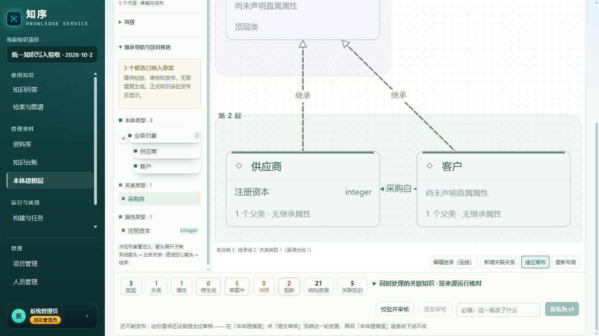

这张图截取本体页面下半部；草案 ID、修订与正式基线需向上查看，不能从本图推断页头身份。先看左侧继承树：“业务对象”下保留“供应商”和“客户”；再看画布上标“继承”的连线及客户指向供应商的“采购自”，并核对供应商卡片上的注册资本为 integer。父类与业务关系是两种定义，不要相互替代。

继续手工完善后，同一示例草案实际到 r8。图中底部显示结构变更 21、关联知识 5，左侧提示 5 个候选已纳入草案；这说明还需审核发布。截图同时显示阻断 2，并提示尚未提交审核；先执行校验、读取诊断并逐项处理，不能因画布结构已经齐全就跳过治理。发布前展开“同时处理的关联知识 · 按来源运行核对”，确认仍是来源 A 的 2 条和来源 B 的 3 条。

### 正确结果

检查器和草案中能看到定义变更。继承边与业务关系边分开；多父类不被默默覆盖。保存布局不会发布版本；新术语要审核发布后才成为正式定义。

### 失败与恢复

历史只读先退出预览。重复 IRI、跨种类同规范名、自引用、继承环或基线冲突按服务诊断处理。中文名可用，不要为绕过校验不断新造同义术语。未支持的 RDF 表达保留在源码中，图形界面不等于完整语义清单。

若提示“已保存到草案，但画布刷新失败”，先重新读取草案核对术语，不要重复新增。审核条件读取超过 15 秒会结束等待并显示“重试读取审核条件”；这个超时只针对状态读取，不代表撤销保存，也不会自动批准发布。点击重试不会重建术语。

### 下一步

批量候选按 [路径 B](#chapter-06) 加入；父类建议按本章操作，复杂限制看 [约束与源码](#chapter-12)，完成后 [审核发布](#chapter-13)。

<a id="chapter-12"></a>
## 12｜约束、RDF 源码、Turtle 导入与本地 SPARQL

### 场景

限制属性的值类型、数量、取值规则，查看未图形化的 RDF，或对当前项目本体与知识执行只读查询。

### 为什么与何时

domain/range、SHACL 与实例质量检查提供不同诊断。图形编辑覆盖常用定义；复杂 RDF 应保留原始表达，再以差异进入治理。

### 前置身份与条件

管理员进行定义修改；能查看项目内容的账号按 API 权限查询。使用真实项目 ID。高级 API 可在已登录的 API 客户端中调用，认证信息由自己的会话提供，不复制他人的令牌。

### 操作步骤

1. 在本体检查器选择类/关系/属性，核对父类、domain/range、数据类型与已有约束。
2. 使用可见约束控件添加、移除或应用类型限制，区分“给定义加约束”和“修改具体属性值”。
3. 从“高级 → RDF 源码 / 导出”查看当前原始 Turtle；需要归档时“导出 Turtle”。
4. 在当前可编辑状态点击“编辑 Turtle”，粘贴或修改合法 Turtle，再“把源码差异加入草案”。这也是已有 Turtle 定义的导入路径；导入后查看差异，不能直接覆盖发布快照。
5. 对图形未支持的 RDF 表达，先备份源码并保留原图，避免仅依据卡片重建后丢失语义。
6. 在“RDF 源码 / 导出”窗口展开“高级查询 · SPARQL（只读）”，填写查询后点击“运行只读查询”。窗口固定所选已发布本体；历史预览按所选发布读取，未发布草案源码不参与。查询不继承其他页面隐藏的 Metadata 条件，切换项目后应重新打开窗口。
7. 高级集成可调用 `POST /api/projects/{p}/sparql`，请求体使用下例；需要固定发布时附真实 `ontology_id`。查询仅在服务允许的本地数据上运行，远端 SERVICE 不作为此入口的能力。

```json
{"query":"SELECT ?s ?p ?o WHERE { ?s ?p ?o } LIMIT 20"}
```

### 正确结果

源码差异列入草案，校验分别显示语法、SHACL、质量与实例影响；未运行的检查显示未判定。SPARQL 返回实际查询结果，不会借此更改生产版本。

### 失败与恢复

Turtle 语法失败先修前缀、IRI 与语句结束符。约束导致历史实例不符合时先读影响面，再决定整改、例外或调整草案。多格式本体导入与任意远端 RDF 导入不应从“导入 Turtle”推导为已支持。

### 下一步

按 [草案审核发布](#chapter-13) 完成治理；修复具体数据按 [台账](#chapter-15)。

<a id="chapter-13"></a>
## 13｜本轮修改、草案管理、校验、审核与发布

### 场景

把手动维护和多个资料批次加入的一轮结构修改，审核为正式本体，并核对其明确关联的候选事实。

### 为什么与何时

草案 ID、基线、修订、操作指纹和审核决定共同防止并发覆盖。发布是不可变快照；结构生效、关联事实处理和索引投影分别有结果，不能用一个“成功”掩盖跳过或待同步。

### 前置身份与条件

管理员；明确选中可编辑草案，修订与当前正式基线有效。来源、事实依赖、校验、逐项理由和警告确认符合发布清单。已发布、已关闭草案只读。

### 操作步骤

1. 展开“本轮修改 · 草案管理与变更”，先核对草案 ID、修订、基于哪个正式发布。“草案管理”中可“选择待处理草案”“另开一轮修改”或“关闭当前草案”；没有选择时不得默认把第一份当工作草案。
2. 查看新增、更新、停用、恢复的前后差异、来源文档/批次和影响面。核对“本体结构变更”与“同时处理的关联知识”；没有候选绑定时关联知识为 0 条。
3. 点击校验与审核入口，读取当前修订的语法、SHACL、质量和实例影响结果。未执行、失败或暂时读不到的检查应显示未判定，不能按通过处理。
4. 逐条审核操作，阅读来源、风险及警告，填写理由，选择批准或拒绝。安全批量操作只覆盖服务允许的安全条目；高风险条目仍须逐项确认。
5. 发生基线变化或来源刷新时先看差异，执行页面提供的重新基线/对齐并处理冲突。重新编辑使旧校验和相关决定失效，重新核对后再审核。
6. 查看实时发布清单，确认最终获批且有效的结构，以及各批关联事实的新增/复用/冲突/跳过预期。先从“同时处理的关联知识 · 按来源运行核对”逐个核对运行 ID 与候选范围；两批来源都加入同一草案时，两批都应列出。被拒绝、撤销、替换或停用的操作会改变依赖事实资格。
7. 填写发布说明并确认所需警告，再提交。响应未知先查草案和正式版本；原请求重试复用同一身份，不把新一轮操作当原请求重试。
8. 发布回执分别核对：正式本体发布 ID 与显示版本；逐来源实际事实新增、复用、跳过及原因；索引任务或投影进度。打开“版本管理”中本次发布的“本次发布实际处理的关联知识”，比对明确选中总数和实际新增 / 复用 / 跳过；展开各来源运行查看候选 ID 与逐条结果，再到知识台账按真实记录 ID 交叉核对。发布时记录的索引状态是快照，当前进度到“构建与任务”查询。
9. 发布成功后本草案为只读历史，后续结构保存进入下一轮。关闭未完成草案时说明原因、保留审计；候选不会丢失或自动写入，再加入前须重新核对来源与绑定。

| 复核位置 | 要回答的问题 | 发现差异时的处理 |
| --- | --- | --- |
| 发布前本轮差异与来源运行 | 手工操作与来源 A、来源 B 是否都在这一草案，是否只包含明确选择项 | 回到准确草案/来源重读，补足选择后重新预演与审核 |
| 发布后版本管理中的实际处理结果 | 每个来源最终新增、复用、跳过多少，哪些候选为什么跳过 | 逐候选看诊断，不按预演计数补写或重复发布 |
| 历史发布只读画布与发布 ID | 正在看的是否本次不可变快照，是否有同为 vN 的其他发布 | 按发布 ID 定位；继续修改先回到最新并进入新一轮 |
| 索引状态与任务页 | 发布时的索引快照和当前执行进度是否一致 | 用任务 ID 追踪；结构已发布时不再次发布来催动索引 |

### 当前界面

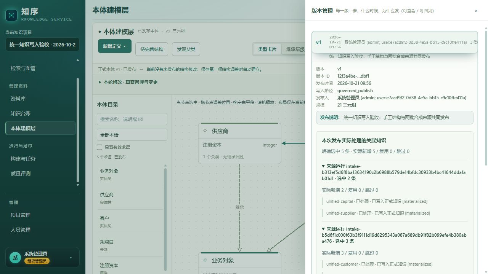

先看背景页已切为“已发布本体”，正式本体为 v1，并提示当前没有未发布的结构修改；再看右侧“版本管理”的发布 ID、发布时间和发布说明。“本次发布实际处理的关联知识”显示明确选中 5 条，实际新增 5 / 复用 0 / 跳过 0。第一来源运行列出 2 条，第二来源运行列出 3 条；第二来源的后续逐条结果在侧栏下方，需要继续滚动，不能只看本图可见的一条就结束复核。

本例实际 API 回执的发布身份是 `12f3a4be-e250-4f02-8141-934c9da0dbf1`。来源 A 的注册资本和供应商候选新增 2 条；来源 B 的客户、采购关系和供应商候选新增 3 条。背景的“21 三元组”是本体表达数，关联事实的 5 条按独立回执计算。实际索引任务为 `ontology-sync:12f3a4be-e250-4f02-8141-934c9da0dbf1`，发布时记录为 pending；这证明任务已被记录，当前是否完成仍需到任务页查询。同一发布请求重放返回同一发布身份与事实结果，不应再次发布来重复处理这 5 条知识。

之后回看这次发布，仍从版本管理按发布 ID 定位，展开各来源核对实际结果；不要用当前草案或后来新版本的状态改写历史回执。若要查看当时结构，使用“查看这一版（只读）”；回到当前工作区继续改动时先“回到最新”，再保存下一轮草案。

### 正确结果

本体发布有真实身份，草案操作和审核记录可回查；多批绑定不互相覆盖，未选候选不被处理。标注性质发布可能同为 vN，使用发布 ID 区分，不能按列表位置另造版本号。事实仍保留自己的本体依据，索引状态单独可查。

### 失败与恢复

409 时核对预期修订、基线和来源，刷新后重新预演或审核；不得盲目重复陈旧命令。发布清单读取失败按未判定处理。结构或事实校验失败时保留草案工作，按逐项原因修正。正式发布已成功而索引待同步时到任务页处理，不重复发布或重写事实。

### 下一步

历史和迁移看 [版本维护](#chapter-14)，正式记录看 [知识台账](#chapter-15)，索引状态看 [任务与投影](#chapter-24)。

<a id="chapter-14"></a>
## 14｜历史查看、术语恢复与受控迁移撤销

### 场景

查某次历史结构、恢复被停用术语，或把仍挂在旧本体发布下的知识迁到新发布。

### 为什么与何时

查看历史不改变线上状态；恢复术语不等于回退整个本体；迁移本体归属不等于自动推断业务事实。例如新增“产品经理”类后，已有“员工”不会自动变成产品经理。

### 前置身份与条件

管理员修改；已有历史发布或可迁移记录。历史预览只读。恢复来源必须是同项目真实发布，迁移由服务提供分组、映射和版本守卫。

### 操作步骤

1. 本体页点击“版本管理”，选择发布，使用“查看这一版（只读）”；核对发布 ID 与版本号。点击“回到最新”退出预览。
2. 需要整体回到某版结构时使用“回到这一版”，由该历史结构创建新草案；查看会撤去哪些后续结构，审核后另发新版本。
3. 停用类/关系/属性时，选择术语，先读影响面，填写原因，再“确认加入停用变更”，按草案流程审核发布。
4. 恢复停用术语时选择“恢复来源”，至少勾一项合法字段：名称与说明、父类，或相应 domain/range、数据类型；填写原因并“确认恢复”。提交包含 `source_ontology_id` 与 `selected_fields`，逐项审核后发布。
5. 查看“关联知识 / 受控重分类”迁移面板，按旧类型分组核对“原样迁到新发布”“按替代映射”“需人工处理”等真实处置。
6. 明确选择要迁移的分组，先“预演”，阅读受影响记录、预期修订与失败原因，再“执行”。不选分组就不应默认全迁。
7. 去台账确认记录本体归属与新修订。需撤销时从迁移结果或操作历史的可撤销项发起撤销，再核对全部影响记录。

### 当前界面

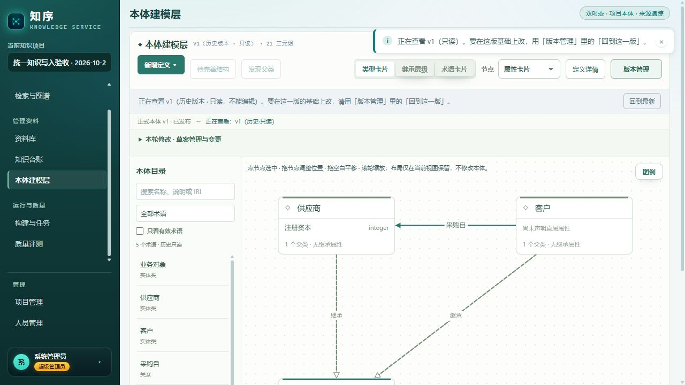

先看顶部“v1（历史版本 · 只读）”与蓝色提示，再看下一行“正式本体 v1 · 已发布 → 正在查看：v1（历史·只读）”。本图是从版本管理点击“查看这一版（只读）”后的实际界面；“待完善结构”和“发现父类”禁用，画布仍可阅读供应商、客户的继承与采购关系。只读查看只切换展示，不创建草案，也不改变当前正式版本。

退出时点击横幅右侧“回到最新”，核对“已回到最新本体”提示，再继续当前工作。若确实要以历史结构开展修改，使用版本管理中的“回到这一版”明确创建新草案，重新审核发布；不要把它与“查看这一版”或“回到最新”混用。

### 正确结果

历史不被改写；恢复发布是新记录；迁移生成事实新修订并保留旧归属。结构待定提示解除与归属迁移分别核对。

### 失败与恢复

后续修订、依赖变化或映射冲突会阻止迁移/撤销。刷新预演后重新选择；不要强改预期修订号绕过冲突。读不到影响面时不确认停用。撤销被拒绝时根据当前事实做新纠正修订，保留审计。

### 下一步

按 [台账编辑](#chapter-15) 处理具体业务类型；完整版本示例见 [版本关系](#chapter-26)。

<a id="chapter-15"></a>
## 15｜实体、关系、独立属性的新增修改删除恢复

### 场景

纠正实体名称/类型、关系端点或某个金额值，并能查看之前是什么。

### 为什么与何时

实体、关系和属性都是有独立 ID、来源与修订的记录。实体详情中的属性汇总不能代替独立属性台账；事实纠正与规则业务换版也不同。

### 前置身份与条件

管理员可创建、编辑、删除和恢复；只读用户可查询与查看历史。新知识先使用当前已发布本体的有效术语，缺少类、关系或属性定义时先建模并发布。普通编辑继续使用该记录原本绑定的本体，迁到另一发布走受控迁移。每次修改用当前预期修订号；业务规则换版应新建记录 ID 并维护各自有效区间。

### 操作步骤

1. 进入知识台账，默认是实体清单。点击“实体 / 关系 / 属性 / 原文片段”切换视角；在“查询当前范围全部记录”输入名称、正文、别名或记录编号后点“查询”，再用表格下方“上一页 / 下一页”翻页。每页最多 50 条，“服务端匹配总数”覆盖当前范围全部记录，不是浏览器已加载前缀的数量。
2. 创建实体时，点击台账上方“新增实体”，打开右侧记录抽屉。从当前已发布本体选择类型，填写“实体名称”；需要时填写业务生效/失效时间，在“更多：元数据与高级 JSON”中填写 Metadata 对象。当前查询筛选不会自动写进新记录的 Metadata；切换项目会关闭该表单。
3. 创建关系时，点击台账上方“新增关系”，或从实体行、图谱实体详情点击“新增关系”，后两处预选起点实体。选择关系类型，核对“允许主体 / 允许客体”，填写关系显示文本，再选择真实起点与终点。允许多个端点类型或未限定端点的关系会如实显示。
4. 选择实体时，在“起点实体 / 终点实体 / 所属实体”输入名称、别名或 ID，点击“查询”；在选择器内部用“下一页 / 上一页”继续查询。也可在“准确实体 ID”输入完整 ID 后点“按 ID 定位”。查询在服务端覆盖当前范围，查询结果不受台账当前页或前 1000 条实体限制；选定后核对姓名与完整 ID。
5. 创建独立属性时，点击台账上方“新增属性”，或从实体行、图谱详情点击“新增属性”预选所属实体。选择属性类型及本体允许的数据类型，填写属性值。布尔值准确输入 `true` 或 `false`；整数、浮点数按原生数值校验。显示文本可留空，系统按属性名称和值生成。
6. 确认抽屉展示的是当前已发布本体的发布 ID 后，点“创建正式记录”。成功后可点“在台账查看”按新记录 ID 定位。创建不会覆盖已有记录；默认由服务生成新 ID。完整记录 JSON 仍在“更多”中，需保留同一知识类别与当前发布 `ontology_id`；批量集成从资料库“更多 → 结构化记录导入”或添加文件抽屉的“结构化导入”按正式契约提交 1–1000 条记录。
7. 修改已有记录时，在记录行或图谱详情点“编辑”，核对 ID、本体归属、当前 rN、有效期与来源，修改字段后保存。实体类型可在原绑定本体中纠正；关系可改主体、谓词与客体，属性可改所属实体、属性术语、值和数据类型。关系和属性编辑同样使用服务端实体选择器，原端点会保留。
8. 属性编辑器中的日期、日期时间和 JSON 模式会按实际契约校验并保存为字符串；不能据此认定本体中的日期、任意 JSON 或嵌套对象数据类型都受支持。创建器只提供当前服务能表达且本体允许的原生数据类型；不支持的 range 会显示原因和“前往本体建模层”，不会悄悄转换成别的数据类型。
9. 若保存提示版本冲突，先保留上方未保存字段，查看窗口下方“服务端最新修订 rN”的比较区，比较“你的提交”和“服务端最新内容”。决定采用最新基线时，明确点“载入最新修订重新编辑”，再重新输入需要保留的修改并保存；不会自动提高预期修订号覆盖他人修改。
10. 点“修订历史”查看旧 rN；恢复历史时选择目标修订号，执行“恢复为新修订”。删除前读影响与确认提示，执行软删除；需要恢复时从历史或对应治理操作恢复，并核对关联关系与断言状态。
11. 需要检查旧本体归属时，点击台账上方“检查本体归属”，读取服务端迁移计划；尚未点击时“迁移状态未检查”不代表没有旧归属。待建模概念、疑似重复与“读取操作历史”按需读取，不为首页数字预载全部知识。
12. 回到图谱、脑图或台账重新读取，确认它们展示同一记录的新修订。台账“关联断言”保留候选血缘和已归位血缘并区分审核状态；若提示“计数不完整”或读取失败，先重试或进入来源详情，不能当成没有来源。需要审批具体候选时点台账上方“知识审核”。

### 当前界面

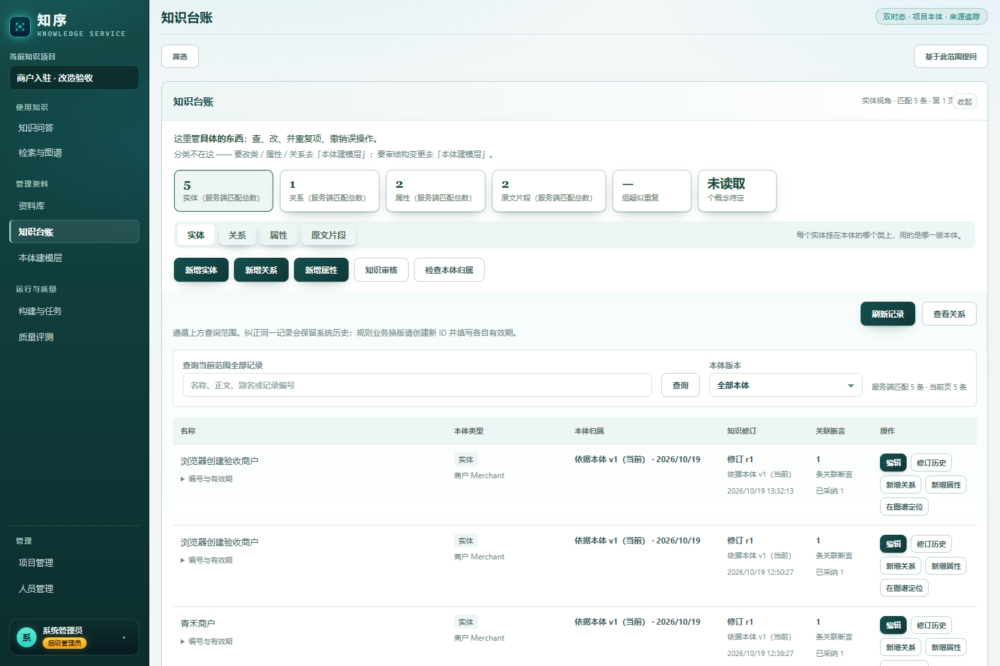

读图时先核对项目与当前对象，再看本章所述操作入口；操作后以服务回执和对应列表/详情变化判断结果。截图取自真实应用的隔离验收项目，示例数据用于说明布局。

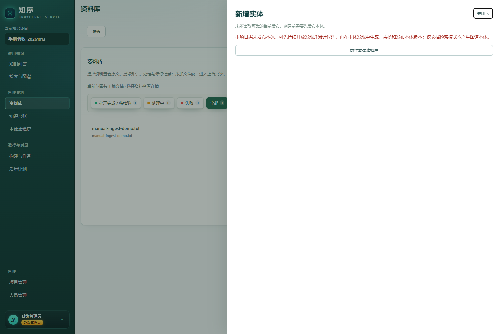

创建表单明确展示本体发布与可选类型；关系、属性使用同一流程选择实体端点并接受服务校验。

### 正确结果

实体、关系和独立属性可直接用字段表单创建；服务校验类型、端点、有效区间和元数据后正式写入，成功回执包含真实记录 ID。纠正产生 rN+1，旧 rN 可查。软删除保留旧修订；恢复再次产生新修订。结构化批次按服务校验原子写入，任一记录失败则该批不写入。原文片段按来源追查，不能在台账伪造改过的原文。

### 失败与恢复

创建窗口没有可靠类型目录时先完成本体发布；创建期间本体已更新则重新打开窗口，按最新发布选择。端点不存在、已删除、术语停用或区间不兼容时，按服务错误修正依赖或业务时间，不伪造端点。记录创建成功但台账未显示时，检查当前本体版本、Metadata 和业务/历史筛选；不要重复创建。查询条件变化会让旧选择器/编辑表单失效，重新打开再操作。409 修订冲突按比较区明确重载；比较读取失败时先保留自己的内容，再刷新最新记录。删除文档会影响其派生断言和关联知识，应先查来源影响，不把软删除等同于物理清理或第二阶段逻辑来源撤回。

### 下一步

重复实体进入 [别名、融合与消歧](#chapter-16)；版本与时间问题见 [范围](#chapter-17) 和 [版本实例](#chapter-26)。

<a id="chapter-16"></a>
## 16｜别名、查重、融合选值、消歧复核与撤销

### 场景

“某某有限公司”和简称可能是同一对象；也可能两个同名对象必须保留独立。

### 为什么与何时

同名、同类型、相似度只提供重复线索。融合会把关系转到保留实体并处置独立属性，需要核对身份、类型、业务区间和来源范围。

### 前置身份与条件

管理员；候选记录当前存在且修订有效。融合兼容性由服务预演决定，不应仅凭显示版本号相同/不同判断；跨本体发布是否可融合仍以真实校验为准。

### 操作步骤

1. 在知识台账展开“实体消歧与融合”，使用名称/别名“查重”；也可点击顶部“组疑似重复”按需读取服务端分组。查看名称、类型、本体依据、区间和来源；数字未读取时不等于没有重复。
2. 确定只是常用别称时，选目标实体并“存别名”，再用该别名查找验证。新增别名不是新增实体，也不自动融合。
3. 确认同一对象时，在查重结果选择“合并后保留”和“作为重复项合并”，核对两个真实 ID。
4. 打开融合预演，阅读实体、关系和属性影响。对于单值属性冲突，逐项指定保留的属性记录（winner）；候选值相同也检查来源。
5. 勾选影响确认后执行融合，核对返回操作 ID、保留实体、新修订及关系转接结果。
6. 消歧复核清单中选择合并、保持独立或驳回建议，填写理由；选择合并时同样传递当前实体预期修订和 `attribute_winners`。
7. 点击“看可撤销的操作”，或在台账“可撤销的操作”中点“读取操作历史”，查看按时间倒序的真实操作。误合并时发起撤销并核对所有受影响记录；当前页的参考影响数不能替代提交前的完整服务端预演。

### 正确结果

保留实体保持身份，重复项按服务规则停用，来源与断言血缘保留。保持独立不会删除资料；融合冲突不会被自动随意选值。

### 失败与恢复

预演失败先修正不兼容的类型、区间或范围。修订变化后重新预演并重新选值，不能复用旧 winner。后续依赖使撤销不可安全执行时按诊断做新修订，不删除操作审计。

### 下一步

核对 [来源断言](#chapter-09)，重新构建需要更新的 [索引](#chapter-24)，再测试检索与问答。

<a id="chapter-17"></a>
## 17｜本页 Metadata、业务时点与系统历史

### 场景

只查询“某平台、某业务、某类对象、某地区”的规则，或重现当时系统知道的历史答案。

### 为什么与何时

业务时点回答“这条规则何时适用”；系统历史时点回答“系统当时知道哪个修订”。发布时间、导入时间与生效时间不可混同。

### 前置身份与条件

已有项目。资料库、问答、检索、台账各有自己的页面范围；管理页、本体页、任务页和评测按各自明确的协议，不继承隐藏内容筛选。

### 操作步骤

1. 在支持的页面点击“筛选”，填写平台、业务、适用对象；需要时添加 Metadata 条件。筛选默认收起，管理页与本体建模不继承这些内容条件。
2. 当前检索与问答支持记录 ID、种类、类型、原文所属资料 ID、生效/失效时间、Metadata，以及独立的平台、业务、适用对象和本体范围。自定义条件按服务支持的字段与运算符组合 AND/OR；NOT 节点暂不支持。Metadata 条件由 PostgreSQL 判定完整资格，再由 Milvus 执行关键词、向量或混合排名；不会忽略条件，也不会因为未在 Milvus 增加列而拒绝所有 Metadata。
3. 设置“业务时点”；需要历史重现时展开“历史与高级条件”，设置“系统历史时点”。
4. 点击“应用筛选”，检查页面上的已应用标签；“清空本页筛选”仅清本页。
5. 从检索或资料上下文继续问答时，明确点击“基于此范围提问”等范围转移操作，不假定切换页签会自动同步。
6. 问答范围改变后核对下一题提交范围；已有回答保留当次范围，不能把新筛选当成旧回答的证据范围。

以下 Metadata 示例可用于资料库、台账、图谱、当前检索和问答，以及历史关键词查询：

```json
{"or":[{"field":"metadata.region.city","op":"eq","value":"北京"},{"field":"metadata.region.city","op":"eq","value":"上海"}]}
```

### 当前界面

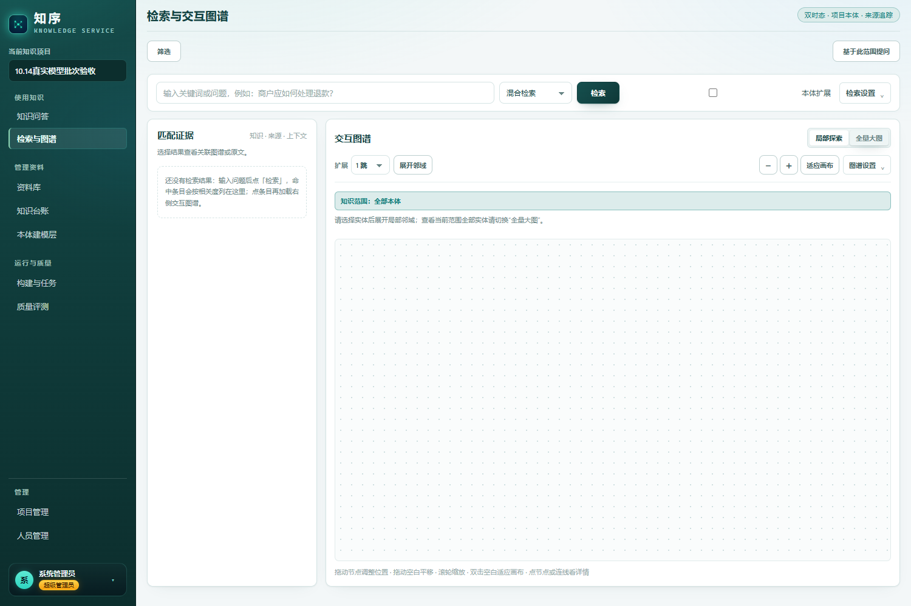

读图时先核对项目与当前对象，再看本章所述操作入口；操作后以服务回执和对应列表/详情变化判断结果。截图取自真实应用的隔离验收项目，示例数据用于说明布局。

### 正确结果

筛选标签、实际请求与返回范围一致，切换项目和页面不会把隐藏旧筛选带入无关管理操作。有效期按左闭右开 `[生效, 失效)`；未给显式生效时间时沿用发布时间，二者都未给则有效期未知。

### 失败与恢复

JSON 错误先修语法和服务允许的字段/运算符。无结果先清本页筛选，再逐项加回；核对有效期未知、系统历史、所选本体发布与被删除状态。筛选不会放宽服务权限或来源资格。

从图谱切回当前检索、继续问答或重试旧问题时，若保留条件包含不支持字段，系统阻止提交并保留完整条件，供你调整；不会删除其中一支再扩大查询范围。原文所属资料 ID 仅筛选切片所属文档；实体与关系的多来源请在来源依据中核对。

平台、业务、适用对象都有“指定值 / 全部适用 / 未知”三种语义。以平台为例，`platform_mode=specific` 时 `platform_values` 保存指定值；`all` 表示全部适用、`unknown` 表示尚未确定，两者的值列表都为空。空列表不能单独区分这两种含义。它们是实际业务筛选字段；Milvus 当前固定保存这些可读字段，不再自动创建 `bf_` 扩展列。后续新增具体业务字段时再显式扩展结构。

### 下一步

在 [检索](#chapter-18) 和 [问答](#chapter-19) 使用同一已确认范围；版本区别见 [版本关系](#chapter-26)。

<a id="chapter-18"></a>
## 18｜关键词、语义、混合检索与本体扩展

### 场景

精确找一个名称，或用不同措辞找相关规则，再把命中的实体送到图谱。

### 为什么与何时

关键词适合明确名称/词语；语义依赖模型 embedding 与 Milvus；混合组合实际检索通道。本体扩展补充父子类召回，不扩大权限、时间或来源资格。

### 前置身份与条件

已选项目和本页范围。当前三种模式均要求 Milvus 项目索引就绪；语义/混合还要求编码器可用、维度一致。服务返回的实际策略和诊断是判断依据。

### 操作步骤

1. 进入“检索与图谱”，在顶部查询栏填写问题或名称，明确选择“关键词”“语义向量”或“混合检索”。左侧显示证据结果，右侧画布用于交互；详情仅在选中记录后展开，可关闭。
2. 需要查父类时召回子类实例，勾选“本体扩展”，再提交。默认关闭时按实际检索模式查询。
3. 查看结果中的实体、关系、原文命中，以及实际通道/策略、数量和可用性提示。不同种类的预算分别生效，不把总 top-k 误当每类数量。
4. 点击实体或关系命中先查看共享详情；选择实体作为种子后，点击“展开邻域”加载局部图。检索或点击检查本身不会重画图。
5. 项目首次使用检索时，由管理员显式提交向量化任务；打开页面或普通编辑不会自动为未构建项目编码。已构建项目的新修订通过增量更新追赶水位；更换模型、旧字段目录或服务明确提示需重建时，再显式重建。到任务页及索引状态确认 ready 和水位一致后重试。局部图的实体选择、精确 ID、方向、预算、类型和标签在“图谱设置”，使用图谱范围。

### 当前界面

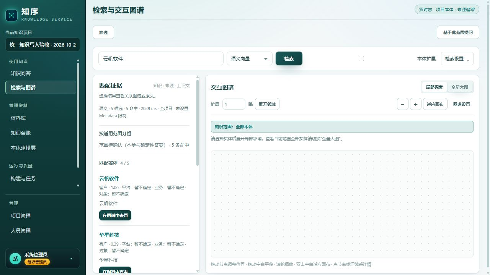

先看查询为“云帆软件”、模式为“语义向量”，再看左侧命中列表和适用范围分组。本例在实际 Milvus 语义检索中返回 5 条命中，云帆软件位于首位；分数 1.00 是检索相似度，不等于业务结论的可信度。左侧同时标“范围待确认（不参与确定性答案）”，平台、业务、对象仍暂不确定；正式入库与命中检索不会自动补齐适用范围。点击结果核对详情与来源，确认范围后再用于问答。

本例随后读取到发布与仅复用确认的两个索引任务均为 completed，正式索引 ready 为 true，与正式发布 ID 一致。它们完成后，历史发布回执中记录的 pending 仍保留为当时快照。截图的 2029 ms 只是这一次合成示例查询的观察值，不能代表日常延迟、P95 或大库性能基准；15 万实体容量状态仍按 [容量证据](#chapter-27) 阅读。

### 正确结果

精确查询能搜索全库而非仅已加载的台账前缀；结果与范围相符。语义和混合只从 Milvus 向量后端执行。无命中与后端失败有不同提示。

本体扩展除扩展标签词，还按相关父子类型补充符合范围的事实。分别设置实体、关系、原文预算时，按对应通道执行；多平台场景还受每个平台的配额限制。若返回范围未完整覆盖，先查看覆盖提示，不能把部分结果当作全库没有其他知识。

### 失败与恢复

Milvus 不可用或项目索引未就绪时，当前三种模式均明确失败；编码器不可用会影响语义/混合。检查连接、模型和索引后重试。切换关键词仍需 Milvus 项目索引，不能绕过索引错误；系统不会自动降级或以本地向量冒充结果。

### 下一步

读 [局部图和路径](#chapter-20)，或通过明确范围操作进入 [知识问答](#chapter-19)。

<a id="chapter-19"></a>
## 19｜知识问答、Local/OAG 与可引用依据

### 场景

提问“某平台当前退款应提供哪些材料”，并判断回答里的每条依据是否支持这次结论。

### 为什么与何时

命中一段文字不等于它有资格支持当前规则。Local/OAG 从实体锚点、本体辅助、合格关系/邻域/路径和原文构建上下文；图关系提供可追踪事实，不自动构成逻辑证明。

### 前置身份与条件

已选项目、问答自己的平台/Metadata/时间范围与检索模式。生成回答需要可用语言模型；语义/混合还要求 Milvus 与 embedding 模型。仅文档资料也可以提供经资格判断的原文参考。

### 操作步骤

1. 进入知识问答，检查筛选标签与问题提交范围，选择检索方式及页面提供的检索/生成设置。
2. 输入具体问题，明确平台与时点；提交后阅读“正在检索证据”“模型组织答案”等实际阶段。
3. 查看实体证据、原文证据、图关系证据数量和实际策略；有模型时再审阅生成答案。
4. 打开回答引用，核对记录 ID、rN、本体发布、适用范围、生效状态及来源文档版本。
5. 点击“查看冻结原文”，从固定证据追溯原文；多来源时展开其他来源。需要关系背景可“在图谱中查看”。
6. 分别阅读已确认规则依据、仅文档说明、未参与本次回答的参考，以及结构待定知识及排除原因。
7. 对缺失/过期/不确定依据的结论回到资料和审核流程修正，再发起新问题比较。

### 正确结果

依据与提交时的项目、范围、业务/系统时点一致。缺少有效依据时如实提示；模型未配置时不伪造回答或分数。来源不可还原时标记不可用，不用当前文本补历史引文。

普通提问会冻结本次证据时点和已就绪索引身份，仍可使用当前关键词、语义或混合检索；不等于你主动选择了历史检索。主动指定“系统历史时点”时仅支持历史关键词。提问期间索引切代或知识水位变化时，明确提示重试，避免将变化后的空命中当作可靠答案。按实体 ID 或类型定位后，来源文档使用该命中的真实来源关系追溯，不要求文档本身也具有实体 ID；项目、业务范围、Metadata 和时间资格继续核对。

### 失败与恢复

流式生成中断的文字只是未完成草稿，不能当成通过最终依据校验的答案。重试前核对服务、模型与索引；Milvus 失败不会自动切关键词。某平台未找到有效依据时单独处理该覆盖缺口，不凭其他平台答案填充。

### 下一步

检查 [来源](#chapter-09) 和 [时态范围](#chapter-17)。需要比较图与本体贡献时运行 [真实消融](#chapter-23)。Global/DRIFT 见 [边界](#chapter-27)。

<a id="chapter-20"></a>
## 20｜局部图、实体脑图、路径与共享详情

### 场景

围绕某个实体查看关联事实，沿分支阅读，或检查两个已加载实体之间的连接。

### 为什么与何时

局部图服务于解释与编辑；脑图组织可见邻域；路径搜索受当前已加载图限制。找不到局部路径不能推出全库没有路径。

### 前置身份与条件

已选项目与检索页范围。查看权限允许访问相关实体；编辑仍需管理员及当前修订。局部探索有节点、边和跳数上限。

### 操作步骤

1. 从实体命中，或打开右侧“图谱设置”按名称、分页与准确 ID 选定种子，核对共享详情，再点击“展开邻域”加载局部图。候选列表提供首页、上一页、下一页和页数；搜索会回到首页，所选实体保留。设置可用关闭按钮、Esc 或遮罩关闭。点击关系只查看关系详情。
2. 拖动节点调整局部布局，平移背景，滚轮缩放；点击实体或关系打开共享知识详情。
3. 在工具栏填写 0–10 的整数跳数，0 只看起点；方向和节点/关系预算在“图谱设置”调整，再请求邻域。较大跳数仍受预算限制。出现截断时提高预算重新请求或更换种子探索；当前局部图没有断点续传游标。
4. 在实体详情点击“展开脑图”，系统按准确实体 ID 核验本页已应用范围后进入脑图，不要求实体出现在候选列表当前页。脑图的搜索词、候选分页与图谱分别保存。可更换根实体，深度填写 0–5 整数后重新生成；点击分支展开/折叠，核对沿用的检索页时间、Metadata 与本体范围。后端按 500 实体、1000 关系有界读取，树最多 500 项、每分支最多 40 个子项，达到限制会提示截断。
5. 路径工具中明确起点、终点与允许的方向等选项，在已加载图内查看连接；路径循环或未发现连接时读诊断。
6. 在详情中查看来源、历史，管理员按共享编辑流程修改；保存后重新读取图和台账核对同一 rN。

### 正确结果

图、脑图和台账指向同一事实 ID。展开受范围控制；有限图存在截断时明确显示不完整。拖动节点不修改业务事实，点击检查不发布本体。

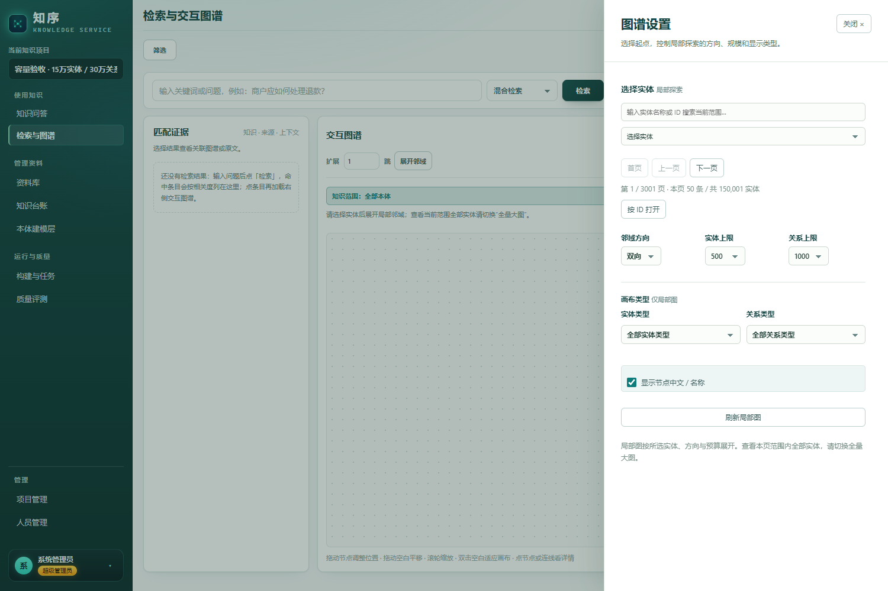

### 失败与恢复

拖动未平移时确认是背景还是节点；空图先核对实体范围和被删除状态。路径未找到时先确认端点都已加载、边方向和规模上限，再扩大明确范围或重新探索，不能报作全库断联证明。

### 下一步

需要加载当前范围全部实体时用 [全量大图](#chapter-21)；需要修改事实读 [台账 CRUD](#chapter-15)。

<a id="chapter-21"></a>
## 21｜全量大图、定位与不完整状态

### 场景

需要在同一画布加载当前范围的全部实体与关系，观察大规模分布，再定位具体记录。

### 为什么与何时

全量模式有明确清单、固定水位和分页会话。图上标签可以少显示，但不能据此偷偷减少实际实体加载量。大图渲染与全库检索性能分别验收。

### 前置身份与条件

浏览器支持当前 WebGL 能力；服务可创建图谱会话。先确认项目与检索页范围。大规模数据会占用浏览器与服务器资源，应依据实测硬件边界使用。

### 操作步骤

1. 在“检索与图谱”选择“全量大图”。
2. 点击“加载首批关系”，先核对清单，再加载一批关系及其同范围端点；有关系时首屏即可查看连线。默认首批 400 条，每批最多 500 条，不先等待全部实体。没有关系的范围直接按批显示实体。
3. 首批完成自动暂停，画布可以平移、缩放和查看详情。点“下一批”单次增量显示；点“自动继续”补齐所有关系，再补齐实体（含孤立实体）；点“本批后暂停”在当前批结束后停止后续批次，之后可继续。只有两个流都结束、实体和关系数分别与清单相等，且显示“全量加载完成”，才是该会话清单完整图。
4. 拖动平移、滚轮缩放，使用“适应画布”或双击空白处调整视野；按需开关关系线。
5. 输入真实实体名称/实体 ID 定位；关系可按关系 ID 定位。点击记录查看同一知识详情、来源和历史，管理员可按修订守卫编辑。
6. 暂停保留会话与加载位置；“取消加载”结束本次加载，“重新开始”重新核对清单并从首批开始。切换项目、改变范围或返回局部模式后，重新确认范围并发起新会话。全量模式隐藏只作用于局部图的预算、类型和路径控件，保留本页 Metadata、时间与本体范围。
7. 在线容量测试：从“项目管理”进入“容量验收 · 15万实体 / 30万关系（保留测试）”，清除本页范围后加载全部。应核对 150,001 个实体和 300,000 条关系。按“真实大库编辑验收实体”检索，可查看详情、修订历史并测试保存；每次保存会新增修订。该项目已保留在主应用，不需要另启测试服务。合成数据和同类复用的真实模型向量用于容量测试，不用于评判业务语义相关性。

### 正确结果

清单总数与实际加载数对齐，关系端点完整。未完成、取消、会话过期、网络中断或 GPU 上下文失败时明确提示，不能把局部图或采样图称为全量完成。标签数量独立于实体数量。

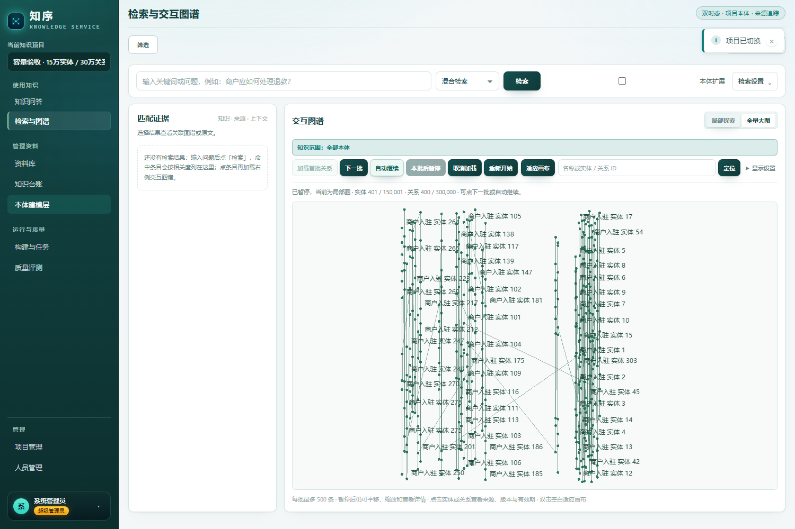

### 失败与恢复

暂停时可继续；取消后当前图不完整，重新开始才能核对新清单。会话/水位失效时创建新会话；网络或 GPU 错误按诊断重试并重新检查计数。定位只查已加载部分，未命中时可继续加载或用全库检索查 ID。显示设置可开关关系线；稀疏图直接绘制关系，密集图使用关系缓存。不要通过隐藏关系线把“关系完整性”判为已经完成。

### 下一步

真实容量测量和未达目标请读 [验收边界](#chapter-27)。局部解释与路径使用 [上一章](#chapter-20)。

<a id="chapter-22"></a>
## 22｜抽取质量评测与标准答案

### 场景

想知道某批资料抽取出了多少应有实体与关系，而不是只看抽取数量多不多。

### 为什么与何时

抽取评测按名称与关系三元组精确比对，precision、recall、F1 解释命中、误项与漏项。它不能替代人工证据审核，也不是问答效果实验。

### 前置身份与条件

管理员；已选择待评项目，并准备与该项目对应的标准答案。抽取评测使用它自己的全项目范围，不继承别页隐藏筛选。

### 操作步骤

1. 进入“质量评测”，选择“抽取质量评测”。
2. 用“载入示例”了解格式，再替换成自己的标准答案；实体用名称列表，关系用 `[主体名称, 谓词, 客体名称]`。
3. 点击“执行评测”，查看实体/关系各自 precision、recall、F1、匹配和漏项。
4. 对漏项回到原文核对，是解析缺失、抽取漏掉、待审核未写入，还是名称/关系表达不一致。
5. 修正数据或抽取设置后，用同一份标准答案再运行并记录比较条件。

```json
{"entities":["商户","平台"],"relations":[["商户","onboards","平台"]]}
```

### 正确结果

显示真实计算结果和实际匹配对象。评测只读，不改本体或知识。示例标准答案应被替换，否则分数只说明与示例是否相符。

### 失败与恢复

JSON 格式错误、缺少数组先修输入。低分先检查精确名称和三元组方向，再定位处理/审核环节；不要只调模型让名字看似匹配。空分母按服务结果解释，不自行填成满分。

### 下一步

想比较检索、图上下文与本体辅助，进入 [检索与问答消融](#chapter-23)。

<a id="chapter-23"></a>
## 23｜真实检索与问答消融实验

### 场景

用固定题集判断本体辅助、图关系和结构化检索是否改善当前项目的回答依据。

### 为什么与何时

只隐藏图形不等于消融。实验必须真实省略对应检索/上下文阶段，并保存固定输入、逐题命中、证据、策略和耗时，才能解释差异。

### 前置身份与条件

管理员；项目知识稳定。语义/混合需要 Milvus；生成回答需要已配置模型。题目标准依据必须填写真实记录 ID；标准答案用于文本精确匹配，不是语义裁判评分。

### 操作步骤

1. 进入“质量评测 → 检索与问答消融”，填写实验名称与固定题集。可每行一个问题，或填写带 `id`、`query`、`expected_record_ids`、`expected_answer` 的 JSON 数组。
2. 选择关键词、语义或混合，设置实体预算、原文预算和关系跳数。实验 Metadata / 时间范围单独填写，默认全项目。
3. 勾选比较变体：基础 Local / OAG、仅文档、去图关系、去本体辅助、去图关系＋本体辅助。逐项阅读实际省略阶段。
4. 需要答案时勾选“调用已配置模型生成回答”，再“创建并运行固定实验”。
5. 在运行记录打开本次实验，查看固定 manifest：本体发布身份、知识/来源水位、索引代次可知状态、模型/编码器/提示词身份、预算和随机性配置。
6. 展开逐题记录，核对 `omitted_stages`、实际策略、命中、证据引用、错误与耗时；查看依据召回与答案精确匹配的评分题数。
7. 运行中可取消；失败或取消后“重试未完成项”。结果有效时导出 JSON，保留逐题证据，比较前确认输入仍可重现。

| 变体 | 实际省略内容 |
| --- | --- |
| 基础 Local / OAG `basic` | 执行本次配置允许的检索、本体辅助与图上下文 |
| 仅文档 `document_only` | 省略实体/关系结构化检索、本体辅助和图邻域，只用原文切片 |
| 去图关系 `no_graph` | 省略图邻居与路径收集，保留允许的实体与原文检索 |
| 去本体辅助 `no_ontology` | 省略术语扩展、类型标签解析及相应本体辅助，治理资格仍检查 |
| 去图关系＋本体辅助 `combined` | 同时省略图邻域、路径、查询扩展和类型标签解析 |

### 当前界面

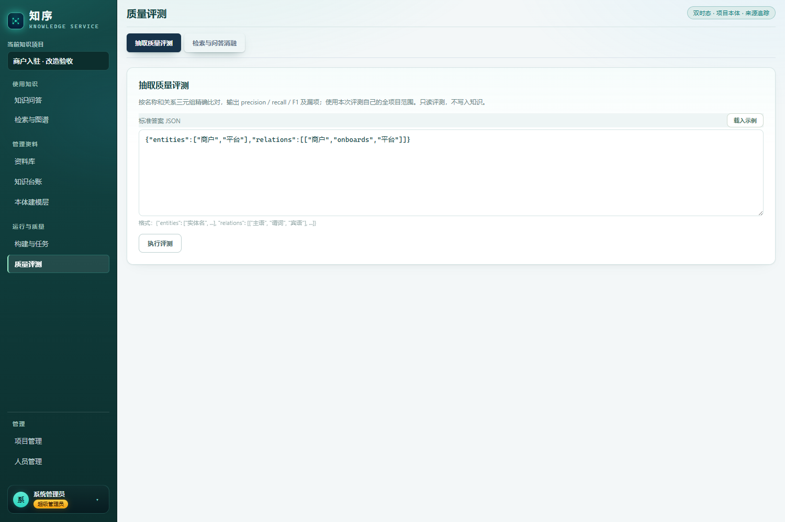

读图时先核对项目与当前对象，再看本章所述操作入口；操作后以服务回执和对应列表/详情变化判断结果。截图取自真实应用的隔离验收项目，示例数据用于说明布局。

### 正确结果

每个变体有真实执行收据。未提供标准项显示“未评分”；模型不可用时保留实际检索证据、说明未生成，答案不评分。失败项不伪装为零分成功题。

### 失败与恢复

Milvus/编码器不可用时语义和混合变体记录失败，不自动关键词补跑。来源、权限、知识水位变化使固定输入失效时，读取/重试/导出可能拒绝，按新状态创建新实验；不要为保留旧分数暴露已经不可访问的证据。

### 下一步

用差异定位 [检索](#chapter-18)、[图证据](#chapter-19) 或 [抽取审核](#chapter-10) 问题；社区 Global/DRIFT 不属于本实验已支持变体。

<a id="chapter-24"></a>
## 24｜后台任务、索引修复与派生投影同步

### 场景

资料已入库但语义检索不可用，发布后的索引仍待处理，或者需要核对外部图谱副本。

### 为什么与何时

任务与索引是派生处理状态。任务完成、Milvus collection 可连接、记录已正式写入和索引覆盖当前水位不能互相替代。Neo4j 副本不替代 PostgreSQL 权威版本与审计。

### 前置身份与条件

管理员；服务与依赖连接正常。当前 Docker 包含 PostgreSQL、Milvus、etcd、MinIO、Attu；Attu 是 Milvus 管理工具，能打开它不能证明项目索引已一致。外部图投影需要另行配置真实连接。

本次存储调整后，Docker 运行数据使用 Linux 命名卷：`knowledge_service_postgres_data` 保存权威数据库，`knowledge_service_etcd_data` 保存 Milvus 元数据，`knowledge_service_minio_data` 保存 Milvus 持久段与索引对象，`knowledge_service_milvus_data` 保存 RocksMQ 日志与运行文件。重建容器继续挂载这些卷；上传原文与来源产物仍按应用的来源存储配置管理，不等于存进 Milvus。旧 Windows 数据目录保留为停机复制时的回退副本，后续新增数据以当前挂载卷为准。迁移与核验结果见改造验收记录。

现有 Windows bind 数据的停机、复制、校验和回退步骤见 [Docker Linux 数据卷迁移指南](2026-10-19-Docker-Linux-volume-migration.md)。已有数据的部署先按该指南迁移，再用新版 Compose 启动；单纯挂上新建空卷不会自动带入旧数据。

### 操作步骤

1. 进入“构建与任务”，先看“项目概览”，再到“后台任务”核对任务种类、状态、阶段、日志和任务 ID。
2. 对资料批次使用其批次控制；对普通任务只使用当前状态允许的取消、重试、重新排队。取消在检查点生效，已提交知识保留。
3. 首次检索或明确需要重建时，从项目的向量化入口提交任务；确认 embedding 模型输出维度与 Milvus 配置一致。已有就绪索引的普通新数据走增量，不必每次全量重建。
4. 在索引状态中核对本体索引/语义索引任务、发布水位与覆盖状态；出现可修复提示时运行真实核验/修复或任务重试，再刷新状态。
5. 高级管理员可读 `GET /api/projects/{p}/ontology-index`；按真实诊断调用 `POST /api/projects/{p}/ontology-index/repair` 或对应失败任务 `/retry`，不凭按钮禁用状态推断已幂等完成。
6. 需要 Neo4j 副本时使用“检查连接”“当前项目同步状态”“同步当前项目”，等待实际同步任务，再检查两边一致性回执。
7. 回到原查询重试，确认实际策略与索引状态，不只看任务绿灯。

普通编辑仍按“保存正式知识 → 后台增量同步 → 检查索引覆盖”操作。增量回执现逐条保存，不再因编辑一条记录而重写全项目清单。首次构建仍需明确发起；索引构建中不会显示为已就绪。外部调用期间不占用业务写事务，失去任务租约后停止后续投递与水位确认。删除项目后，向量清理有持久重试，迟到的旧代写入也会再次清理。这些调整不要求重新上传已有资料或重建所有项目。

若容器重建或迁移后项目、文件或 collection 看起来为空，先核对容器实际挂载的卷、数据库名称和配置的 collection，再核对迁移前后数量；不要用重复上传掩盖挂错存储。页面里的“知识备份”不包含这些 Docker 数据卷，其边界见第 24 章。

### 当前界面

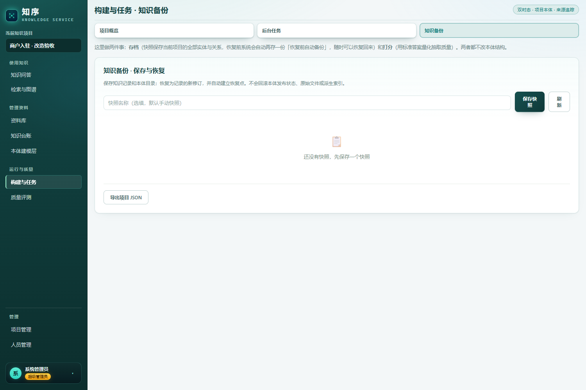

读图时先核对项目与当前对象，再看本章所述操作入口；操作后以服务回执和对应列表/详情变化判断结果。截图取自真实应用的隔离验收项目，示例数据用于说明布局。

### 正确结果

任务状态、日志与业务结果能对应。派生失败不改写权威事实；语义索引不一致时请求明确失败。Neo4j 同步结果可核对项目范围，不宣称它自动接管全部检索与历史。

### 失败与恢复

先区分服务不可达、模型不可用、维度不一致、索引缺失/陈旧、任务失败。修复配置后针对失败任务重试，避免无目的重建所有投影。重启后持久任务按租约机制恢复领取，不等于任何中间输出都已提交。清理失败保留任务 ID 交管理员复核。

### 下一步

业务记录恢复看 [备份](#chapter-25)；容量与运行边界看 [验收说明](#chapter-27)。

<a id="chapter-25"></a>
## 25｜知识备份与导出

### 场景

变更前留恢复点、导出知识记录，在需要时恢复为新的事实修订。

### 为什么与何时

知识快照恢复会生成记录的新修订。它不会回滚本体发布状态、原始文件或向量/图投影，因此不能称为整个系统的一键回滚。

### 前置身份与条件

管理员；明确备份或恢复目标项目。重要生产操作应保留原始文件、导出结果与服务管理的数据库备份；本章快照不代替基础设施备份。

### 操作步骤

1. 从“构建与任务 → 知识备份”，或项目设置的“知识备份”进入；填写名称，点击“保存快照”，刷新确认快照 ID 和时间。
2. 恢复时选准确快照，阅读确认。系统恢复前自动建立“恢复前自动备份”，再把快照内容恢复为记录新修订。
3. 恢复后在台账与操作历史核对记录、删除状态及修订，按真实状态重建派生索引。
4. 点击“导出项目 JSON”，保存导出文件。导出内容的实际清单为准，不假定包含所有原始文件、账号、外部索引和运行配置。

### 正确结果

快照可查，恢复后是新的事实 rN，恢复前自动备份保留。导出 JSON 用于离线留存；恢复使用系统保存的快照。

### 失败与恢复

恢复结果不符合预期时核对恢复前自动备份，再按其流程生成新修订恢复。旧目录不可读或格式不符合先修服务可识别路径与格式。原始文件缺失和本体发布回退须分别处理，不能靠记录快照补全。

### 下一步

用 [版本实例](#chapter-26) 核对恢复后的身份，再执行 [索引核验](#chapter-24)。

<a id="chapter-26"></a>
## 26｜用一个实例理解文档、本体、事实与索引版本

### 场景

同事说“我已经升级到 v3”，但台账还是旧本体，或者回答用了旧文档，需要准确沟通是哪一种版本。

### 为什么与何时

平台没有一个能代表所有内容的“项目 vN”。版本属于不同对象：文档修订、本体发布、事实修订与派生索引代次各有用途。

### 前置身份与条件

能读取项目记录和历史；示例 ID 为解释性代号，操作时换成真实身份。系统历史时间与业务有效时间另行维护。

### 操作步骤

1. 在资料修订记录查看文档 `doc-refund` 的 r1；记录原文固定版本 ID，例如 `src-A`。r2 是该文档记录的新修订，来源原始对象版本另有身份，不能只记文件名。
2. 在版本管理记录本体 `v2 + 发布 ID ont-A`。若另一次标注发布仍叫 v2，但 ID 是 `ont-B`，它是另一个明确发布身份。
3. 在台账记录事实 `merchant-001 r1` 使用 `ont-A`；来源断言指向文档 r1/固定原文版本 `src-A`。
4. 发布 `v3 + ont-C` 后检查事实：未迁移时 `merchant-001 r1` 仍归属 `ont-A`，不会自动变成新类。
5. 受控迁移生成 `merchant-001 r2` 并明确本体依据 `ont-C`；手工纠正名称再生成 r3。恢复 r1 的内容也要生成 r4，而不是删除 r2/r3。
6. 查看 Milvus 索引记录的代次/水位，如已知的 `generation G7` 覆盖到哪个知识水位。未知代次显示未知，不能从任务完成时间猜出 G7。
7. 重现某次回答时同时保存提交范围、业务时点、系统历史时点、证据事实 rN、文档固定版本及本体发布 ID，再核对索引策略。

| 对象 | 示例 | 改变它的操作 | 不会自动发生的事 |
| --- | --- | --- | --- |
| 文档记录修订 | `doc-refund r1 → r2` | 已支持的记录修订/处理 | 不等于第二阶段逻辑来源换版与撤回协议已完成 |
| 本体发布 | `v2 + ont-A → v3 + ont-C` | 草案校验、审核、发布 | 不自动迁移旧事实 |
| 事实修订 | `merchant-001 r1 → r2 → r3` | 迁移、编辑、融合、恢复 | 不覆盖审计历史 |
| 索引代次/水位 | `G7 / knowledge watermark` | 派生构建、修复 | 不成为业务事实权威 |
| 任务 | `job-123` | 某次处理的执行 | 任务 ID 不是文档或知识版本 |

### 正确结果

能够准确表述“事实 r3 挂在 ont-C，依据来自文档 r1 的 src-A；索引覆盖水位已经核验”。历史查看和新发布分别可追踪。

### 失败与恢复

只有“v3”或文件名无法定位时，从版本管理、事实历史和冻结引用补齐 ID。索引未知不自行填值；来源缺失按证据不可用处理。发现归属旧版时先预演迁移，再决定是否应改业务类型。

### 下一步

疑难情况按 [排错与边界](#chapter-27) 检查；技术人员使用 [入口/API 对照](#chapter-29) 复核。

<a id="chapter-27"></a>
## 27｜当前支持边界与容量证据

### 场景

某个入口看起来正常但结果不对，或需要判断“15 万实体支持”是否已经完整验收。

### 为什么与何时

可见入口、服务已实现、实际环境通过验证和容量目标是不同事实。故障排查应从真实阶段与身份开始，验收必须保留未达目标。

### 前置身份与条件

准备当前项目、页面、提交时间、问题/任务/草案/记录 ID、当前角色和公开错误码。不要把口令、令牌或未脱敏连接串粘进工单。

### 操作步骤

1. 无数据先看项目、页面筛选、业务/历史时点、正式/候选状态与被删除状态，再查看来源资格。
2. 有原文无图谱先看上传模式；仅文档是正常无图谱，开放候选需要治理，受控结果可能仍在审核。
3. 改本体后知识未变，先看事实本体归属；需要迁移时预演并执行，业务重分类由明确事实编辑决定。
4. 语义/混合失败按 embedding 模型、Milvus 连接、维度、索引覆盖和实际策略检查；无本地向量回退或自动关键词降级。
5. 草案操作 409 时核对 expected revision 与发布基线；不可编辑先确认是否历史预览；发布灰色读发布清单。
6. 大图先看 manifest 总数与已加载数，再看绘制、定位、帧间隔、内存与长期稳定性；不能用标签数量、总 records 或局部图证明实体容量。
7. 用下表区分已提供的功能和独立后续阶段，按实际环境报告限制。

| 范围 | 当前口径 |
| --- | --- |
| 现有记录与来源 | 保留文档/事实修订、固定原文、断言血缘及审核；原有软删除与恢复按服务执行 |
| 精确来源 revision manifest | 独立第二阶段；未提供按选定文档 rN 固定候选输入的完整提交协议 |
| 逻辑来源新修订/撤回 | 独立第二阶段；不把现有记录删除冒充完整来源失效流水线 |
| 跨草案合入 | 独立阶段；现有草案选择、关闭和基线对齐不等于跨草案 merge |
| 项目成员 ACL | 独立阶段；系统角色不提供按成员限制某项目访问 |
| 社区 Global / DRIFT | 独立后续阶段；当前 Local/OAG 不等于社区报告、全局聚合或 DRIFT 已实现 |
| 任意格式本体/任意 JSON 恢复 | 只按现有 Turtle 差异与系统快照契约使用，不推导为通用导入 |

### 正确性与存储核验补充（2026-10-22）

正式库已迁移到 schema 26；迁移前后 12 个项目的当前记录计数、两个现有 G2 索引的模型/水位，以及 42 条投递回执的版本与指纹保持一致。真实认证 API 与独立 PostgreSQL 差分共 74 项通过，覆盖列表、详情、小图完整身份与端点、三种 Milvus 检索、Metadata 正反条件、问答冻结版本/来源和容量项目抽样内容。提交前重点后端回归 81 项、前端回归 438 项通过。

本轮没有重新认证性能 P95。真实问答引用可追溯，但示例材料仍有不确定状态，不能当作有效业务答案质量通过；全量旧测试也尚未全部适配通过。具体证据、失败记录和剩余能力见 [生产改造检查点](research/2026-10-22-production-checkpoint.md)。下面的性能数字仍是 2026-10-21 的独立测量。

### 性能实测与可在线测试的范围（2026-10-21）

本轮已删除 Milvus 的 16 个 `bf_` 自动扩展列，当前只保留 21 个明确字段。两个普通项目已显式构建到第 2 代，Strong 查询有效记录数为 37、5，水位追平。正常服务的健康检查为 ok，真实语义编码后 `/readyz` 返回 200。当前关键词、语义、混合检索均由 Milvus 执行，无降级。

保留项目仍为“容量验收 · 15万实体 / 30万关系（保留测试）”，150001 个实体、300000 条关系。进入知识台账搜索“真实大库编辑验收实体”，可测试详情、文字修改与历史；每次保存增加版本。本轮修改/恢复后原文保留，探针版本为 41。图谱中选择关联实体可输入 1、3、10 跳测试。该项目本轮未向量化，检索页的索引状态与台账/图谱可用性分别理解，不能据此误判权威数据不存在。

| 本轮实测 | 样本与结果 | 使用时如何理解 |
| --- | --- | --- |
| 大库普通实体文字修改/恢复 | 20 次 PUT 全成功，P50 2.65 s、P95 5.24 s、最大 5.93 s | 包含首次操作，保留 CAS/事务/来源治理；复杂 SHACL、改类型/来源/本体等仍完整校验，不承诺同样速度 |
| 修改期间的分页/详情 | 仅统计与真实 PUT 重叠的 141 / 140 次请求，P95 0.172 / 0.108 s，零失败 | 说明本轮读取可继续进行，不表示所有并发冲突都已消除 |
| 大库台账分页/详情 | 各 20 次暖态，P95 0.040 / 0.034 s | 每页 20 条；台账关键词定位另为 P95 1.207 s |
| 大库双向 1 / 3 / 10 跳 | 各 20 次暖态，P95 0.125 / 0.169 / 0.550 s | 已修复重复调用后执行计划退化；代表性种子、500 节点/1000 边预算，不代表任意高连接度节点 |
| 大库全图清单 | 20 次暖态，P95 2.115 s | **未达到 2 秒目标**，不能称全部性能指标通过 |
| 完整 HTTP 图谱枚举 | 单次 29.468 s，实体 16 页、关系 30 页；无重复 ID、无缺失端点 | 只证明接口完整枚举；只有一次样本，**不代表浏览器绘制时间、P95 或浏览器完整加载 30 秒目标通过** |
| 普通项目当前检索 | 37 条项目各模式 20 次，关键词/语义/混合暖态 P95 0.241 / 0.567 / 0.570 s | 含语义查询编码；首次语义预热 43.156 s 含冷模型加载；**不能作为 15 万实体向量检索验收** |

此次写测和读测的 PostgreSQL 采样均未捕获阻塞会话或未获准锁；主机可用内存最低约 10 GiB。采样间隔中的短等待仍可能存在。编码模型加载后服务 RSS 约 3 GiB、主机可用约 7.42 GiB，不能将 pagefile 已用值当作实时换页证据。全部原始样本、修复原因、遗留限制和既有 xfail 见 [固定字段与容量复测报告](research/2026-10-21-fixed-fields-and-capacity-report.md)。下面保留的较早诊断描述当时状态；当前普通文字修订优先参考本节，复杂写入性能仍需分别评估。

**较早的容量测量（2026-10-19）：** 原始夹具含 150,000 个实体，以下为当时的独立测量，保留作历史对照。2026-10-21 固定字段调整后，保留容量项目的权威数据仍为 150,001 实体 / 300,000 关系，当前未向量化；两个普通项目分别有 37、5 条 Milvus 记录。不要用下表的旧向量夹具数字推断当前容量项目已有索引，也不要把普通项目的检索延迟当作 15 万实体的向量检索验收。

| 测量范围 | 实际结果 | 使用时如何理解 |
| --- | --- | --- |
| 隔离绘图层：15 万实体、100 万关系 | 构造及首次绘制 3.39 s，帧间隔 P95 17.1 ms，拾取 P95 0.8 ms | 证明绘图层实际处理该数量；不代表数据库到产品的加载时间 |
| PostgreSQL：15 万实体、30 万关系 | 45 页完整枚举 20.19 s；无重复 ID | 证明权威数据分页与计数；尚不含浏览器传输和显示 |
| Milvus：45 万条逻辑记录 | 模型身份与数量核对通过；暖态原生 semantic / hybrid P95 0.271 / 0.278 s | 此引擎计时不含查询编码；物理索引当时仍在构建 |
| 真实产品 HTTP 检索 | 同一长测中含查询编码的 semantic / hybrid 暖态 P95 1.031 / 1.484 s | 使用真实 Milvus，没有本地向量或自动关键词替代 |
| 真实产品全图：15 万实体、30 万关系 | 与回归共享宿主资源时，五轮首次可见 P95 1.585 s，完整加载 P95 46.906 s | 清单、唯一 ID、端点和实际绘制均完整；30 s 完整加载目标未通过 |
| 真实产品另五轮：150001 实体、30 万关系 | 无 pytest 并行时，首次可见 P95 18.301 s，完整加载 P50 28.218 s、P95 48.187 s | 包含长测新增的正式实体；计数、内存与 Milvus 检索正确，30 s 完整加载目标仍未通过 |
| 真实产品长稳与共享编辑 | 1871 s、72 次交互采样；帧 P95 最大 16.8 ms，实际点击进入详情 P95 188 ms，浏览器 RSS 峰值 2.786 GiB，无脚本错误 | 经过项目/本体范围/局部与全量切换；真实创建和修订产生两版历史，旧会话 409，重载后完整绘制 150001 实体 |

真实长测的单条正式创建和保存分别耗时约 230 / 226 s。移除重复规划快照、全图 JSON 往返和复制后，无 pytest 或其他浏览器并行的一次普通修订对照为 144.093 → 125.454 s；事务、完整指纹和执行时的新权威快照仍保留。**大库正式写入仍然偏慢**，这组单次对照不能作为 P95 或普遍加速承诺，详细条件见 [正式写入测量](research/2026-10-19-governed-write-latency.json)。高级 Metadata 筛选单次样本为 8.62 s，冷模型首批编码为 88.58 s，不能用默认暖态检索代表这些阶段。规模语料是合成实体与关系，重复使用真实配置模型的向量，不能证明业务语义质量。1k/10k/50k 梯度与 100 万边目前是独立绘图层测量；不能把其中一项代替整个平台的容量结论。完整记录见 [改造验收记录](research/2026-10-19-redesign-acceptance.md)。

**2026-10-20 渐进加载补充：** 保留容量项目的一次主应用实测，首批 401 实体 / 400 关系约 16.65 s；之后暖态独立首批复测约 2.20 s。首批关系线像素核对通过，下一批、暂停保留位置及继续通过。完成全部关系及孤立实体核对约 219.30 s（包含手动操作与轮询等待），最终 150,001 实体 / 300,000 关系、无缺失端点、无脚本错误。该模式用于提前交互，细分页增加完整扫描开销；**不表示完整加载 30 s 目标已通过，也不代表 P95**。具体证据见 [渐进图谱验收](research/2026-10-20-progressive-graph-delivery.md)。

### 主应用实测补充（2026-10-20）

“项目管理”中已保留“容量验收 · 15万实体 / 30万关系（保留测试）”。进入后可加载 150,001 个实体、300,000 条关系，在知识台账搜索“真实大库编辑验收实体”测试受本体治理的编辑；每次成功保存都会增加修订。该合成夹具用于容量测试，不能作为业务语义相关性基准。当前未向量化的状态不影响台账、详情及图谱操作；检索页的 Milvus 查询需先显式向量化，本次不会自动为该项目执行。

同一主应用本次单条正式修改返回 200，用时 102.888 秒；规划与执行两次全项目快照合计 64.179 秒，历史时间戳预留 13.090 秒，暖态编码 0.289 秒，提交后投影推进 12.211 秒。主要问题是单条治理操作仍处理全项目数据。141 个 PostgreSQL 样本未见锁等待或阻塞，采样存在间隔，不能排除短暂等待，也不能承诺并发无风险。

本次完整图单次加载 77.516 秒、首次可见 5.413 秒。仓储 RLock 等待累计 32.725 秒，最慢实体页 26.657 秒中有 26.256 秒在等应用内部锁。持锁者未捕获，不能称为数据库锁表或直接归因 Milvus。JSON 解析约 0.446 秒、布局往返约 0.180 秒，都不是本次主要耗时。

主机 CPU 与内存压力可能放大延迟，仍需受控对照；当前 30 秒全图目标未通过，单条修改也仍慢。以上均为单次阶段诊断，不能作为 P95 或相对前一天的提速承诺。具体数据、限制和优化顺序见[主应用容量诊断](research/2026-10-20-main-capacity-diagnosis.md)。

### 正确结果

问题被定位到具体阶段和对象，恢复操作与状态相符。对独立阶段功能没有可执行假步骤；对未通过的容量目标保留真实测量值。

### 失败与恢复

仍无法定位时记录最小复现：项目、范围、真实 ID、输入、错误、时间、期望和实际结果。由管理员核对任务日志与已脱敏诊断；不要以清空项目、重传全部资料或重建所有索引作为默认恢复办法。

### 下一步

技术复核使用 [入口与 API 映射](#chapter-29)，跟踪 [验收记录](research/2026-10-19-redesign-acceptance.md) 的新测量。

<a id="chapter-28"></a>
## 28｜按现象排查：从当前对象恢复工作

### 场景

上传后找不到知识，保存或发布卡住，检索无结果，或者大图只显示了一部分。需要找到当前失败阶段并保留已有工作。

### 为什么与何时

相同的空列表可能来自项目选错、隐藏筛选、候选尚未治理、来源失效或索引未完成。先识别对象与阶段，才能选择重试、重新预演、修订或任务恢复，避免重传与重复写入。

### 前置身份与条件

记录当前项目、角色、时间、页面范围和对象 ID（批次/文档/候选/草案/发布/任务/事实）。只保留公开错误与脱敏诊断；不提交令牌、口令或原始连接串。

### 操作步骤

1. 先确认服务能连接、账号有效、项目正确；清楚本页是否应用 Metadata、业务时点、系统历史、正式版本或删除状态筛选。
2. 用下表找到最早未完成的阶段，打开对应对象详情和真实回执，先核对已经成功的部分。
3. 对结果未知的写入先查询对象与回执；同一客户端请求重试沿用身份。内容或目标改变后视为新意图，重新预演，不复用陈旧确认。
4. 恢复后从该阶段向后验证一次：原文、事实、索引、检索和引用各看自己的结果，不需要重跑无关阶段。

| 看到的现象 | 先核对什么 | 恢复动作 |
| --- | --- | --- |
| 有原文，没有实体/关系 | 本批是否仅文档；开放候选是否待治理 | 仅文档是正常结果；开放候选走路径 B；受控待确认去知识审核 |
| 批次部分失败 | 逐文件/逐切片错误、申请与实际并发、模型/OCR | 修原因后从断点继续或只重试失败切片；配置变化按规则整份重处理 |
| 预演成功，草案没有变化 | 是否真正点“加入本轮修改”，目标草案 ID 是否一致 | 预演不落库；核对后明确保存，未知响应先查回执 |
| 有多份草案，不知写到哪 | 当前明确选择、修订、正式基线 | 先选正确目标；不以第一份或最新列表顺序猜测 |
| 409 / 预演过期 | 修订、基线、来源和选择是否变化 | 刷新并重新预演/审核；保留原工作，按冲突诊断处理 |
| 已保存但画布未刷新 | 服务回执和草案操作是否已存在 | 重读同一草案；不重复新增；审核条件可单独重试 |
| 发布后部分事实跳过 | 最终批准结构、缺失依赖、来源和映射 | 按逐项回执修正；未选或未获准事实不会自动补写 |
| 手动发布后旧候选仍在 | 是否明确加入过候选范围 | 用新正式版本重新核对，再显式复用确认；手动发布不扫积压 |
| 语义/混合检索失败 | embedding、Milvus、维度、索引覆盖、任务 | 恢复模型或索引；明确报错，不自动关键词降级或本地向量回退 |
| 问答没有有效依据 | 范围、时点、来源资格、最终依据校验 | 核对检索和冻结原文；无有效依据时保留无法回答的结果 |
| 全图只有部分节点/关系 | manifest、已加载数、暂停/取消/截断状态 | 继续加载或重建该会话；不把可见标签数当完整实体数 |
| 编辑冲突或撤销失败 | 最新记录修订和后续依赖操作 | 查看冲突比较，重载后重新决定；不覆盖他人的新修订 |

### 正确结果

能指出失败的对象、阶段和错误，并保留此前成功的原文、草案、事实或审计。恢复后真实回执与页面一致；不会为了消除提示而清空项目或伪造“通过”。

### 失败与恢复

仍不能定位时提供最小复现：项目与对象 ID、输入、时间、角色、范围、期望和实际结果、脱敏错误。管理员按 [基础设施维护](2026-10-01-Docker基础设施维护手册.md)、[解析日志定位](解析日志定位.md) 和任务日志继续检查，不默认重建全部索引或重传全部资料。

### 下一步

支持和容量限制见 [当前边界](#chapter-27)，技术集成与协议核对见 [入口/API 映射](#chapter-29)。

<a id="chapter-29"></a>
## 29｜入口与 API 映射：复核和集成查阅

### 场景

管理员或集成人员需要把手册步骤对应到真实页面、服务协议和源码，确认某个结果究竟由哪里负责。

### 为什么与何时

界面说明不能代替服务契约。下面按章节提供主要入口和 API；`{p}` 代表真实项目 ID，`{id}` 等参数应替换为真实对象身份。请求模型以正在运行服务的 `/openapi.json` 为准。

### 前置身份与条件

持有自己的有效会话与相应权限。高级 API 操作遵从与页面相同的权限、范围、时态、修订和基线守卫。

### 操作步骤

1. 在下表找到对应任务章节，先从页面完成可见操作。
2. 核对返回对象、ID、revision 和状态；需要集成时按当前 OpenAPI 请求模型构造请求，不复制示例假 ID。
3. 复核源码时使用表中的文件链接，查看当前 worktree 的实现。接口存在不自动证明环境中的模型/索引可用。

| 章节 / 用户入口 | 主要 API | 实现依据 |
| --- | --- | --- |
| 01 工作区地图 / 项目选择 | `GET /api/projects`；`GET /api/auth/me` | [导航](../knowledge_service/web/menu-hierarchy.js)、[页面上下文](../knowledge_service/web/workspace-context.js) |
| 02 个人账号 / 人员管理 | `POST /api/auth/login`；`GET /api/auth/me`；`POST /api/auth/password`；`GET/POST /api/users`；`PATCH/DELETE /api/users/{user_id}` | [用户路由](../knowledge_service/api/users.py)、[认证路由](../knowledge_service/api/auth.py)、[人员界面](../knowledge_service/web/user-admin.js) |
| 03 项目管理 / 项目切换 | `GET/POST /api/projects`；`GET/PUT/DELETE /api/projects/{project_id}` | [项目路由](../knowledge_service/api/projects.py)、[项目界面](../knowledge_service/web/projects-view.js) |
| 04 第一份资料路线 | 沿下列 05–19 章依次调用批次、来源、草案、审核、索引、检索和问答服务 | [结果后续导航](../knowledge_service/web/knowledge-navigation.js)、[抽取结果](../knowledge_service/web/ingest-results.js) |
| 04–08 添加文件 / 上传批次 | `GET /api/ingest/capabilities`；`POST /api/projects/{p}/ingest-batches`；`POST /api/projects/{p}/ingest-batches/{batch_id}/files`；`POST /api/projects/{p}/ingest-batches/{batch_id}/{action}` | [批次 API](../knowledge_service/api/parity.py)、[批次界面](../knowledge_service/web/ingest-batches.js) |
| 09 资料库详情 / 固定原文 | `POST /api/projects/{p}/sources`；`GET /api/projects/{project_id}/assertions`；`GET /api/projects/{project_id}/ingest-runs`；`GET /api/projects/{project_id}/source-documents/{version_id}` | [资料界面](../knowledge_service/web/sources-view.js)、[原文 API](../knowledge_service/api/source_documents.py) |
| 09 证据 / OCR | `GET /api/projects/{p}/assertions/{assertion_id}/evidence`；`POST /api/projects/{p}/records/{record_id}/evidence`；`POST /api/projects/{project_id}/source-documents/{version_id}/assets/{asset_id}/ocr/retry` | [证据 API](../knowledge_service/api/evidence.py)、[阅读器](../knowledge_service/web/source-reader.js) |
| 10 台账“知识审核” / 抽取结果审核 | `GET /api/projects/{p}/reviews`；`POST /api/projects/{p}/reviews/{doc_id}/{candidate_id}`；`POST /api/projects/{p}/ontology-change-proposals/{proposal_id}/decision` | [台账稳定入口](../knowledge_service/web/records-view.js)、[审核 API](../knowledge_service/api/reviews.py)、[事实审核界面](../knowledge_service/web/task-review.js) |
| 07 / 11 目录与手工建模 | `POST /api/projects/{p}/ontology-drafts/{draft_id}/commands`；`GET /api/projects/{p}/ontology/term-impact` | [目录](../knowledge_service/web/ontology-model-catalog.js)、[检查器](../knowledge_service/web/ontology-model-panel.js) |
| 06 待完善结构 / 候选读取 | `GET /api/projects/{p}/ontology-discovery/candidates` | [发现 API](../knowledge_service/api/ontology_discovery.py)、[候选写入服务](../knowledge_service/services/ontology_intake.py)、[选择抽屉](../knowledge_service/web/ontology-intake.js) |
| 06 只读预演 | `POST /api/projects/{p}/ontology-discovery/selection-preview` | 候选、来源、正式基线、目标草案与修订组成预演意图；不保存草案或事实 |
| 06 加入本轮修改 | `POST /api/projects/{p}/ontology-discovery/add-selection` | 保存目标草案操作与明确候选绑定，返回新修订及结构/待发布事实回执 |
| 06 仅复用正式术语写事实 | `POST /api/projects/{p}/ontology-discovery/confirm-reuse` | 明确逐候选正式 IRI，校验后写事实；不创建本体草案或发布 |
| 11 父类发现 | `POST /api/projects/{p}/ontology-drafts/{draft_id}/discover-parents` | [发现 API](../knowledge_service/api/ontology_discovery.py)、[本体主控](../knowledge_service/web/ontology-model.js) |
| 12 RDF / 校验 / SPARQL | `GET /api/projects/{project_id}/ontology`；`POST /api/projects/{project_id}/ontology/validate`；`POST /api/projects/{project_id}/sparql` | [知识 API](../knowledge_service/api/knowledge.py)、[目录源码入口](../knowledge_service/web/ontology-model-catalog.js) |
| 13 草案 / 审核 / 发布 | `GET/POST /api/projects/{p}/ontology-drafts`；`POST /api/projects/{p}/ontology-drafts/{draft_id}/validate`；`POST /api/projects/{p}/ontology-drafts/{draft_id}/decisions`；`POST /api/projects/{p}/ontology-drafts/{draft_id}/publish` | [草案 API](../knowledge_service/api/ontology_drafts.py)、[审核发布界面](../knowledge_service/web/ontology-model-panel.js) |
| 14 版本 / 术语恢复 / 迁移 | `GET /api/projects/{project_id}/ontologies`；`GET /api/projects/{p}/reclassify`；`POST /api/projects/{p}/reclassify/preview`；`POST /api/projects/{p}/reclassify`；`POST /api/projects/{p}/operations/{operation_id}/undo` | [迁移界面](../knowledge_service/web/ontology-model-reclassify.js)、[迁移服务](../knowledge_service/services/reclassify.py) |
| 15 台账整库查询 / 选择器翻页与 ID 定位 | `POST /api/projects/{p}/records/page`（范围、类别、query、cursor、limit）；`GET /api/projects/{project_id}/records/{record_id}`；`GET /api/projects/{project_id}/assertions`（canonical_record_id 与可重复 assertion_ids 查询字段） | [分页 API](../knowledge_service/api/graph_sessions.py)、[有界 SQL](../knowledge_service/repository/scoped_reads.py)、[台账](../knowledge_service/web/records-view.js) |
| 15 新增实体 / 新增关系 / 新增独立属性 | `GET /api/projects/{project_id}/ontology`（当前已发布目录与 ID）；`POST /api/projects/{project_id}/records` | [结构化创建与实体选择器](../knowledge_service/web/record-create.js)、[图谱详情入口](../knowledge_service/web/evidence-inspector.js)、[正式写入 API](../knowledge_service/api/knowledge.py) |
| 15 记录编辑 / 冲突比较 / 历史 / 删除恢复 | `PUT /api/projects/{project_id}/records/{record_id}`（expected_version）；`GET /api/projects/{project_id}/records/{record_id}`（冲突最新内容）；`GET /api/projects/{project_id}/records/{record_id}/history`；`POST /api/projects/{p}/delete`；`POST /api/projects/{p}/restore` | [知识 API](../knowledge_service/api/knowledge.py)、[共享编辑与比较](../knowledge_service/web/record-dialog.js)、[属性值校验](../knowledge_service/web/record-attribute-editor.js) |
| 16 查重 / 融合 / 消歧 | `POST /api/projects/{p}/resolve`；`POST /api/projects/{p}/aliases`；`GET /api/projects/{p}/duplicate-groups`；`POST /api/projects/{p}/merge/preview`；`POST /api/projects/{p}/merge`；`POST /api/projects/{project_id}/resolution-reviews/{review_id}` | [融合界面](../knowledge_service/web/entity-governance.js)、[治理服务](../knowledge_service/services/governance.py) |
| 17 本页范围 | `POST /api/projects/{p}/metadata/facets`；`GET /api/projects/{project_id}/applicability-values` | [范围状态](../knowledge_service/web/workspace-context.js)、[范围控件](../knowledge_service/web/workspace-context-ui.js) |
| 18 检索 / 19 问答引用 | `POST /api/projects/{project_id}/search`；`POST /api/projects/{project_id}/qa`；`POST /api/projects/{p}/qa/stream`；`GET /api/projects/{p}/answers/{answer_id}/evidence/{citation}/provenance` | [检索](../knowledge_service/services/retrieval.py)、[问答](../knowledge_service/services/answers.py)、[引用 API](../knowledge_service/api/provenance.py) |
| 20 局部图 / 脑图 / 路径 | `POST /api/projects/{p}/explore`；`POST /api/projects/{p}/entity-options`；`POST /api/projects/{p}/mindmap`；`POST /api/projects/{project}/graph-neighborhood` | [图谱工具](../knowledge_service/web/graph-workbench.js)、[局部路径](../knowledge_service/web/graph-paths.js) |
| 21 全量大图 | `POST /api/projects/{project}/graph-sessions`；`POST /api/projects/{project}/graph-sessions/{session_id}/page` | [全图 API](../knowledge_service/api/graph_sessions.py)、[全图渲染](../knowledge_service/web/full-graph.js)、[全图入口](../knowledge_service/web/full-graph-view.js) |
| 22 抽取质量 | `POST /api/projects/{p}/evaluate` | [评测 API](../knowledge_service/api/parity.py)、[工作区评测逻辑](../knowledge_service/web/workbench.js) |
| 23 检索与问答消融 | `GET/POST /api/projects/{project}/retrieval-experiments`；`GET /api/projects/{project}/retrieval-experiments/{run_id}`；`POST /api/projects/{project}/retrieval-experiments/{run_id}/cancel`；`POST /api/projects/{project}/retrieval-experiments/{run_id}/retry`；`GET /api/projects/{project}/retrieval-experiments/{run_id}/export` | [实验 API](../knowledge_service/api/retrieval_experiments.py)、[实验服务](../knowledge_service/services/retrieval_experiments.py)、[实验界面](../knowledge_service/web/retrieval-experiments.js) |
| 24 任务 / 索引 / 副本 | `GET /api/projects/{p}/jobs`；`POST /api/projects/{p}/indexes/rebuild`；`GET /api/projects/{p}/ontology-index`；`POST /api/projects/{p}/ontology-index/repair`；`POST /api/projects/{p}/storage/neo4j/sync` | [任务 API](../knowledge_service/api/parity.py)、[草案索引 API](../knowledge_service/api/ontology_drafts.py)、[投影界面](../knowledge_service/web/storage.js) |
| 25 知识备份 / 导出 | `POST /api/projects/{p}/snapshots`；`POST /api/projects/{p}/snapshots/{snapshot_id}/restore`；`GET /api/projects/{p}/export` | [备份 API](../knowledge_service/api/parity.py) |
| 26 版本实例 / 历史核对 | `GET /api/projects/{project_id}/records/{record_id}/history`；`GET /api/projects/{project_id}/ontologies`；`GET /api/projects/{p}/ontology-index` | [版本显示](../knowledge_service/web/record-version-context.js)、[冻结引用](../knowledge_service/api/provenance.py) |
| 27 排错 / 环境诊断 | `GET /api/health`；结合任务、索引、来源和发布清单的实际回执 | [健康检查](../knowledge_service/api/__init__.py)、[诊断脱敏](../knowledge_service/utils/diagnostics.py) |
| 29 手册复核 | 静态检查，不执行业务 API | [文档检查器](../scripts/verify_redesign_manual.py) |

### 候选选择与确认的集成契约

先读取候选清单；可用 `document_id` 固定当前资料范围，`offset/limit` 翻页。返回的 `published_terms` 是正式术语候选目录，仍需操作者明确映射。不能用前端当前只加载的一页冒充全部候选。

| 请求内容 | 字段和核对方式 |
| --- | --- |
| 精确候选及正式基线 | `candidate_ids` 与 `expected_ontology_id`；空项目无正式本体时后者为 null，不随意替换成新发布 |
| 已有结构草案 | 同时发送 `target_draft_id`、`expected_revision`；须对应当前明确目标 |
| 明确另建 | `create_new_draft:true`；打开预演仍不创建，真正加入时才建立 |
| 仅复用事实 | 不带目标草案，`create_new_draft:false`；`confirmed_mappings` 为每个选中 candidate ID 到已发布 IRI 的明确映射 |
| 只读预演结果 | 保存返回的 `source_fingerprint`、`preview_fingerprint`，核对 `can_add/can_confirm_reuse`、`associated_fact_scope`、`missing_dependencies`、冲突与语义建议 |
| 最终加入或复用确认 | 重发同一冻结请求并带两个指纹与 `idempotency_key`；按需带明确的 `selected_suggestion_fingerprints`，不可悄悄扩大选择 |
| 不确定结果重试 | 相同 key 与相同完整意图重放；修改来源、目标、正式基线或修订后重新预演并使用新身份 |

加入回执的 `draft` 与 `receipt.draft_id/revision/run_id` 用于定位实际工作；`structure.added/reused` 是结构结果，`facts.selected/pending` 仍待发布，`index.status:not_requested` 不表示索引失败。复用确认的 `receipt.ontology.published:false` 表示此次没有发布新本体，事实按 `added/reused/skipped/per_batch` 报告，并附校验和跳过项。正式发布回执保存于版本 `metadata.publication.receipt`，分列本体、各来源候选事实结果及索引 `task_id/status`，不能只检查 HTTP 200。

### 三条路径的交付复核

对本版新衔接，应另外保留真实请求与界面回执：按已有本体写事实后草案/本体数不增；全部复用不建空草案；手工草案加入两批候选后原操作保留；陈旧修订/来源阻止确认且无部分写入；纯手工发布关联知识为 0；发布后的事实与索引结果分项可回查。静态手册检查不执行这些业务故事，也不证明它们已经通过。

### 正确结果

每项操作能对应真实服务、对象身份与守卫。文档覆盖检查器可核对章节、必需主题、本地链接、HTML 锚点和主要路由：`python scripts/verify_redesign_manual.py`；修改 Markdown 后用 `--build` 同步离线 HTML。

### 失败与恢复

实际服务模型与表格不一致时，先确认是否部署了对应版本，再查当前 OpenAPI 和验收记录；不要强行按旧字段提交。覆盖检查只能证明文档结构和静态映射，不代替功能、权限、数据或容量验证。

### 下一步

回到 [工作区地图](#chapter-01) 选择任务，或查看 [改造验收记录](research/2026-10-19-redesign-acceptance.md) 中的真实验证状态。
