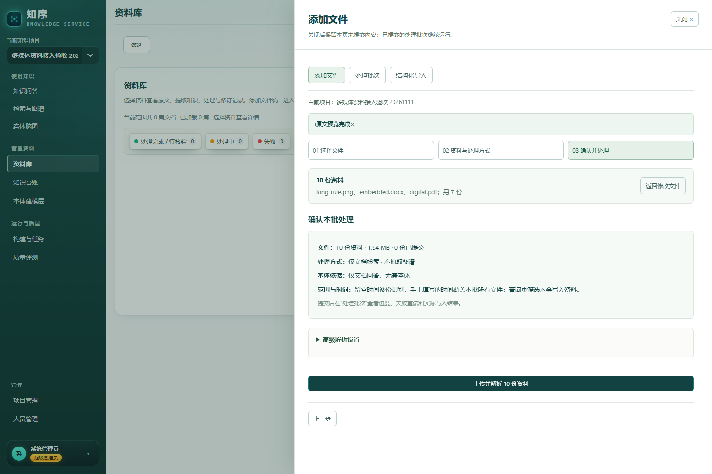
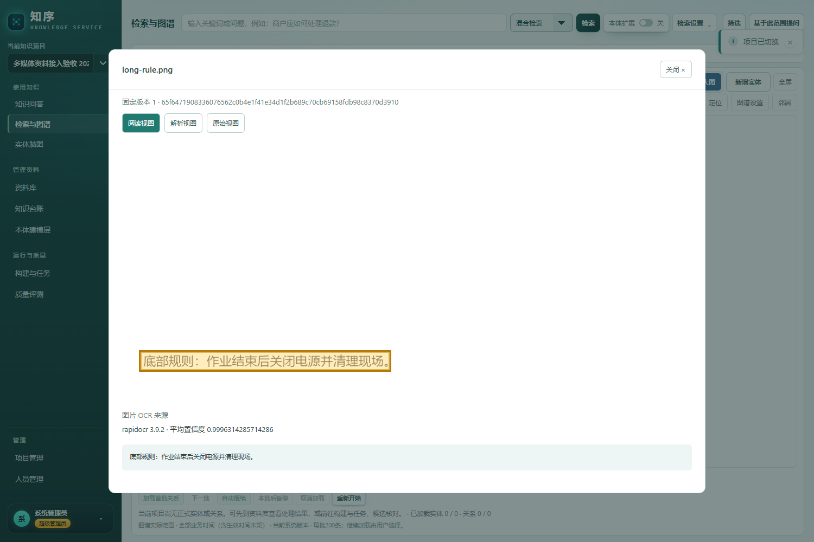
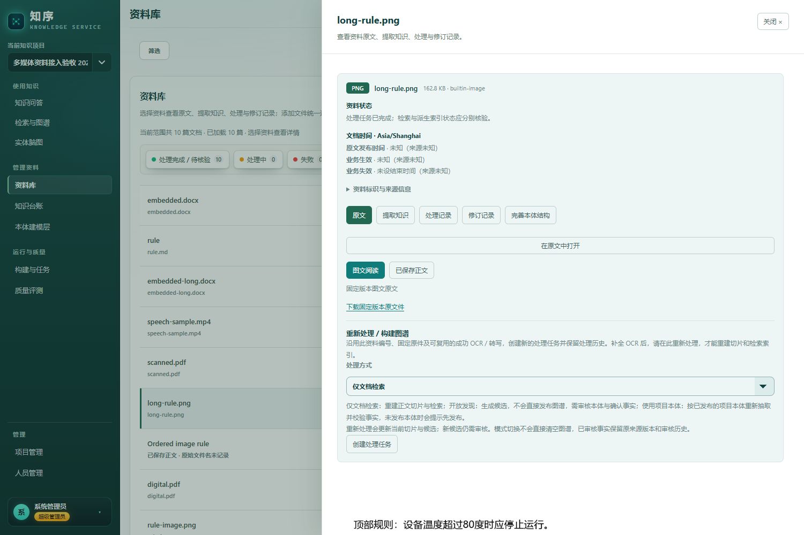
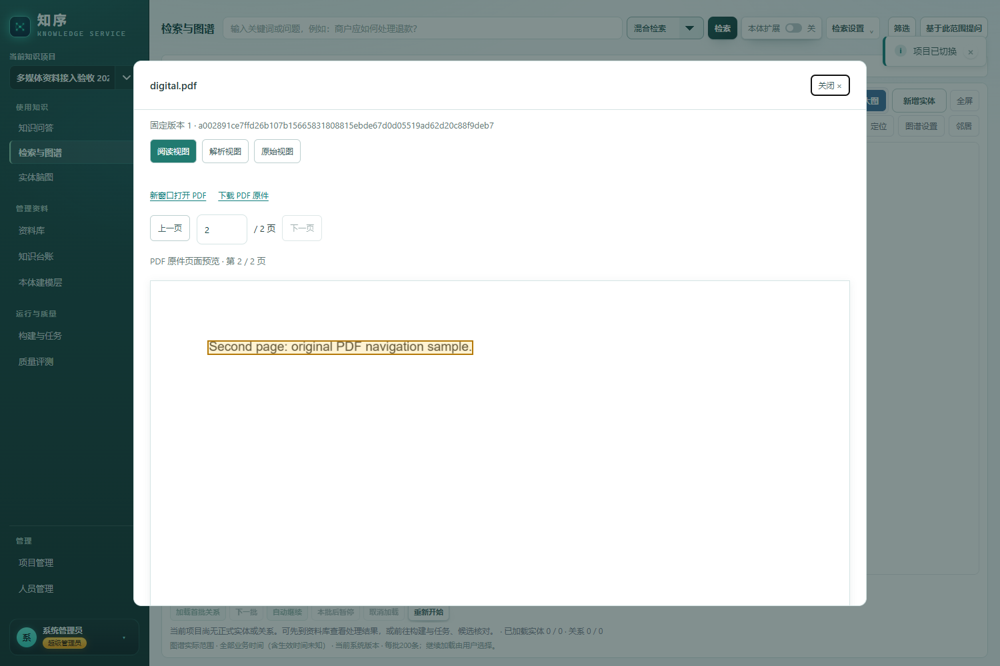

# 统一媒体接入与后续图谱构建验收

日期：2026-11-11。范围：独立图片与长图、文档内图片、PDF、视频、一包一资料 ZIP、上传步骤、已保存资料重新处理。操作说明见[上传与打包手册](平台规则资料上传与ZIP打包操作手册.md)。

## 验收环境与边界

在隔离工作区启动 `http://127.0.0.1:8102`，使用独立 PostgreSQL 验收库、MinIO、Milvus、本地 BGE-M3、RapidOCR、FunASR 及实际配置的知识抽取模型。未删除原有项目，未替换或停止其他任务管理的 8100 服务。自动化回归使用另一个独立测试库，避免并发测试清库互相影响。

本报告验证接入、来源、阅读器、切片、检索及最小图谱链路；不替代合同中的十平台本体规模、15 万节点、50 万关系、P95 延迟及全功能覆盖验收。本轮也未做主机断网演练，不把使用本地模型等同于全部离线依赖已经验收。

## 真实文件处理

十份资料均完成真实上传及正式处理，每个独立文件或 ZIP 对应一份资料，均保留带来源的可检索切片。

| 样本 | 已核对结果 |
| --- | --- |
| 独立静态图片 | 原图可读，正式 OCR 产生文字及文字框 |
| 1080×20000 长图 | 九块全部完成，顶部、中部、底部均有 OCR 文字；点击底部文字定位到原图对应区域 |
| DOCX 内嵌普通图片 | 图片自动提取，OCR 文字插入正文前后段之间 |
| DOCX 内嵌长图 | 保留 20000 像素原高度，复用长图识别链路 |
| 原生文字 PDF | 提取正文及页号，原文件可下载；分页阅读另见下文 |
| 扫描 PDF | 页图 OCR 产生正文及来源 |
| 混合 PDF | 原生文字及扫描区域均产生带来源切片 |
| MD 与图片 ZIP | 一个资料，正文与附件关联；原包下载 SHA256 与输入一致 |
| 有序图片 ZIP | 一个资料、两张有序图片；原包下载 SHA256 与输入一致 |
| MP4 视频 | 原视频播放入口及 FunASR 语音文字、分段时间均保留 |

真实长图单独实验记录：1080×20000、24 px 字、九块，六条关键行均识别到，同一条款在不同位置出现两次时仍保留两处，耗时约 54 秒，冷进程峰值约 973 MiB。它是一个样本的覆盖与资源记录，不能推定所有小字、表格或低清图的 OCR 准确率。

视频处理范围是语音转写，不包含视频帧 OCR。Word 提供图文解析与原文件下载，不保证复杂浮动排版与 Word 原版式一致。

## 页面操作与后续图谱

实际浏览器核对：第一步可分次追加文件；第二、三步只显示摘要及“返回修改文件”；返回追加后原队列保留。原文预览与切片预览分开。

从 OCR 文字打开原图时，能滚动到长图底部并高亮对应区域。

资料详情提供“重新处理 / 构建图谱”。页面实际创建了新的仅文档检索任务：保持 document ID 与来源版本，生成新处理代际并完成处理。无需重新上传文件；已有活动任务时拒绝冲突，旧代重试不能覆盖新代。OCR 单项重试后，仍需整份重新处理才能更新切片与检索输入。

仅文档检索会执行解析、OCR/ASR、切片及检索投影，不抽取实体关系。项目首次显式构建索引后，关键词、语义、混合三类实际查询均命中长图切片，后端为 Milvus，无降级检索。已建索引需核对增量同步状态，处理完成不等同于索引立即就绪。

后续选择开放发现或已发布项目本体可创建图谱抽取任务。开放发现候选经本体及事实审核后才写入正式图谱；模式切换不自动清空已有正式事实。重新处理切片减少时退休旧尾片，图谱抽取失败时保留已有可检索文字。

另用真实平台规则 ZIP 完成“上传 → 真实模型抽取 → 选择候选 → 本体审核发布 → 来源核验 → 检索 → 图谱”最小链路：得到两个实体、一条关系，三条正式记录均完成来源核验，查询词为“虹鳟鱼”。这证明链路连通，不代表已经完成全量平台本体建设。

## PDF 原版页面预览

阅读器使用服务端本地渲染的分页图片，保留原 PDF 下载及新窗打开入口，避免依赖浏览器内置 PDF 插件。原生、扫描、混合三份真实 PDF 均返回有实际内容的 PNG；浏览器已核对第二页可见、原页文字区域高亮、上一页及页码输入、下载哈希与原件一致，无页面错误。ZIP 主 PDF 通过 API 回归，原包与主文件下载均保留。

渲染使用独立短子进程，限制输入大小、页码、输出边长与像素、并发和超时，不修改来源记录。原件仍完整保留；预览分辨率用于阅读，精细检查可下载原 PDF。首次 iframe 方案曾出现灰屏，已由上述真实页图结果替代，不将旧 DOM 页号检查计入视觉验收。

## 回归记录

接入核心回归为 305 passed、2 skipped；两项跳过源于 Windows 创建符号链接权限限制。新增 PDF 页图 API 回归 10/10 通过，含真实第二页像素、ZIP 主件、来源不变、项目隔离及限额。图文阅读浏览器文件三项通过，覆盖真实 PNG 加载、翻页和 URL 释放。Node 默认契约 1039/1039 通过。最终整合后的定向回归另在下方记录。

开发机原始记录位于被 Git 忽略的 `.benchmarks/unified-media-20261111/`：`page-report.json`、`retrieval-reprocess-report.json`、`graph-pipeline/report.json` 以及 Python、Node、浏览器日志。报告配图为浏览器实测截图。
