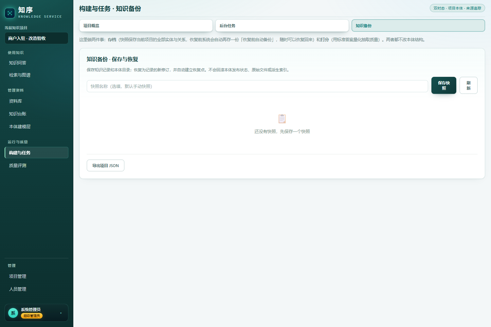

# 服务启动及运维手册

适用版本：2026-11-16。本手册面向**负责部署、启动、维护这套系统的人**；日常界面怎么用见[知识平台操作手册](知识平台操作手册.md)。所有命令默认在仓库根目录 `knowledge_service/` 下执行。

## 1. 系统架构总览

系统 = 一个 Python 应用（FastAPI）+ 一组 Docker 基础设施。**PostgreSQL 是唯一权威数据库**，没有 SQLite 回退；Milvus 只做检索投影，Neo4j 是可选副本。

| 组件 | 容器名 | 地址（默认只绑本机） | 职责 |
| --- | --- | --- | --- |
| 应用服务 | —（宿主机进程） | `http://127.0.0.1:8100` | 界面、API、任务编排 |
| PostgreSQL | knowledge-postgres | 127.0.0.1:5432 | 记录、修订、本体、断言、来源、任务、审计 |
| Milvus | milvus-standalone | 127.0.0.1:19530（gRPC）/ 9091（指标） | 向量检索投影，共享 collection `knowledge_vectors`，按项目与构建代际隔离 |
| etcd | milvus-etcd | 127.0.0.1:2379 | Milvus 元数据 |
| MinIO | milvus-minio | 127.0.0.1:9000 / 9001（控制台） | Milvus 内部文件 + 业务原件/图片/视频（分 bucket） |
| Attu | attu | 127.0.0.1:30001 | Milvus 可视化管理台（无状态） |
| Neo4j（可选） | — | neo4j://127.0.0.1:7687 | 图谱只读副本，不影响权威数据 |

数据流一句话：文件进来 → 解析/OCR/ASR → 切片 → 抽取 → 审核后写入 PostgreSQL → 同步投影到 Milvus（检索）和 Neo4j（可选图副本）。

## 2. 环境要求

| 项目 | 要求 |
| --- | --- |
| 操作系统 | Windows 10/11（PowerShell）或 Linux；当前部署在 Windows |
| Python | 3.12，使用既有 conda 环境 `llm_model`，**不要另建 .venv** |
| Docker | Docker Desktop，可运行 `docker compose` |
| 磁盘 | 数据库、向量、原件都随使用增长；模型另需数 GB（BGE-M3 约 2 GB、OCR 数百 MB、ASR 约 1 GB、Docling 数 GB） |
| FFmpeg | 启用视频转写时，`ffmpeg` / `ffprobe` 必须在 PATH |
| 网络 | LLM 走 OpenAI 兼容接口需要出网；本地模型全部离线运行 |

## 3. 首次部署（从零到能登录）

按顺序执行，每步做完再做下一步：

```powershell
# 0. 进入仓库根目录
cd D:\workspace\knowledge_service_v2\knowledge_service
conda activate llm_model

# 1. 准备配置：复制样例并按本机情况修改
copy .env.example .env

# 2. 新环境安装依赖（已有环境跳过）
python -m pip install -e ".[local-export,milvus,neo4j,ocr,asr,semantica-runtime,test]"

# 3. 启动基础设施（PostgreSQL/Milvus/etcd/MinIO/Attu）并等待健康检查
docker compose up -d --wait

# 4. 初始化/升级数据库结构（使用独立迁移凭据，应用账号不做 DDL）
python -m knowledge_service.repository.migrate

# 5. 放好本地 BGE-M3 后，首次或更换权重时准备 ONNX 制品（只做一次）
python scripts/prepare_embedding_runtime.py --model-dir data/model/embedding/bge-m3

# 6. 启动应用
python -u -m knowledge_service --port 8100
#    或：powershell -File scripts/start-service.ps1 -Port 8100
```

部署后核对三件事：

1. 浏览器打开 `http://127.0.0.1:8100/` 能看到登录页；API 文档在 `/docs`。
2. 就绪探针 `http://127.0.0.1:8100/readyz` 返回 200（本地 embedding 启动时后台预热，就绪前语义检索会明确提示初始化中；**不要只看进程活着**）。
3. 用初始账号登录：`admin` / `admin123`（首次启动库为空时自动播种超级管理员，可用 `KG_SEED_ADMIN_USERNAME` / `KG_SEED_ADMIN_PASSWORD` 覆盖），**登录后立即在「人员管理」改掉默认口令**——默认口令还在用时每次启动日志都会告警。

## 4. 日常启动与停止

| 要做什么 | 命令 |
| --- | --- |
| 启动基础设施 | `docker compose up -d --wait` |
| 启动应用 | `python -u -m knowledge_service --port 8100`（或 `scripts/start-service.ps1`） |
| 停止应用 | 在应用窗口 Ctrl+C（持久任务会由租约机制在重启后恢复领取） |
| 停止基础设施 | `docker compose down`（**不带 `-v`**；`-v` 会删除数据卷，等于清库） |
| 只重启某个容器 | `docker compose restart milvus`（或 postgres / etcd / minio / attu） |

重启后注意三点：任务按租约自动恢复，不代表中间输出都已提交；embedding 重新预热，等 `/readyz`；改了后端代码必须重启服务，只刷新页面无效。

## 5. 状态检查与日志

| 检查 | 入口 | 说明 |
| --- | --- | --- |
| 应用是否活着 | `curl http://127.0.0.1:8100/livez` | 进程存活 |
| 应用是否就绪 | `curl http://127.0.0.1:8100/readyz` | 数据库、模型、依赖全部可用才是 200，**部署探针用它** |
| 匿名健康 | `curl http://127.0.0.1:8100/api/health` | 不需要登录 |
| 容器状态 | `docker compose ps` | 五个容器都应为 running/healthy |
| 容器日志 | `docker compose logs -f milvus` | postgres / etcd / minio / attu 同理 |
| 应用日志 | 启动终端 | 终端按 `KG_LOG_LEVEL`（默认 INFO），文件日志恒为 DEBUG |
| 慢查询定位 | `KG_SLOW_MS=200` | 只打印慢于该毫秒数的读路径阶段 |



健康检查通过**不等于**功能验收通过；上传、检索、问答要按操作手册各章的实际回执核对。

## 6. 配置速查（.env）

完整清单见 `.env.example`（复制为 `.env` 后填写；**凭据不要提交到 Git**）。常用分组：

| 分组 | 关键配置 | 说明 |
| --- | --- | --- |
| 数据库 | `POSTGRES_DB / POSTGRES_APP_USER / POSTGRES_APP_PASSWORD`；`KG_DATABASE_URL` | 应用用最小权限账号连接；`KG_MIGRATION_DATABASE_URL` 仅供迁移器建表用 |
| 认证 | `KG_JWT_SECRET`、`KG_JWT_TTL_SECONDS`（默认 12 小时） | **生产必填固定 JWT 密钥**：留空则每次重启所有人都得重新登录 |
| 初始账号 | `KG_SEED_ADMIN_USERNAME / KG_SEED_ADMIN_PASSWORD` | 空库首次启动播种超级管理员；默认 admin/admin123 |
| LLM | `KG_LLM_BASE_URL / KG_LLM_MODEL / KG_LLM_API_KEY`、`KG_LLM_PROXY` | OpenAI 兼容接口；代理留空=直连（应用不继承系统代理） |
| LLM 加密 | `KG_LLM_ENCRYPTION_KEY` 或 `KG_LLM_KEY_FILE` | 加密模型管理里保存的密钥；留空则首次生成 `data/runtime/llm.key`，**必须与数据库一起备份，多实例共用同一密钥** |
| 向量编码 | `KG_EMBEDDING_BACKEND=local`、`KG_EMBEDDING_PATH=data/model/embedding/bge-m3`、`KG_LOCAL_EMBEDDING_RUNTIME=auto` | `auto` 优先用已验证的 ONNX 制品；`onnx` 强制；`sentence-transformers` 回退原运行时 |
| Milvus | `KG_VECTOR_BACKEND=milvus`、`KG_MILVUS_HOST/PORT`、`KG_MILVUS_DIM` | 维度以编码器声明为准，`KG_MILVUS_DIM` 只做旧配置校验 |
| 文档解析 | `KG_DOCUMENT_OCR_MODE=auto`、`KG_DOCUMENT_ARTIFACTS_PATH` | PDF 需要 Docling 本地模型；`disabled` 关闭 PDF OCR |
| 图片 OCR | `KG_IMAGE_OCR_BACKEND=rapidocr`、`KG_IMAGE_OCR_MODEL_ROOT` 等 | 质量阈值 `KG_IMAGE_OCR_MIN_CONFIDENCE` 等参与复核指纹 |
| 视频 ASR | `KG_VIDEO_ASR_MODEL_ROOT / KG_VIDEO_ASR_VAD_ROOT`、`KG_VIDEO_ASR_MAX_DURATION_SECONDS=600` | 需 `asr` extra 和 FFmpeg；Worker 禁网、单任务独立进程 |
| 来源存储 | `KG_SOURCE_OBJECT_BACKEND=local`（默认）或 `s3` + `KG_SOURCE_S3_*` | S3 用独立业务 bucket `knowledge-sources`，不复用 Milvus 的 bucket |
| 批量限额 | `KNOWLEDGE_INGEST_MAX_ITEMS=1000`、`KNOWLEDGE_INGEST_MAX_FILE_BYTES=25000000`、并发项 | 页面从 `/api/ingest/capabilities` 读取 |
| 日志 | `KG_LOG_LEVEL`、`KG_SLOW_MS` | 见第 5 章 |
| Neo4j（可选） | `KG_NEO4J_URI / USERNAME / PASSWORD / DATABASE` | 只读投影，按项目手动同步 |

测试专用：测试套件使用隔离库 `knowledge_test`，并自动设置 `KG_SKIP_DOTENV=1`；生产**绝不**设置 `KG_AUTH_DISABLED`（会关闭全部接口认证）。

## 7. 本地模型准备

模型不随 Git 提交，迁机器必须单独复制整个目录（不能只拷权重文件，词表和配置要一起）。

| 模型 | 目录 | 准备方式 |
| --- | --- | --- |
| 向量编码 BGE-M3 | `data/model/embedding/bge-m3` | 放好原模型后运行一次 `python scripts/prepare_embedding_runtime.py --model-dir data/model/embedding/bge-m3`（校验分词/向量对照后原子启用 ONNX，保留原权重） |
| 图片 OCR（RapidOCR） | `data/model/ocr/pp-ocr-v6-small` | `python scripts/install_ocr_models.py`；布局整理 `prepare_model_layout.py` |
| PDF 解析（Docling） | `data/model/document-parser/docling` | `python scripts/prepare_document_models.py`，部署后用 `--check` 校验；缺失时 PDF 明确返回 `model_unavailable`，DOCX/TXT 不受影响 |
| 视频语音（FunASR） | `data/model/asr/SenseVoiceSmall` 与 `data/model/asr/speech_fsmn_vad_zh-cn-16k-common-pytorch` | 完整复制两个模型目录（Apache-2.0，保留许可文件）；确保 FFmpeg 在 PATH；改路径后重启，并先看 `/api/ingest/capabilities` 的 `asr_available`，再传一段真实视频验证 |

LLM 不需要本地模型：超级管理员在「管理 → 模型管理」新增 OpenAI 兼容配置 → **测试连接** → **设为默认**即可；未启用平台模型时回退 `.env` 的 `KG_LLM_*`。切换默认模型只影响新任务，运行中任务沿用启动时配置。

## 8. 数据存储与数据卷

Docker 运行数据使用 Linux 命名卷（`docker volume ls` 可见）：

| 数据卷 | 保存内容 |
| --- | --- |
| `knowledge_service_postgres_data` | PostgreSQL 权威数据库 |
| `knowledge_service_etcd_data` | Milvus 元数据 |
| `knowledge_service_minio_data` | Milvus 持久段与索引对象 |
| `knowledge_service_milvus_data` | Milvus RocksMQ 日志与运行文件 |

业务原件（上传的文件、图片、视频、ZIP）按 `KG_SOURCE_OBJECT_BACKEND` 存放在 `data/sources`（local）或 MinIO 业务 bucket（s3）。`data/model` 是本地模型，`data/runtime/llm.key` 是 LLM 加密密钥。

三条铁律：

1. **绝不执行 `docker compose down -v`**——它删除上述全部数据卷。
2. 迁移、复制数据先停写，按[数据卷迁移指南](2026-10-19-Docker-Linux-volume-migration.md)操作；挂新空卷不会自动带入旧数据。
3. 页面里的"知识备份"不包含这些数据卷；基础设施级备份见下一章。日常维护细节另见[2026-10-01-Docker基础设施维护手册](2026-10-01-Docker基础设施维护手册.md)。

## 9. 备份与恢复

正确备份 = 三样一起备，缺一样都恢复不全：

| 备什么 | 怎么备 | 丢了会怎样 |
| --- | --- | --- |
| PostgreSQL 数据卷（或 `pg_dump`） | 停写后复制命名卷，或 pg_dump 全库 | 全部记录、本体、审计丢失 |
| MinIO 业务 bucket（原件、图片、视频） | 停写后复制 `knowledge_service_minio_data` 卷（含业务 bucket）或用 MinIO 工具导出 | 原文无法下载和核验，只剩数据库文字 |
| `data/runtime/llm.key`（或记录 `KG_LLM_ENCRYPTION_KEY`） | 与数据库一起保存 | 已保存的模型配置和任务快照无法解密，只能重配 |

恢复后按对象清单核对大小和 SHA-256，并打开一份资料下载原件比对。项目级"知识备份/快照"只是业务级留档，**不能替代**本章的基础设施备份。

## 10. 升级与变更流程

```powershell
git pull                                  # 拉取新代码
python -m pip install -e ".[...]"         # 依赖变化时（对照 pyproject）
docker compose up -d --wait               # 基础设施镜像/配置变化时
python -m knowledge_service.repository.migrate   # 应用编号迁移 SQL
# 重启应用，等待 /readyz，再按操作手册抽查上传/检索/问答
```

注意：不要删除或修改已应用的编号迁移 SQL；更换向量模型或维度前先读第 6 章 Milvus 配置说明。同维度模型变化由后台重建项目索引；共享集合维度不兼容时仍需维护集合，不能用普通项目重建代替。升级后用 `python scripts/production_storage_checkpoint.py --output <file>` 前后对比存储检查点。

**当前 Milvus 投影 schema 为 5。** 检索文本包含资料标题、原文件名与正文切片。升级代码并重启后，后台会为旧 schema 4 索引安排重建；首次索引、同维度模型变化和普通故障恢复也自动调度。索引版本升级使用完整后台重建，不靠增量投递跳过校验，无需重新上传资料或删除共享 collection。查看资料库、检索与图谱、问答或台账的“检索索引”，等待“可检索”后抽查结果；管理员可用“重建全部检索索引”手动恢复。PostgreSQL 权威记录不受影响。

上传只暂存和验证，用户明确开始解析后才执行昂贵识别和分块；切片向量先在 `data/cache/embeddings/` 下预计算缓存，草稿不写正式检索索引。默认缓存有效期 7 天、上限 512 MiB，可丢弃，不代替业务库、原件或 Milvus 索引备份。确认提交后复用匹配的向量；缓存损坏或不可写时重新编码。正式写入只唤醒后台，索引任务去重并按 5 秒至 5 分钟退避重试；正常等待长任务不消耗本体同步错误重试次数。

## 11. 故障排查速查

| 现象 | 先查什么 | 处理 |
| --- | --- | --- |
| 应用起不来 | 终端第一行报错：DSN 缺失 / 依赖缺失 / 端口占用 | 按提示补 `.env`、装依赖；`netstat -ano \| findstr 8100` 查端口 |
| `/readyz` 一直不就绪 | embedding 预热中；PG/Milvus 连接失败 | 看日志等待；`docker compose ps` 核对容器 |
| 检索报索引未就绪 | “检索索引”中的自动任务、模型与 Milvus 连接、版本和错误 | 等待自动建立或重建；失败按错误修复，必要时管理员手动重建全部检索索引 |
| 维度不一致报错 | `KG_MILVUS_DIM` 与编码器声明 | 按报错把 `KG_MILVUS_DIM` 改成编码器维度，重建 collection |
| PDF 报 `model_unavailable` | Docling 制品缺失 | `python scripts/prepare_document_models.py --check` 后重新准备 |
| 视频无转写、`asr_available` 为否 | ASR 模型目录、FFmpeg PATH、配置路径 | 核对第 7 章；改完重启并用真实视频验证 |
| 图片 OCR 大量失败/低置信 | 原图清晰度、质量阈值 | 核对原图；必要时与业务确认阈值（`KG_IMAGE_OCR_MIN_CONFIDENCE` 等） |
| 模型管理配置无法解密 | `llm.key` 是否换过/丢失 | 用配套备份恢复；没有备份只能删除配置重录 |
| 重启后所有人要重新登录 | `KG_JWT_SECRET` 是否固定 | `.env` 设置固定长随机串后重启 |
| 容器重建后数据"空了" | 挂载的卷名、数据库名 | 停止写入，按迁移指南核对卷与配置，不要重复上传掩盖 |
| 忘记 admin 口令 | 是否还有其他超级/管理员 | 由其他管理员在人员管理重置；唯一超管丢失需按种子提升规则谨慎处理 |
| 磁盘增长快 | `docker system df`、volumes、`data/` | 清理前逐项确认归属；绝不动四个命名卷 |
| 测试连不上库 | 测试专用 DSN、compose 是否在跑 | 测试用隔离库 `knowledge_test`，与生产库无关；详见 tests/README |

## 12. 安全清单

- 服务默认只监听 `127.0.0.1`，不要随意改成 `0.0.0.0` 暴露到外网；确需外部访问应加反向代理和认证。
- 生产保持认证开启，**绝不**设置 `KG_AUTH_DISABLED`。
- `.env` 含口令密钥，不提交、不截图、不粘贴到工单。
- 固定 `KG_JWT_SECRET`；初始 `admin/admin123` 登录后立即修改。
- 不要执行 `docker compose down -v`；不要删除 MinIO 业务 bucket 或数据卷。
- 诊断与工单只提供脱敏后的错误信息，不要带口令、令牌或完整连接串。

## 13. 运维脚本索引

脚本详情、参数与边界见 [scripts/README.md](../scripts/README.md)（**先读再用**；多为手动工具，不属于自动回归）。

| 用途 | 脚本 |
| --- | --- |
| 启动应用 | `scripts/start-service.ps1` |
| 数据库迁移 | `python -m knowledge_service.repository.migrate` |
| 模型准备 | `prepare_embedding_runtime.py`、`prepare_document_models.py`、`install_ocr_models.py`、`prepare_model_layout.py` |
| 规则打包（一包一资料 ZIP） | `package_rule_documents.py` |
| 全链路验收（隔离项目） | `verify_platform_rule_pipeline.py` |
| 权限专题 / 内容差分 | `verify_auth_rbac.py`、`verify_production_content.py` |
| 存储检查点 | `production_storage_checkpoint.py` |
| 来源对象迁移（local → S3） | `migrate_source_objects.py`（默认只读盘点，`--apply` 才执行） |
| 数据卷归档/迁移 | `archive_windows_docker_bind.py`、`copy_stopped_docker_volume.sh`、`migrate_docker_storage.py` |
| 手册构建 | `build_knowledge_service_manual.py`、`verify_redesign_manual.py` |

## 14. 地址与端口速查

| 用途 | 地址 |
| --- | --- |
| 工作台 | `http://127.0.0.1:8100/` |
| API 文档 | `http://127.0.0.1:8100/docs` |
| 就绪探针 | `http://127.0.0.1:8100/readyz` |
| 存活探针 | `http://127.0.0.1:8100/livez` |
| 匿名健康 | `http://127.0.0.1:8100/api/health` |
| Attu（Milvus 管理台） | `http://127.0.0.1:30001` |
| MinIO 控制台 | `http://127.0.0.1:9001` |
| PostgreSQL | `127.0.0.1:5432` |
| Milvus gRPC | `127.0.0.1:19530` |

> AI生成
