# 知识平台完整操作手册

使用流程与功能指南 · 2026-11-16 版

面向资料整理、知识审核、业务使用和系统管理人员。按「准备项目 → 定义结构 → 上传配置 → 解析检查 → 确认处理 → 核对知识与自动索引 → 检索、看图、问答 → 日常维护」编排。第一次建立知识库请从头操作；只想使用已有知识，可从第 18 章开始。

本册真实页面截图标注采集日期，数量和名称只代表截图时的项目。标有「示意图」的附图用于解释流程，不是产品截图。HTML 版内嵌全部附图，可离线阅读、搜索正文、放大图片和打印；专题链接需配套文件。

安装、启动和完整备份见[服务启动及运维手册](服务启动及运维手册.html)；附件组织、文件案例和可选 ZIP 清单见[资料上传与 ZIP 打包操作手册](平台规则资料上传与ZIP打包操作手册.html)。

## 1. 先看全流程：把资料变成可追溯的知识

系统把文档、图片、PDF、视频整理成可搜索的正文，以及实体、关系和属性。你可以从答案或图谱回到原文，核对信息来自哪里、适用于什么时间和范围。

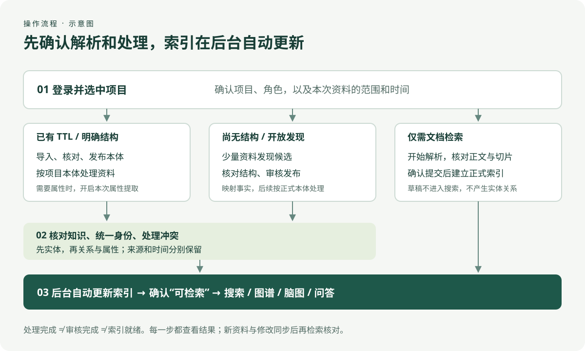

| 阶段 | 你要完成的事 | 完成标志 |
| --- | --- | --- |
| 准备项目 | 登录，建立并选中项目 | 左上角显示正确项目 |
| 定义结构 | 导入本体，或从资料发现类型；核对、审核、发布 | 本体建模层显示正式版本 |
| 导入资料 | 上传、分别配置，明确开始解析并核对，再确认处理 | 文件已提交后续处理，进度可查看 |
| 核对知识 | 处理待审实体、关系、属性和结构候选 | 所需事实成为正式知识，来源可打开 |
| 整理身份 | 复核重复实体，必要时合并并处理冲突 | 同一对象身份清晰，冲突有明确状态 |
| 建立检索 | 系统自动建立并更新；在「检索索引」查看状态 | 项目索引显示「可检索」 |
| 使用维护 | 搜索、看图、提问；补充资料并复核 | 结果可追溯，任务与索引状态正常 |

**处理完成不等于所有结果都已成为正式知识，也不等于已经能检索。** 分别检查任务结果、知识审核和项目索引。仅文档检索模式没有实体节点是正常结果。

## 2. 登录、角色与界面导览

由管理员提供访问地址和账号。本机默认地址为 `http://127.0.0.1:8100/`；远程使用时打开实际部署地址。

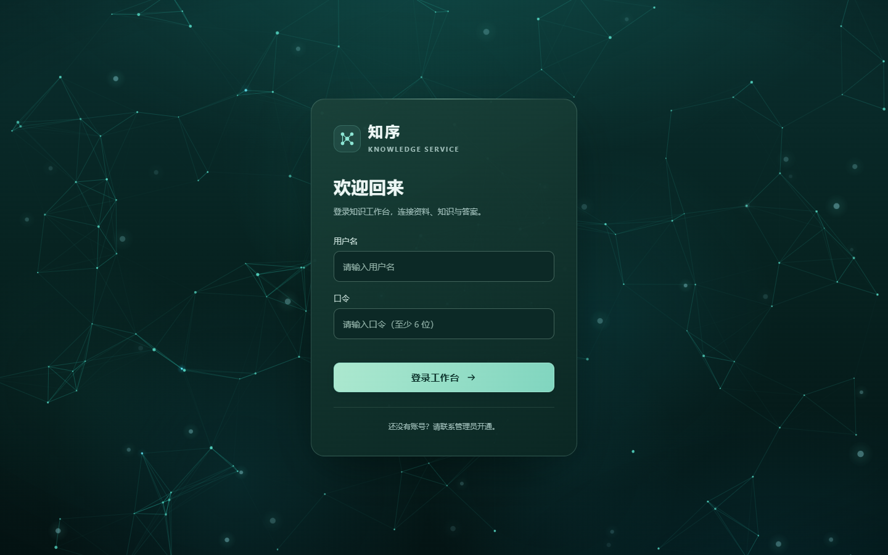

1. 输入用户名和口令，点击「登录工作台」。本系统不开放自助注册。
2. 登录后先看左上角「当前知识项目」，确认正在使用哪个项目。
3. 通过左侧导航进入所需页面。操作后留意状态提示；退出通过左下角账户菜单操作。

| 角色 | 常见工作 | 权限边界 |
| --- | --- | --- |
| 只读用户 | 检索、问答、看图谱和脑图、核对可访问证据 | 不能上传、修改、审核或合并知识 |
| 管理员 | 建项目、上传、建模、审核、维护知识和普通账号 | 受超级管理员保护规则限制 |
| 超级管理员 | 全部管理工作，以及模型和高级账号管理 | 同样遵守页面校验和审核流程 |

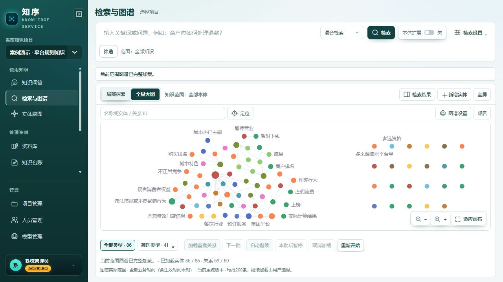

菜单按「使用知识」「管理资料」「运行与质量」「管理」分组，随角色显示。**各页面的筛选范围独立**。需要限定问答材料时，直接打开「知识问答」的「筛选」，应用本页范围后再提问；资料库不提供范围提问跳转。

## 3. 建立项目，选择起步路线

入口：「管理 → 项目管理」。不同资料集和业务线可用项目隔离。

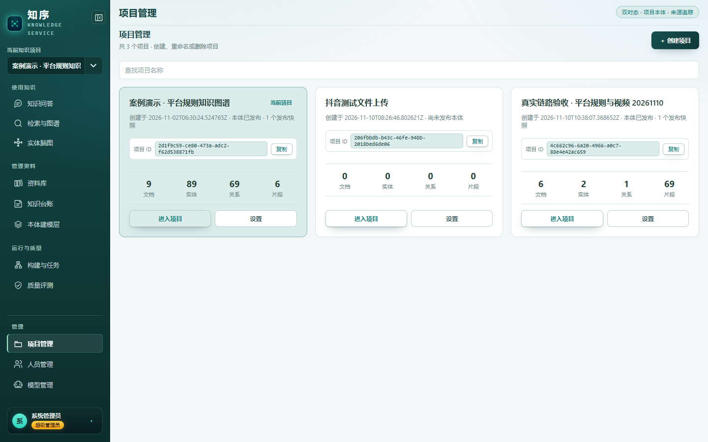

1. 填写项目名称和说明，创建项目。
2. 在左上角选中新项目，再进行后续操作。
3. 按下表选择路线。先用一两份有代表性的资料跑通，再批量导入。

| 当前准备情况 | 建议操作顺序 |
| --- | --- |
| 已有 TTL 本体或明确结构 | 在本体建模层导入、核对并发布；上传时选「使用项目本体」 |
| 不知道资料中有哪些类型 | 少量资料选「开放发现」；核对结构候选、加入草案、审核发布，再按本体处理 |
| 只需要正文检索和问答 | 选「仅文档检索」；确认提交后自动建立检索索引，不必先建本体 |

项目卡片可以改名和删除。删除影响该项目的数据，先确认备份和范围；不要用删除项目来整理重复实体。

## 4. 本体建模：定义类型、关系和属性

入口：「管理资料 → 本体建模层」。本体规定知识怎样组织，不是具体业务事实。

| 定义种类 | 用途 | 例子 |
| --- | --- | --- |
| 实体类 | 规定对象属于什么类型 | 平台、商户、规则 |
| 关系（对象属性） | 连接两个实体 | 平台「发布」规则 |
| 属性（数据属性） | 描述实体的值及其约束 | 平台职责：文本；成立年份：整数 |

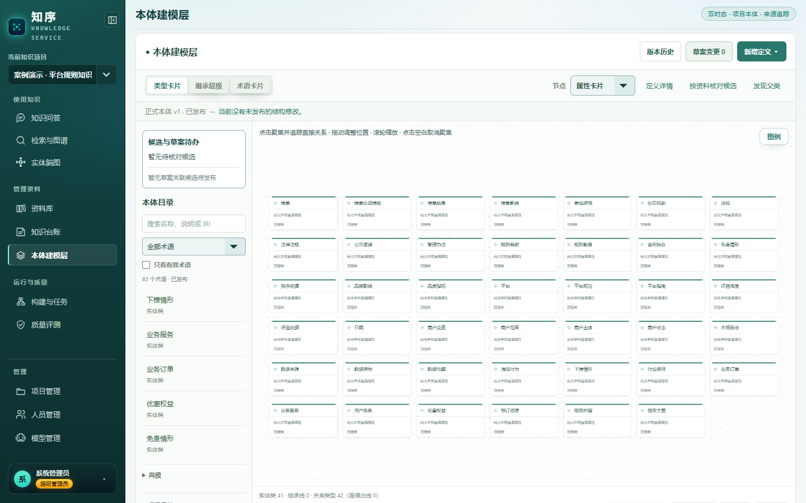

### 导入已有 TTL

1. 打开本体目录「高级 → RDF 源码 / 导出」，点击「编辑 Turtle」。当前界面通过编辑源码接入已有 TTL，不提供单独的 TTL 文件上传按钮。
2. 将 TTL 内容整理到编辑区。已有本体时先导出备份、核对要保留的定义，不要未经核对直接替换整段源码。
3. 点击「把源码差异加入草案」，核对实体类、关系、数据属性及增删影响，再校验、逐项审核和发布，以顶部正式版本为准。
4. 上传或重新处理时选「使用项目本体」，核对选用的已发布版本。

TTL 有数据属性定义时，可以按这些定义抽取具体值，仍需在本次处理选项中开启属性提取。导入 TTL 不会自动给旧文档补抽属性。

### 手动维护结构

通过「新增定义」选择种类，填写名称、说明和约束。选中术语后通过「定义详情」修改。类型卡片、继承层级、术语卡片用于不同角度浏览；「节点显示方式」可切换属性卡片或紧凑节点。

本体中的「职责：文本」是字段定义；实体的「负责商户准入与服务治理」才是具体值。不要把长段落正文拆成一堆实体类型。

## 5. 发布本体与调整已有类型

入口：本体建模层顶部「草案变更」「版本历史」。

1. 将本轮修改加入工作草案，查看变更清单。
2. 运行校验，修正重复、继承循环、类型或约束问题。
3. 进入审核，逐项核对影响并给出决定，再发布新版本。
4. 核对正式版本；后续处理选择该版本。历史版本用于追溯。

| 要解决的问题 | 应该怎么做 |
| --- | --- |
| 名称或说明不合适 | 编辑定义，按草案审核发布 |
| 两个类型表达同一概念 | 类型详情「合并到已有类型」，预览影响后加入草案、审核发布 |
| 旧知识仍挂在旧类型 | 使用受控重分类入口，逐组选择、预演后迁移 |
| 类型不再使用 | 停用术语，必要时指定替代，保留历史 |
| 两个具体实体是同一对象 | 到知识台账做实体合并，见第 13 章 |

预演只显示预计影响；加入草案也没有发布。结构发布、已有知识重分类、具体实体合并是三个不同操作。

## 6. 为跨文档实体设置身份规则

入口：本体建模层 → 选择实体类 → 定义详情 →「实体身份策略」。

两份文档提到同一平台时，资料有效期可能不同。是否为同一实体应按对象身份判断，不能只要求所有来源起止时间完全一致，也不能只凭名称相同就认定相同。

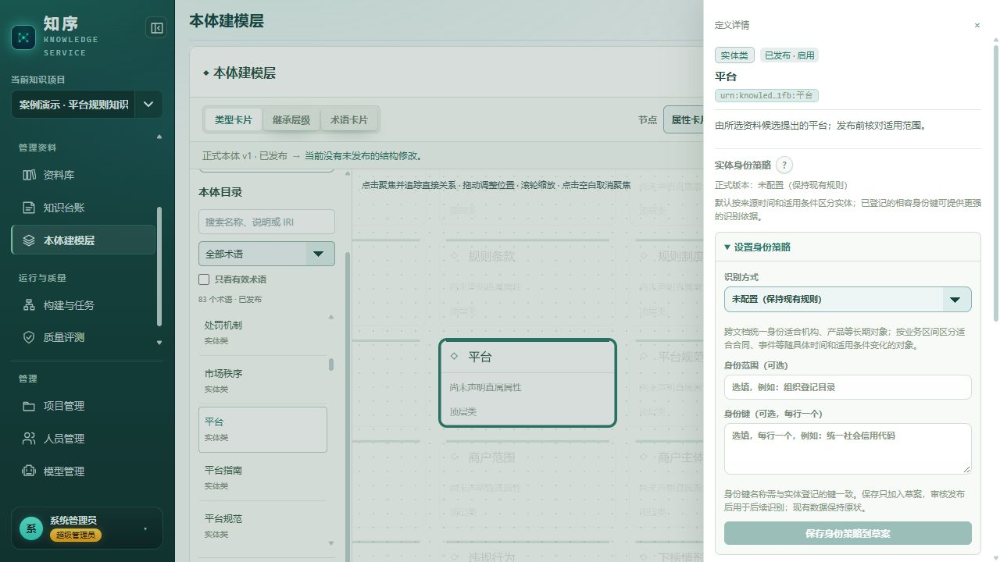

| 识别方式 | 适用情况 | 操作建议 |
| --- | --- | --- |
| 未配置（保持现有规则） | 尚未确定该类型如何区分身份 | 保守保留，先抽样复核 |
| 跨文档统一身份 | 公司、平台、产品等长期对象 | 核对规范名称、别名、范围和唯一键；来源分别保留时间 |
| 按业务区间区分 | 具体合同、事件等需要时间参与区分的对象 | 核对具体对象、区间和适用条件，避免同名误合并 |

按需要填写「身份范围」「身份键」；键名应与实体登记的键一致。点击「保存身份策略到草案」，完成审核发布后生效。

这是在同一本体里规定各类型怎样识别，不是拆到另一个系统处理。**修改策略不会自动合并旧数据**；旧数据通过第 13 章扫描、预览后处理，也不会把不同来源的时间改成一个共同有效期。

## 7. 添加文件：先配置，再解析，核对后确认处理

入口：「管理资料 → 资料库 → 添加文件」。当前四步为「1 上传核对 → 2 配置资料 → 3 解析与检查 → 4 确认处理」。

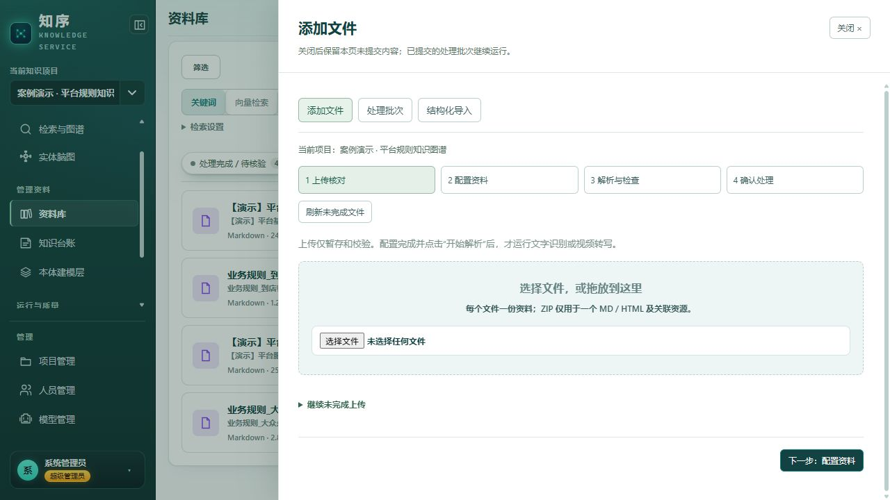

1. **上传核对。** 打开「添加文件」后，把文件拖到上传核对区域的虚线框或空白处即可，也可点「选择文件」，可以分次追加。这里只保存并验证文件，不运行 PDF 深度解析、OCR 或 ASR。上传后在对应文件行点击「原件预览」；Word 会在弹窗内按标题层级、表格与内嵌图片渲染，分页与页眉页脚以 Word 打开为准，也可下载原件核对。此时还没有正式解析切片。
2. **配置资料。** 同批文件可以属于不同平台、业务、适用对象和时间。点击某文件的「设置」在该文件卡片下展开；多份相同配置时，勾选文件后点击「批量设置所选文件」，选择填补空值或覆盖，并保存。无需要求整批资料来自同一平台。选择本批后续处理方式，按需展开「高级解析设置」；切片策略、最大字符数与重叠在「开始解析」时应用于所选文件，也可用「将切片设置应用到所选文件」提前写入逐文件配置。
3. **解析与检查。** 点击「开始解析」才启动后台任务，查看排队、文字识别、语音转写、生成切片及「计算切片向量」等阶段。解析完成后，逐文件打开「查看正文与切片」核对。如果拆分不符合预期，在「高级解析设置」调整切片策略、最大字符数或重叠后，对已完成文件点「重新拆分」：正文与识别结果直接复用，不重复 OCR 或转写，仅按新设置重新生成切片。切片向量会自动准备，但未确认提交的草稿不会进入正式搜索、问答或图谱。
4. **确认处理。** 选择已核对、解析完整的文件，按处理方式点击「开始构建本体」「开始知识抽取」或「开始建立检索索引」。这是提交后续任务，不等于已经发布本体或全部处理完成。已提交文件从本次上传清单移出，后续去「处理批次」查看进度。

「继续未完成上传」用于找回本项目尚未提交的文件、资料配置和可复用的解析结果，便于离开或刷新后继续操作；它不是恢复已入库资料。任务可在后台继续，关闭窗口不会自动取消。未提交准备会话自创建起保留 **7 天**，访问不会续期；过期后未提交暂存会被清理，需要重新上传。这与切片向量缓存的有效期不同。全部提交后，添加文件页回到新上传；已提交资料和批次仍保留。

| 文件类型 | 处理结果 | 核对重点 |
| --- | --- | --- |
| TXT、Markdown、HTML | 保存正文并切片 | 正文完整、标题正确 |
| PDF | 文字表格解析，扫描页可用 OCR | 页码、识别质量和原件 |
| Word（DOCX） | 正文表格、内嵌图片识别 | 图片文字是否进入正文 |
| PNG、JPG、JPEG、WebP | 保留原图，开始解析后 OCR，长图可分块 | 顺序、清晰度、是否部分失败 |
| MP4、WebM | 原件保存及语音转写 | 语音和时间段；不做视频画面 OCR |
| ZIP | 一个 MD / HTML 主文档及其引用资源组织为一个来源 | 相对路径正确；普通包不需要 manifest.json |

MD / HTML 引用了本地图片或视频时，将唯一主文件放在包根，与 `assets/` 一起打包即可，不要求手写 `manifest.json`。PDF、Word、独立图片和视频直接分别上传。原件预览不运行 OCR/ASR；需要识别文字和切片时，配置完成后明确开始解析。旧清单也须满足根主文档要求；有序图片页包仅供已入库历史来源读取，新上传改用一个根 MD 按顺序引用图片，详见专题手册。

数字 PDF 通常可以直接提取文字；扫描件需要 OCR。只有页眉、页脚可选中的混合扫描 PDF，也要核对正文是否识别完整。图片 OCR 和视频 ASR 的文字按引用位置并入正文，再按长度、重叠和段落规则切片，不因附件身份强制独立成片；来源位置仍可追溯。

常见限制：单文件或 ZIP 25 MB；图片 10 MiB、4000 万像素；一份资料最多 200 张图片、共 100 MiB；视频最长 10 分钟且不超过 25 MB。部署可调整限制，以页面提示为准。

## 8. 抽取模式与属性提取开关

处理方式决定确认提交后执行什么任务。在第 2 步「配置资料」选择本批方式，并按需打开「高级解析设置」配置抽取细节；第 3 步先检查解析正文和切片，第 4 步才确认后续处理。

| 处理方式 | 使用场景 | 结果与后续操作 |
| --- | --- | --- |
| 仅文档检索 | 先建立可搜索资料库 | 「开始建立检索索引」：正式提交正文和切片，自动建立索引，不抽实体、关系、属性 |
| 开放发现 | 发现新类型和关联 | 「开始构建本体」：生成结构建议与事实候选；仍需核对、加入草案、审核和发布 |
| 使用项目本体 | 已有已发布本体 | 「开始知识抽取」：按选定版本抽取、校验；候选与正式事实分别核对 |

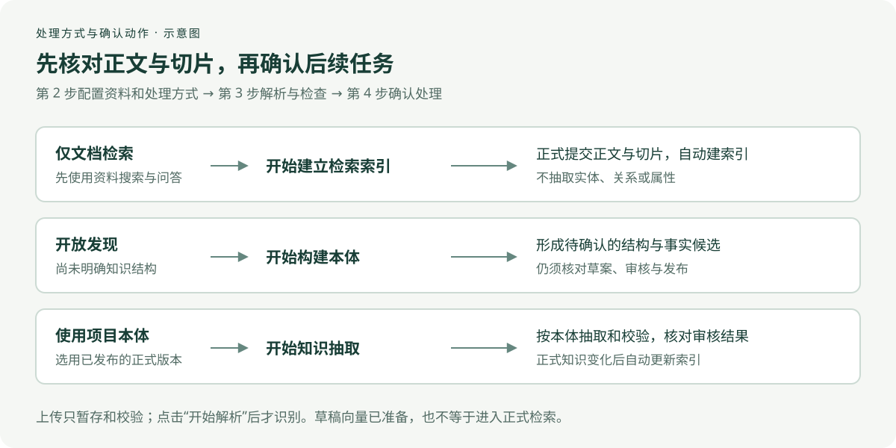

**属性提取默认关闭。** 在第 2 步「配置资料」展开「高级解析设置」，勾选「抽取实体属性（含数值、状态与说明段落；结果先审核）」。「仅文档检索」不能开启属性提取。

1. 按已有 TTL 提取时，选「使用项目本体」，确认已发布版本有所需数据属性。
2. 开启属性提取。开放发现提出保守候选；本体模式按已发布定义提取具体值。
3. 完成后到「知识台账 → 知识审核 → 属性事实」，先处理依赖实体，再核对属性。
4. 审核通过后，值进入正式知识，在实体详情、检索和问答中使用。

导入 TTL、发布新本体都不会自动重跑旧资料。**当前资料详情的重新处理只让你选择模式，并沿用先前的解析设置，不提供属性开关覆盖。** 原先已开启属性提取的资料可按现有设置重新处理；原先未开启或没有处理设置的旧资料，需要维护人员安排补抽，不能仅靠再次点击重新处理来开启。重新上传会成为另一份资料，不应误当作原资料原位更新。

高级设置还可调整切片策略、最大字符数和重叠长度。初次使用保留默认即可；条款较多时可考虑优先标题或中文条款，段落说明较多时可考虑段落/句子边界。关系约束默认「转审核」，其他方式分别为警告、严格拦截或不检查，修改前应明确业务后果。同名/别名消歧与语义相似自动合并是不同开关；语义分数只作线索，已有重复优先采用逐组预览确认。

## 9. 查看任务进度与失败恢复

解析草稿先在「添加文件 → 解析与检查」看进度；确认提交后的业务处理看「资料库 → 处理批次」，索引更新看「检索索引」。汇总任务入口为「运行与质量 → 构建与任务 → 后台任务」。

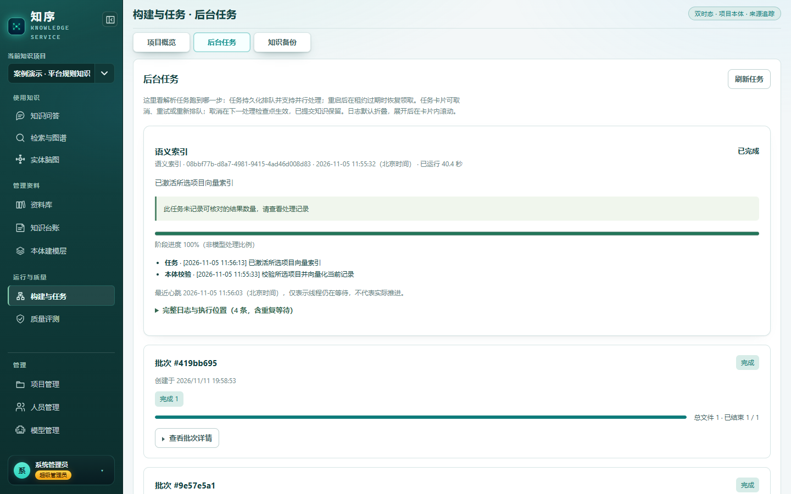

1. 找到刚提交的任务，看排队、解析、OCR/ASR、切片、抽取等阶段。
2. 完成后核对结果和待审提示，再到资料库看原文与提取知识。
3. 失败时展开错误和日志，先确认阶段，再选页面提供的恢复方式。

| 情况 | 建议恢复 |
| --- | --- |
| 临时连接失败，前面已成功 | 从断点继续或重试失败部分 |
| 个别切片抽取失败 | 仅重试失败切片，再核对候选 |
| 解析器或 OCR/ASR 模型变化，结果提示过期 | 在对应文件或预览提示处「重新解析」；也可「重试失败或过期项」 |
| 更换抽取模型、本体或抽取方式 | 核对设置后整份重新处理 |
| 更换同维度语义模型 | 等后台重建检索索引，不必因此重跑原文识别 |
| 图片识别不完整 | 解析视图单项重试，补齐后整份重新处理 |
| 文件损坏、缺附件 | 修正后重新提交 |
| 模型不可用或认证失败 | 管理员核对配置后重试 |

进度条是阶段进度，不代表模型的精确处理比例；心跳只表示仍在等待或运行。取消在检查点生效，不能当作撤销已写入知识。先看处理记录，避免重复提交。

**解析失败与索引失败要分开处理。** 技术性的 OCR/ASR 失败或未识别到可审核正文时，不能确认提交。已过滤少量低置信文字但仍有足够可靠内容时，可能显示非阻断提示，应核对正文。若正文已完整、仅向量预计算失败，可确认提交，由正式索引任务重试；此时不能把资料称为已可检索。索引窗口显示数量进度和最近错误，普通更新失败按间隔自动重试。

## 10. 资料库：找资料、看结果和重新处理

入口：「管理资料 → 资料库」。点击资料，分别看「原文」「提取知识」「处理记录」「修订记录」。

| 要核对什么 | 查看位置 |
| --- | --- |
| 实际保存了什么文字 | 原文，区分已保存正文与原始文件 |
| 文档支持哪些实体、关系、属性 | 提取知识，核对候选/正式状态和证据 |
| 为何失败、使用什么方式 | 处理记录 |
| 内容何时更新 | 修订记录 |

### 搜索资料

资料库提供「关键词」「向量检索」「混合检索」。「关键词」按字面查名称、原文件名和已保存正文，不调用语义模型；「向量检索」按标题、文件名与正文切片的语义匹配；「混合检索」可在「检索设置」选择关键词候选排序或双路融合，详见第 18 章。向量及混合方式需要正式项目索引就绪。

「在结果中继续检索」叠加条件，每步可选关键词、向量或混合方式；「退回上一步」撤销最后条件并恢复该步设置。每步的策略和阈值保留，调整当前检索设置不会清除之前的条件。不同步骤可命中文档的不同位置，不要求都在同一段。向量和混合显示本次有界召回，最多 100 个匹配片段，不把它当成全库精确总量。

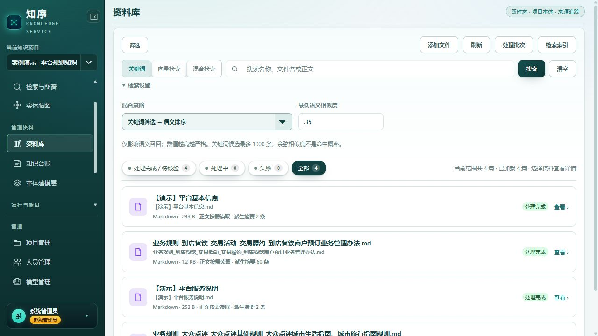

### 重新处理

打开「重新处理 / 构建图谱」，选择方式后点「创建处理任务」。系统复用原件、保留处理历史，按当前已发布本体处理，并沿用已有解析设置。首次只存文档、后来要出实体关系图谱可用此入口，无需重复上传。属性开关的限制见第 8 章。

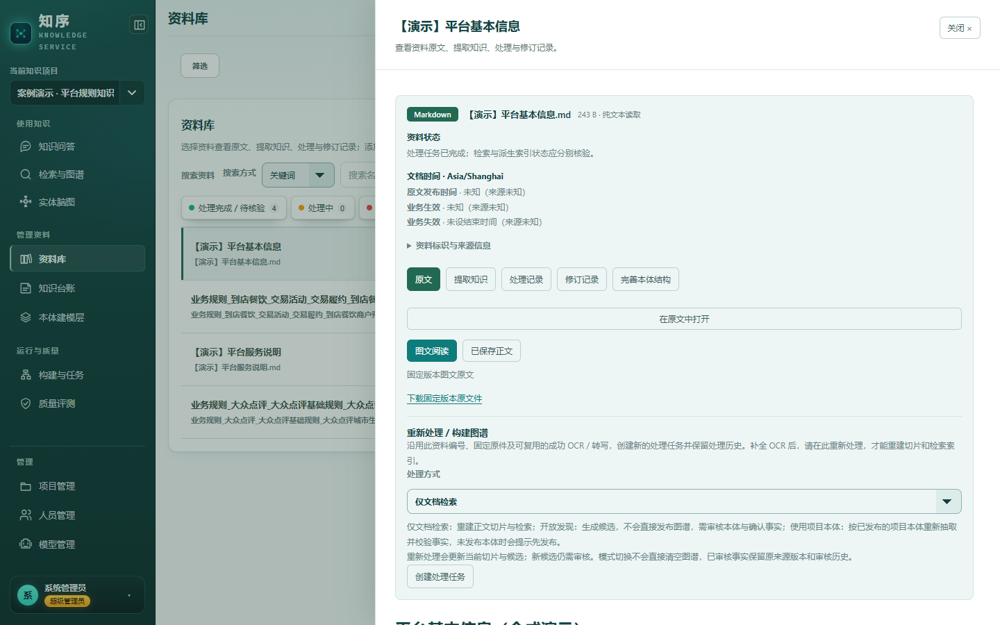

单项重试 OCR 只更新识别结果；新文字要进入切片、抽取和检索，还需整份重新处理。

## 11. 阅读原文与核对证据

入口：资料详情，或检索、问答的来源 →「在原文中打开」。阅读器固定到被引用的资料版本，便于复核旧答案。

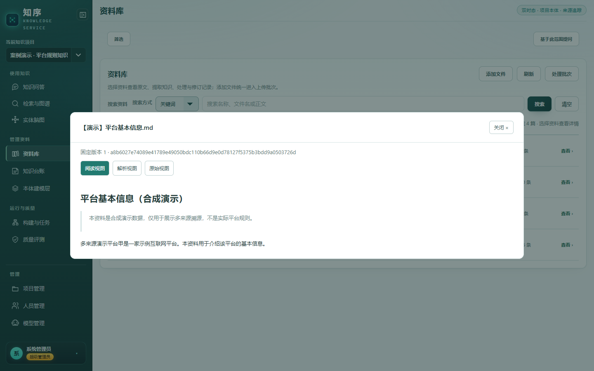

| 视图 | 内容 | 常用操作 |
| --- | --- | --- |
| 阅读视图 | 顺序组织的正文、表格、图片和视频 | 放大图片、切 PDF 页码、播放媒体 |
| 解析视图 | OCR 文字、置信度、分块、语音时间段 | 对照识别区域，查看或重试失败项 |
| 原始视图 | 当时保存的原文件或 ZIP | 核对、下载原件 |

PDF 以分页页面图展示并可高亮来源；长图可由文字定位到区域；视频按语音时间段核对。已保存正文可能含 OCR/ASR 补入文字，排版与原件不同是正常的。

确认知识至少核对：**对象、原文支持、适用范围、有效时间**。多个文档支持同一实体时，分别打开来源，不只看第一份。

## 12. 审核候选：先实体，再关系和属性

入口：「知识台账 → 知识审核」。结构候选也可从资料详情「完善本体结构」或本体建模层按资料核对。

| 候选类别 | 操作 | 完成结果 |
| --- | --- | --- |
| 结构候选 | 复用正式术语，或核对后加入草案 | 正确映射，或待审核发布的结构变更 |
| 实体事实 | 核对名称、类型、来源、时间，映射已发布类 | 具体对象的正式记录 |
| 关系事实 | 核对两端实体、方向和关系定义 | 两个实体的正式关联 |
| 属性事实 | 核对所属实体、定义、值类型、全文、来源、时间 | 已接受的具体值 |
| 约束问题 | 按提示确认例外或标记需整改，写明理由 | 可追踪的处置记录 |

按已发布本体处理时，符合定义的实体、关系可能直接正式写入；异常或无法映射的进入审核。**提取后的属性候选仍先审核**，不能把任务结果全部当作已确认事实。

1. 展开原文证据，选择准确的已发布术语。
2. 依赖实体未入图时先审实体，再返回处理关系和属性。
3. 填理由，选择「批准并写入」或「拒绝」。缺定义时申请本体变更，发布后再处理。
4. 看已处理记录并刷新台账，索引同步后再检索核对。

预演不写入，结构加入草案不等于事实已写入。拒绝实体不会自动拒绝所有依赖候选，需继续处理待审项。

## 13. 归并跨文档重复实体

入口：「管理资料 → 知识台账 → 扫描已有重复实体」。页面下方还有消歧复核和高级治理入口，日常优先使用扫描与逐组预览。

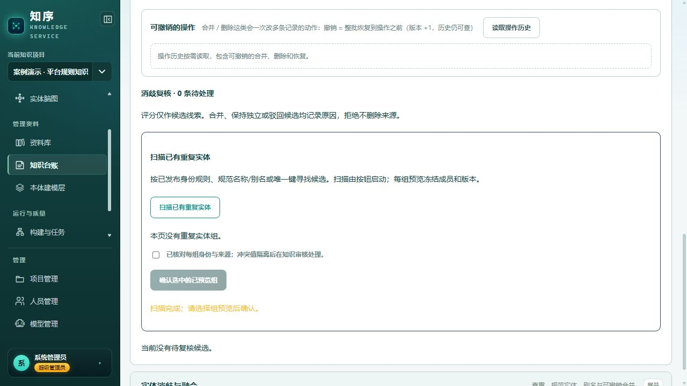

1. 点击「扫描已有重复实体」。系统按已发布身份规则、规范名称、别名或唯一键提出候选，需要时继续扫描下一页。
2. 逐组看名称、类型、来源、支撑和各自时间。名称相似只是线索，不是确认身份的依据。
3. 点「预览本组影响」，检查保留对象、受影响关系和属性、单值冲突。预览不执行合并。
4. 勾选已预览且确认相同的组，勾选「已核对每组身份与来源；冲突值隔离后在知识审核处理」。
5. 点「确认选中的已预览组」，查看逐组结果。失败项重新预览再重试，不确定的保留原状。
6. 有冲突继续第 15 章；需要撤销到「可撤销的操作」读取历史、核对影响。

**此流程不需要手填实体 ID。** 合并统一对象身份，各文档证据及业务时间分别保留，不要求起止完全一致，也不简单取并集当成所有事实的有效期。

例如 A 文档在 1—6 月提到平台，B 在 4—12 月提到同一平台。身份确认后可归并平台；具体规则或属性在哪个期间适用，仍按各条事实和证据判断。合同、事件的时间参与身份识别时，按该类规则区分，不能只因为区间重叠就合并。

扫描无候选不代表绝无重复，先核对类策略、名称、别名和键。预览提示版本变化时刷新重做，不能复用过期确认。

## 14. 属性怎么读：具体值、多来源、长段落

「青禾平台」是实体，「平台职责」是属性定义，「负责商户准入与服务治理」是某份文档支持的具体值。

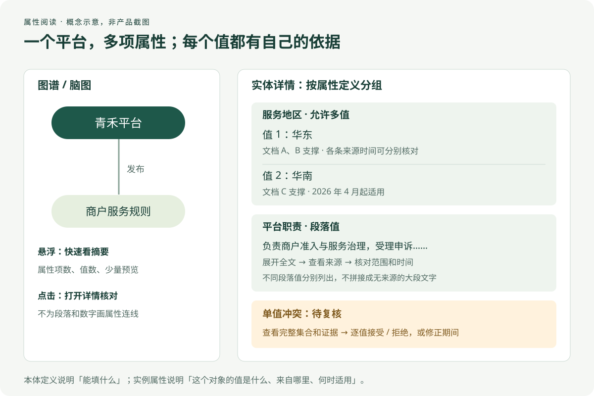

| 情况 | 阅读和处理方式 |
| --- | --- |
| 定义允许多个不同值 | 分组逐值显示，分别核对来源和期间 |
| 同一个值被多份文档提到 | 查看文档数、支撑数，展开来源分别核对 |
| 值是一段长文字 | 摘要后「展开全文」，保留换行，再「查看来源」 |
| 值随时间改变 | 看各值期间，历史值不等于当前值 |
| 单值出现重叠范围的不同值 | 进入冲突处置，不能全部当作确定事实 |

**图谱和脑图不把数据属性画成独立节点，也不为属性值画线。** 节点和线表达实体及实体关系；数字、短文本、长段落在实体详情阅读，避免撑满画布。

悬浮提示项数、值数、少量摘要和冲突标记，用于快速判断；点击实体的详情按属性分组展示多个值、全文、来源分页、时间和状态，用于认真核对。两处不仅大小不同，内容深度也不同。

有审核权限的人可从「处理冲突」进入审核。没有已接受值时，先查开关、任务、审核和范围，不要把属性定义误认为已经抽出了具体值。

## 15. 处理单值属性冲突

入口一：图谱或脑图实体详情「处理冲突」。入口二：「知识台账 → 知识审核 → 属性事实 → 全项目属性冲突集合」。两个入口进入同一审核流程。

单值约束表示在所覆盖业务时间和范围内只应有一个有效值。不同时间的历史值不一定冲突；时间未知、期间重叠、平台范围不同，都需结合证据判断。

1. 打开「处理属性冲突集合」，查看全部成员和状态，不只看当前图谱范围露出的值。
2. 展开全文和来源，必要时继续加载证据，核对对象、原文、范围和时间。
3. 若实际是前后换版，修正准确业务期间；不要为绕过冲突随意编时间。
4. 对能确认的值逐一选择「接受此值」或「拒绝此值」并填理由，未确定的保留待审。
5. 提交后核对集合及正式属性，等索引更新；版本变化时重新读取后复核。

合并产生的冲突值会隔离，页面提示「身份已统一，属性约束待复核」。系统没有默认胜者，不按文档数或上传先后替你选值；未解决值不会作为确定事实回答。

普通候选与现有单值冲突时，还可看到「保留旧值/拒绝候选」「接受新值」等操作。接受替代前核对是否确为纠正旧值；业务换版优先登记真实期间。

## 16. 知识台账：新增、查询、纠错与历史

入口：「管理资料 → 知识台账」。实体、关系、属性、原文片段四视角分别展示具体记录，筛选、查询和本体版本条件共同决定列表。

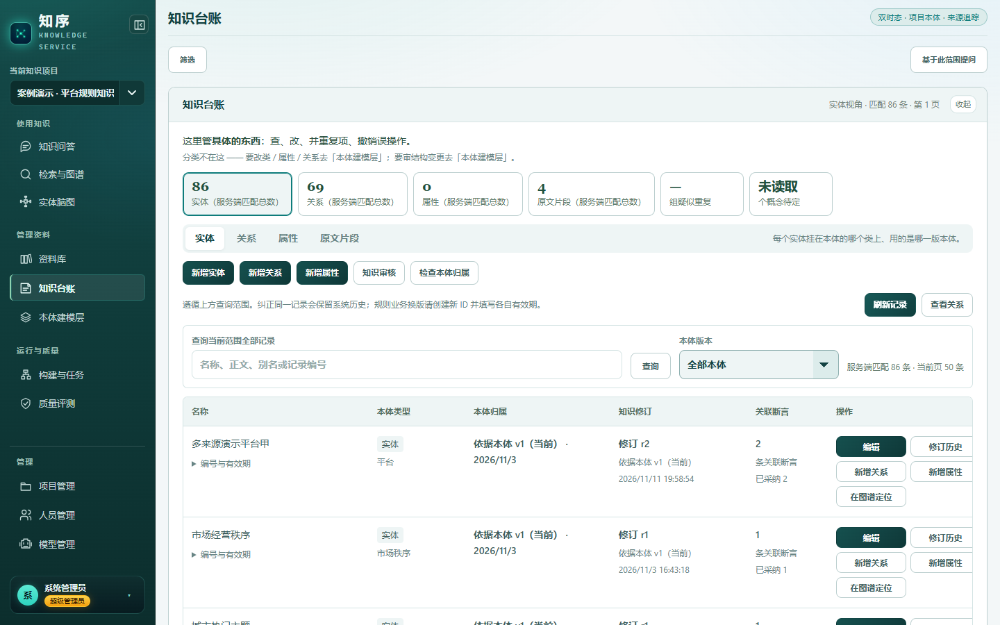

### 手动新增

1. 「新增实体」选择已发布实体类，填写名称和实际业务期间，创建正式记录。
2. 「新增关系」选择类型与两端实体，核对方向后保存。
3. 「新增属性」选择所属实体与数据属性，按定义输入文本、数值、布尔值或日期，核对期间后保存。

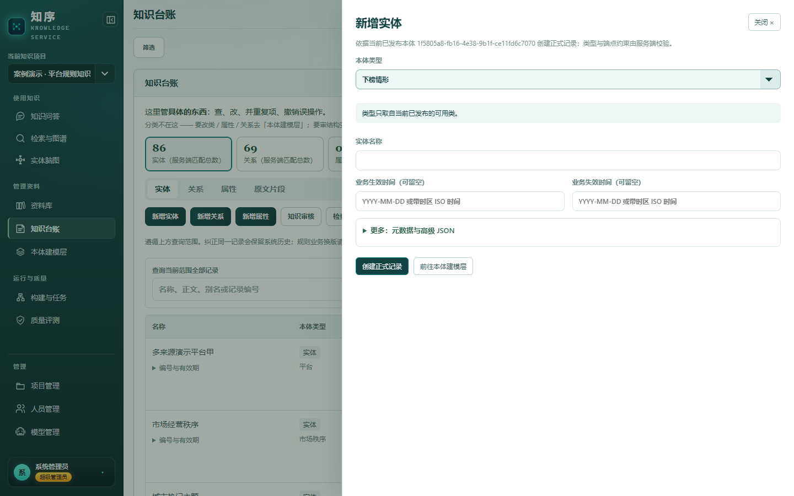

缺合适定义时先维护本体，不要借用不相关类型。手动创建同样受定义和值类型校验。

### 修改和撤销

「编辑」纠正同一记录并生成新修订；「修订历史」查看前后变化。业务规则换版按页面提示创建新记录、分别填写有效期，避免把换版误作录入纠错。

软删除保留历史。合并、删除、恢复等操作在「可撤销的操作 → 读取操作历史」核对后撤销，以页面状态和依赖限制为准。保存冲突时刷新最新修订，重新编辑，不连续提交旧表单。

## 17. 自动索引与手动维护：让知识可检索

资料库、检索与图谱、知识问答和知识台账都提供「检索索引」入口。日常处理不要求先手动向量化；先选对项目，再查看状态。

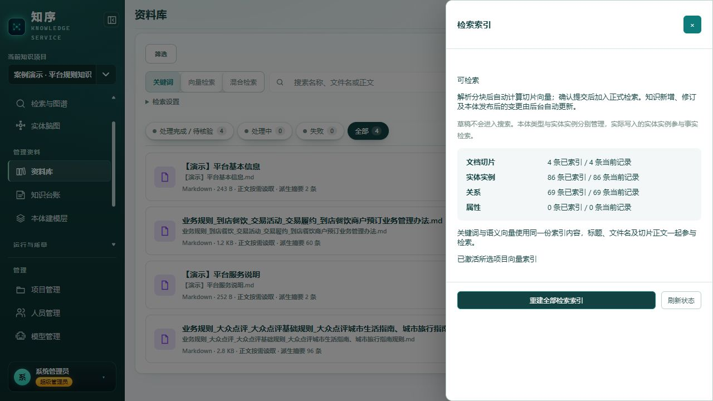

1. 明确开始解析后，系统分块并自动准备向量。显示「切片向量已准备」仍是草稿准备结果，未确认提交的内容不会被正式检索。
2. 第 4 步确认提交后，首次索引在后台自动建立；已有项目通过队列更新。相同正文、标题、文件名与模型的向量可以复用。解析后又改了标题或切片配置，会提示「向量待更新」，提交时自动补算。
3. 正式知识接纳、修订、合并以及本体发布后的相关变更自动同步。发布本体定义不等于凭空生成实体实例；只有实际写入的正式知识参与事实索引。
4. 打开「检索索引」，查看文档切片、实体实例、关系、属性的「已索引 / 当前记录」、任务阶段、进度和错误。显示「可检索」后，用已知内容试查并打开来源。
5. 普通失败会后台重试并逐步延长重试间隔。需要人工恢复时，管理员点击「重建全部检索索引」；关键词与语义索引一起处理，无需分别操作，也不需要重新上传原件。

主检索的**关键词、语义向量、混合检索都由 Milvus 执行**。未建索引或服务不可用会明确提示。资料库的「关键词查正文」是另一种入口，不能混淆。

PostgreSQL 保存业务记录、版本、来源、审核和任务；Milvus 保存检索内容及可筛选字段，负责搜索。重建索引不等于重新上传或改写业务事实；索引备份也不能代替业务库备份。

## 18. 搜索知识：关键词、语义与两种混合策略

入口：「使用知识 → 检索与图谱」。先确认索引就绪。

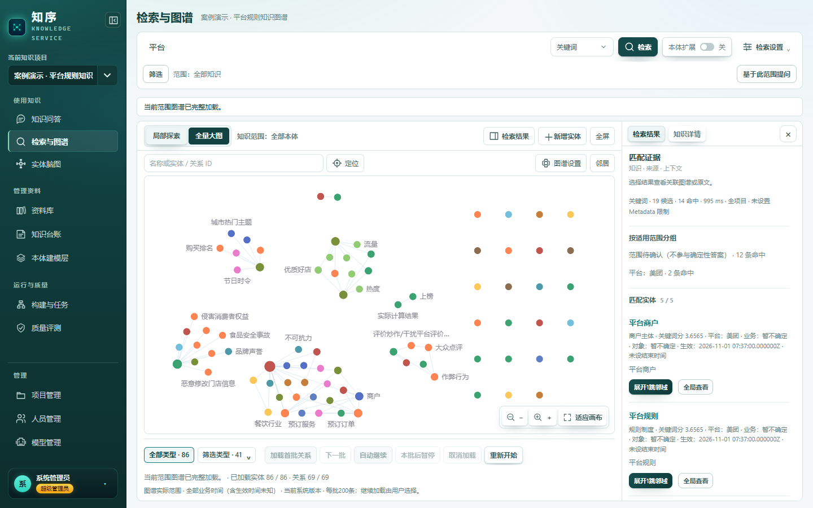

1. 核对项目，通过「筛选」设置平台、业务、对象和时间。
2. 输入关键词或问题，选择方式，点击「检索」。
3. 看相关度、类型、值和来源，点击条目查看详情及关联图谱。
4. 结果过多缩小范围；过少先清理条件，再尝试语义表达或混合检索。

| 方式 | 适合输入 | 建议 |
| --- | --- | --- |
| 关键词 | 准确名称、短语、编号、属性原文中的词 | 知道用词时优先 |
| 语义向量 | 用自己的话描述问题 | 与原文用词不同但意思相近 |
| 混合检索 | 专名加自然语言问题 | 先在「检索设置」确认使用哪种策略 |

| 混合策略 | 怎样形成结果 | 什么时候使用 |
| --- | --- | --- |
| 限定关键词范围（页面默认；原名「关键词筛选 → 语义排序」） | 先以关键词分词命中形成候选，再在候选中按语义排序并过滤低分；不加入纯语义命中的其他资料 | 必须保留关键词命中范围时 |
| 扩展相近含义（原名「关键词＋语义分别召回后融合」） | 两路分别召回，将有效结果合并排名；关键词未命中但意思相近的内容也可能出现 | 需要同义表达和语义补召回时 |

「最低语义相似度」默认 **0.35**，可以在 -1 到 1 之间调整，越高越严格。它只作用于语义结果：双路融合先过滤低于阈值的向量一路，再与关键词一路融合；有效关键词命中可保留。余弦相似度不是命中概率，融合分也不是余弦相似度；不同方式的分数不要直接比较，缺少有效得分时不显示。

向量没有阈值时也只是取最接近的前若干条，不等于召回全库，但这些内容仍可能不相关。结果太散时，提高语义阈值、缩小业务范围，或选关键词候选排序；结果太少时，检查关键词、筛选和阈值，必要时改用双路融合。关键词候选排序属于有界召回，内部每个资格批次最多 1000 条候选；关键词分词命中不等于整句逐字匹配。

已接受属性值参与检索，段落属性也可匹配，并可回到所属实体及证据。待审、未解决冲突属性不能当作已确认知识。可用筛选以面板为准，全文命中不表示支持任意属性条件组合。

「本体扩展」按结构扩展检索线索，可能补充相关类型及子类。选择严格的关键词候选排序时，不执行会绕过关键词边界的本体补召回。图谱的定位框只查已加载图，不等于检索全库。

## 19. 交互图谱：总览与局部探索

入口：「检索与图谱」交互图谱区域。节点是实体，线是实体关系，数据属性在详情阅读。

| 想做什么 | 操作 |
| --- | --- |
| 看一个对象周围 | 局部探索或邻居入口，逐步展开 |
| 看当前范围整体结构 | 切「全量大图」，留意已加载数和总数 |
| 调整视野 | 拖空白平移；滚轮或加减缩放；「适应画布」找回整体 |
| 节点重叠 | 拖实体调整位置，缩小范围或按类型查看 |
| 找已加载对象 | 输入「在已加载图中定位实体或关系」，点击定位 |
| 加载更多 | 下一批、自动继续，必要时暂停、取消、重新开始 |
| 核对属性 | 悬浮看摘要，点击看分组值、全文、来源和时间 |

「全量」指当前范围，不保证首屏一次画完。加载结束前，不要因画布缺少节点判断库里不存在；看实际范围说明和计数。

本体版本条件按知识归属筛选，不等于整库历史快照；跨归属端点可能被过滤。大图拥挤时先检索定位再展开。

## 20. 实体脑图：围绕对象逐层查看

入口：「使用知识 → 实体脑图」。适合围绕一个中心对象追踪关系层次。

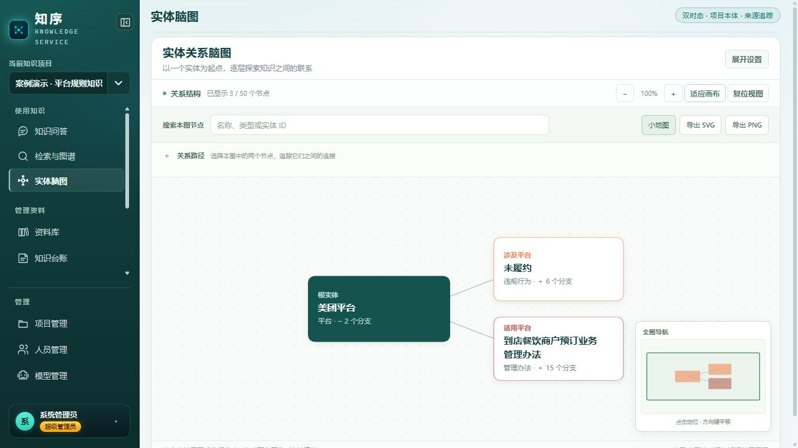

1. 搜索并选择「根实体」，设置「展开深度」，点击「生成脑图」；实体下拉框可翻页。
2. 按需展开分支，点节点核对详情和来源。
3. 拖空白左右、上下平移，滚轮或按钮缩放，找不到中心用「适应画布」。
4. 「收起设置」增加图面空间，需要修改再「展开设置」。本图搜索仅定位已加载节点；小地图用于导航，也可导出 SVG 或 PNG。

需要看连接路径时展开「关系路径」，选择本图中的起点和终点，按页面结果定位路径；它不代替全库路径查询。

脑图与交互图谱都看实体关系，数据属性都在详情，不为一段职责文字画出属性节点。改根实体或展开深度后留意重新加载结果，避免把旧图当成新条件结果。

## 21. 知识问答：回答与证据一起看

入口：「使用知识 → 知识问答」。

1. 新建或选择会话，确认项目。
2. 直接打开问答页「筛选」设置平台、业务、对象、资料及业务时间，应用后就在该范围内提问。其他页面的筛选不会自动替代本页条件。
3. 问题写清对象、事情和时间，例如「某平台在 2026 年 5 月的商户申诉要求是什么？」。
4. 「生成模型答案」未勾选时仅展示依据，勾选后调用模型组织回答。「检索设置」可选检索方式、混合策略、最低语义相似度、本体扩展及历史/未来/待核对参考；策略与阈值含义同第 18 章，参考材料不等于已确认当前有效的规则。
5. 打开证据核对文档、段落和版本，再继续追问。

问答可使用已接受属性值及其来源，也可依据文档正文。长段落属性不只能在图上看。来源不足或属性仍有冲突时，补资料或完成审核，不把缺依据回答作为业务结论。

旧会话引用应按当时固定版本理解。要判断当前规则，请按当前时间和范围重新提问。

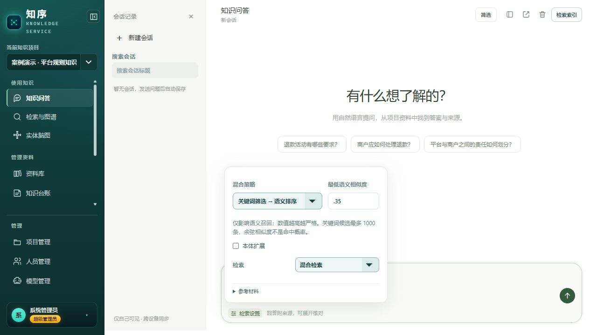

## 22. 时间和范围：避免查错版本

平台、业务、适用对象和业务时间共同决定适用性。未知范围不等于全部适用，资料标签应与正文相符。

| 概念 | 表达什么 | 例子 |
| --- | --- | --- |
| 业务生效、失效时间 | 事实何时在业务上成立 | 5 月 1 日生效，6 月 1 日不再适用 |
| 系统修订时间 | 何时录入或纠正 | 5 月 8 日补录 5 月 1 日已生效规则 |
| 本体归属 | 按哪版定义解释记录 | 记录属于本体 v2 的平台类 |
| 来源版本 | 引用哪份文档修订 | 旧答案仍打开当时文档 |

业务期间包含生效时刻、不包含失效时刻。5 月 1 日至 6 月 1 日包含 5 月 31 日，不包含 6 月 1 日。无准确时间保留未知，留意「时间待核」，不要随意填今天。

查不到时依次核对项目、页面范围、业务时间、系统历史和本体条件。先扩大范围找到记录，再收窄到所需条件。

## 23. 质量评测与日常复核

入口：「运行与质量 → 质量评测」。以代表性样例检查质量，不能代替业务审核。

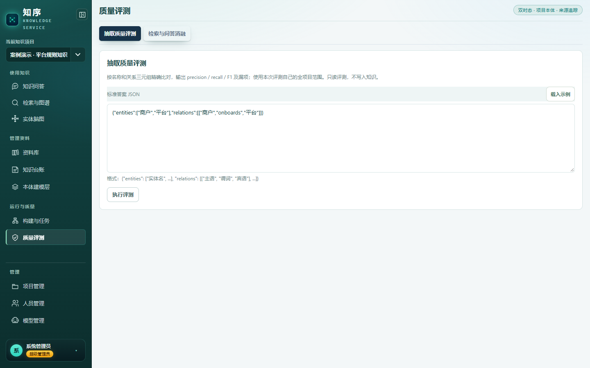

1. 选择项目，准备样例及正确实体、关系等参照。
2. 按页面运行评测，看命中、遗漏和错误。
3. 对照原文判断问题在解析、定义、抽取还是映射。
4. 调整后复核，通过小样本后再批量处理。

日常抽查正文完整性、实体重复、属性来源与时间、单值冲突和检索命中。分数只反映样例，不代表全部资料都正确。

## 24. 快照、导出与恢复

入口：「构建与任务」知识备份区域。

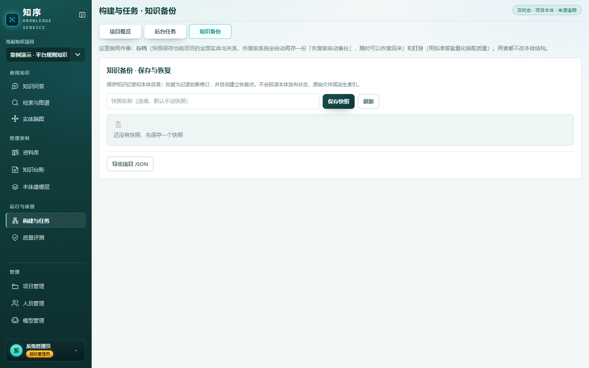

1. 重要整理前保存命名清晰的快照，如「11 月规则核对前」。
2. 离线留存可导出项目 JSON，核对导出清单。
3. 恢复前确认项目和快照。系统保留恢复前自动备份，以新修订记录恢复结果。
4. 完成后查台账、来源和索引，按提示重建或等待同步。

快照和项目导出不是完整系统备份，不要假定包含全部原件、配置和索引。完整恢复需备份业务库、原件存储等，按运维手册执行。

## 25. 人员、模型与管理分工

### 人员管理

入口：「管理 → 人员管理」。按职责分配权限，调岗、离职时停用不再需要的账号。

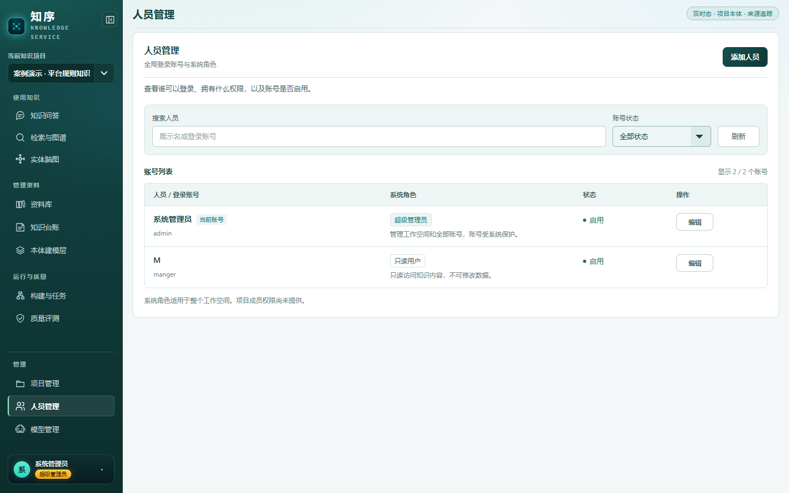

创建账号填写用户名、显示名、角色和初始口令。管理员不能任意修改超级管理员；最后一个有效超级管理员也受保护。忘记口令联系有权限人员，普通手册不提供通用登录口令。

### 模型管理

入口：「管理 → 模型管理」，仅超级管理员可用。

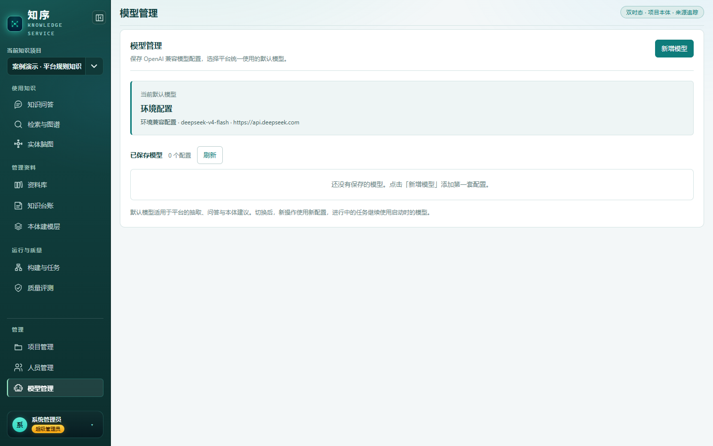

新增配置并填写名称、服务地址、模型名和认证信息，先测试连接，再设为默认，供抽取、问答和本体建议等使用。变更后先小样本复核，再批量重新处理。

模型配置与检索索引配置不同。检索问题应检查项目索引和检索服务；OCR、ASR、原文解析环境交由维护人员处理。

## 26. 按现象排查问题

| 现象 | 先检查 | 处理 |
| --- | --- | --- |
| 登录失败或页面打不开 | 地址、服务、账号状态 | 管理员核对服务和账号 |
| 上传或 ZIP 被拒 | 格式、大小、是否一包多份 | 按提示修正，查专题上传手册 |
| 图片、视频无文字 | 是否只打开原件、是否开始解析 | 开始解析；技术识别失败时核对原件和模型并重新解析 |
| 任务完成但图谱为空 | 模式、审核、范围 | 文档模式需重新处理，候选先审核 |
| TTL 有属性而实体没有值 | 发布、原任务开关、审核 | 新任务开启后提取；旧任务未开启时由维护人员补抽，见第 8 章 |
| 属性出现多个值 | 多值定义、时间和状态 | 允许多值逐值读，单值冲突审核 |
| 跨文档有重复平台节点 | 类策略、名称、别名和键 | 扫描、预览后确认，不只凭名称合并 |
| 扫描无明显重复项 | 已发布规则和候选条件 | 核对类型和键，必要时人工复核 |
| 合并后有属性冲突 | 单值约束、各值范围和期间 | 打开完整集合逐值处置 |
| 主检索三种方式不可用 | 索引、Milvus、向量模型 | 在「检索索引」看自动任务进度或错误；必要时管理员手动重建 |
| 台账有记录但检索没有 | 正式状态、范围、同步 | 等索引就绪再查 |
| 语义结果不相关或混合范围太宽 | 策略、业务范围、语义阈值 | 使用关键词候选排序、缩小范围或调高阈值 |
| 资料库关键词有而主检索无 | 搜索依赖不同 | 查项目索引与正式知识范围 |
| 图谱或脑图找不到节点 | 范围、加载数、中心 | 适应画布，加载下一批或清筛选 |
| 问答缺少依据 | 范围、时间、已接受知识 | 补资料或完成冲突复核 |
| 保存或审核报版本冲突 | 别的窗口是否修改 | 刷新最新记录，重新预览确认 |
| 要撤销合并或删除 | 历史与可撤销状态 | 读取操作历史，核对影响后撤销 |

## 27. 高级操作：结构化导入、源码与外部图服务

以下入口面向数据对接和复杂建模人员，日常上传、检索、审核无需使用。

### 结构化记录导入

入口：「资料库 → 添加文件 → 结构化导入」。接收整理好的 JSON 记录，不是批量文件上传。

1. 确认项目与已发布本体，由对接人员准备实体、关系、属性等记录。
2. 展开「结构化记录导入（高级）」，核对编号、种类、类型及端点引用；一次 1—1000 条。
3. 点击「写入知识」。任意记录校验失败时整批不写入，按错误修正后再提交。
4. 已存在的记录去知识台账修订，不通过重新导入相同编号覆盖。

### 文件上传 API 的操作顺序

对接程序也可以采用准备会话流程：创建准备会话、上传文件、分别设置每个文件的范围和时间，明确请求解析，轮询状态并读取正文切片，核对结果版本后再确认发布。同一会话可以包含不同平台或业务的文件，不要求整批使用一套资料 metadata。

接口以当前服务的 API 文档为准。准备会话位于 `POST /api/projects/{p}/preparations`；会话下使用文件上传、设置、`parse`、结果读取及 `publish` 操作。配置版本和结果版本需要随请求核对，旧结果不能绕过过期检查直接提交。正式写入后的关键词与向量索引由后台统一维护，不必每次调用手动向量化接口。

解析或发布返回已接收任务时，不表示已经完成。对接方分别监控文件解析、处理批次和 `GET /api/projects/{p}/indexes/status`；只有索引就绪后，才把资料视为可检索。

### 本体源码、导出与只读查询

入口：「本体建模层 → 本体目录 → 高级 → RDF 源码 / 导出」。可导出 Turtle 留档；编辑通过「把源码差异加入草案」进入校验、审核、发布。历史版本只读。

窗口中的「高级查询 · SPARQL（只读）」供对接人员检查已发布本体及知识；历史本体按该窗口选择读取，不继承其他页面隐藏的筛选。业务查询优先使用检索与图谱。

### 外部图服务同步

部署已配置 Neo4j 时，在构建区域按同步入口查看连接和同步状态。它用于外部图服务投影，不是保存业务事实的入口，也不是启用 Milvus 检索的前提。维护人员按运行状态处理同步问题。

## 28. 日常清单与术语速查

### 新建知识库

1. 建项目并选中，确定本体、发现或纯文档路线。
2. 少量资料验证解析、类型、属性开关。
3. 发布本体、审核候选、抽查来源和时间。
4. 复核重复与冲突，在「检索索引」确认后台自动更新完成。
5. 试查已知内容、看详情和问答证据，再扩大导入。

### 每次补充资料后

1. 看处理完成和失败项，不只看上传成功。
2. 复核候选，必要时发布本体新版。
3. 处理身份和冲突，确认索引同步。
4. 抽查来源，重要调整前留快照。

| 术语 | 白话说明 |
| --- | --- |
| 资料 / 来源 | 一份文档或 ZIP，带原件和版本 |
| 切片 / 原文片段 | 从正文拆出的检索和证据片段 |
| 本体 / 术语 | 类、关系、数据属性及约束；IRI 是正式标识 |
| 实体实例 | 一个具体对象，如某平台、某合同 |
| 关系 | 两个实体间有类型、有方向的关联 |
| 属性定义 / 值 | 前者规定字段和约束，后者是实体具体内容 |
| 来源断言 / 支撑 | 文档对知识的证据，同一知识可有多来源 |
| 候选 / 草案 | 事实待核对；结构草案审核发布后成为正式本体 |
| 身份规则 / 合并 | 识别同一对象的规则 / 归并已有具体记录 |
| 业务时间 / 修订 | 何时适用 / 何时保存或纠正 |
| 属性冲突集合 | 一起核对的不兼容单值及来源 |
| 索引 | 从业务知识同步的检索内容和筛选字段 |
| 快照 / 撤销 | 项目知识恢复 / 可撤销操作的恢复，均保留历史 |

日常以页面实际状态、操作结果和来源证据为准。部署、配置及完整备份交由维护人员，参见配套运维手册。

> AI生成
